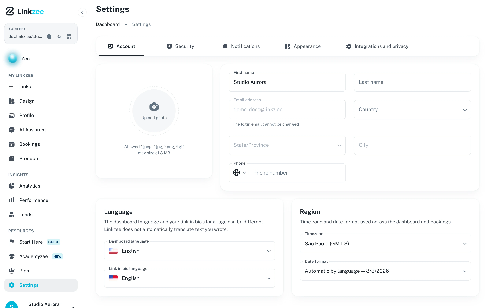

Your **account** settings live in one place. Here you set how Linkzee speaks to
you, where you're based, and how the interface looks and feels.

<Frame caption="The Account tab: language, region, timezone, appearance and accessibility.">
  
</Frame>

## Language and region

- **Dashboard language**: the language Linkzee uses across your editor.
- **Link in bio language**: the language of your public page's buttons,
  labels and messages. It can be different from the dashboard language.
  Linkzee doesn't translate the text you wrote yourself.
- **Country** — pick your country, and your **timezone** follows it automatically.
- **State** and **city** — narrow down your location.
- **Date format** — choose how dates are shown.

All of these are in **Settings → Language and region**. Your account and your
page start in the language of the page where you signed up.

<Note>
  This timezone applies to **your dashboard** (dates, reports). Your booking
  times follow the **business timezone**, which is set separately in
  **Bookings → Settings** — so a business can operate in a different timezone
  than your account, and each works independently.
</Note>

### Language suggestion for your page

If your public page is in a language that customers in your region don't
usually read, the dashboard shows a short notice, for example: "Your public
page is in English. Customers in your region usually read Portuguese." Tap
**Switch to** to change the page language in one tap, or **Keep it as is**.

## Appearance and accessibility

- **Appearance** — switch between **light** and **dark**.
- **Accessibility** — adjust the **font size** and turn on **higher contrast**
  for easier reading.

Every change you make here takes effect right away — there's no Save button to
remember.

## Related pages

<CardGroup cols={2}>
  <Card title="Password and security" icon="lock" href="/account/password-security">
    Change your password or reset it if you forgot it.
  </Card>
  <Card title="Public page SEO" icon="magnifying-glass" href="/account/public-page-seo">
    Set the title and description people see on Google and link previews.
  </Card>
</CardGroup>
