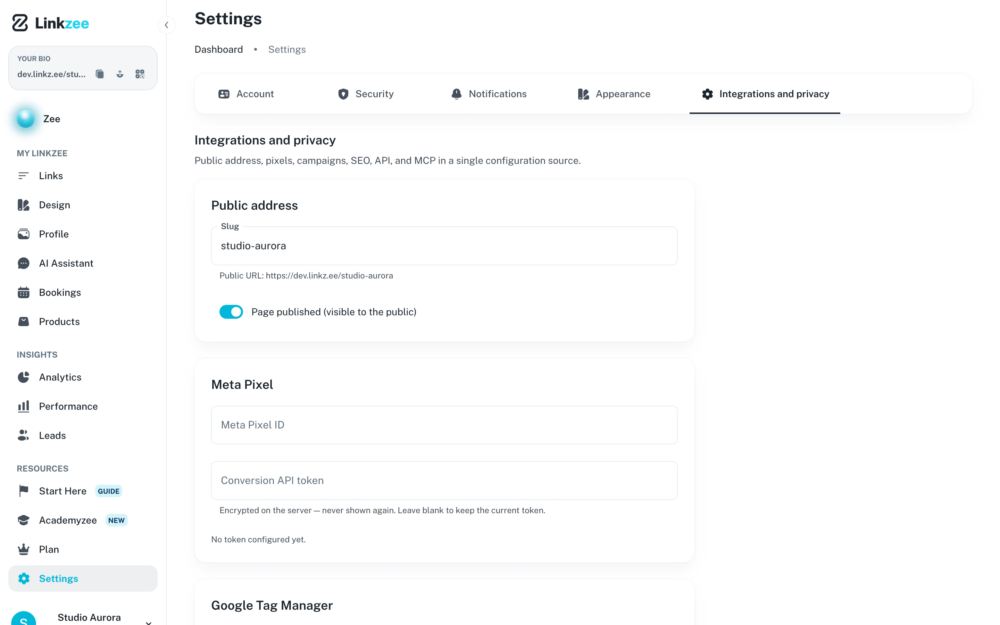

Linkzee has its own [Performance](/analytics/overview) screen, but you can also
measure conversions with your **own** marketing tools. Connect them once and
Linkzee sends the data as visitors interact with your page.

<Frame caption="Integrations & privacy: Meta Pixel, GTM and your page's public address.">
  
</Frame>

Everything here auto-saves as you type. There's no Save button.

## Meta Pixel

Add your **Meta Pixel** ID to track visitors and conversions in Meta Events
Manager. Then add its **Conversions API** token as well.

The token matters: browsers and iOS often block the pixel script, so events can
go missing. The Conversions API sends the conversion straight from Linkzee, so it
still gets recorded even when the script is blocked. Adding both gives you the
most complete tracking.

## Google Tag Manager

Add your **Google Tag Manager** container ID to load your GTM container on your
public page. From there you can manage your own tags and triggers in Google Tag
Manager.

To protect your visitors, your container runs on your page in a **restricted
mode**. Every bio lives on the same Linkzee address, so tags that can run any
code are switched off:

**What works:**

- Google tags: Google Analytics 4, Google Ads and the conversion linker.
- Meta Pixel and TikTok Pixel tags from the Community Template Gallery.
- The **Custom image** tag.

**What doesn't run:**

- **Custom HTML** tags and **Custom JavaScript** variables.
- The **JavaScript variable**, **1st-party cookie** and **DOM element**
  variables.
- Built-in tags from other vendors that load their own script or frame.
- Universal Analytics tags, and a second container loaded from inside yours.

If a tag of yours doesn't fire on your page, check whether it is on the
list of what doesn't run. For Meta, the Meta Pixel and Conversions API
fields above
are the most reliable option.

## UTM parameters

Set default **UTM** parameters, such as source, medium and campaign, that
Linkzee automatically adds to your outgoing links. This tags the traffic you send
out so your analytics attribute it to the right source and campaign.

<Note>
  You'll find these values in your marketing tools: your Pixel ID and
  Conversions API token in **Meta Events Manager**, and your container ID in
  **Google Tag Manager**.
</Note>

## How Linkzee measures its own ads

The settings above are yours and run on your public page. Separately, on
Linkzee's own pages (website, quiz, sign-up and subscription), and only if you
accept advertising cookies, Linkzee measures the results of its ads with Meta
(Pixel and Conversions API) and Google Tag Manager. For this, Linkzee sends Meta:

- Email, phone and name in encrypted form (SHA-256 hash), and an internal
  identifier, also hashed.
- Your approximate location derived from your IP address (city, state and
  country, never the postal code).
- The IP address and browser used at the time of the event.
- Meta's advertising identifiers (the `_fbp` and `_fbc` cookies).

For payments, the billing address you give Stripe may complement this data. The
phone may come from your account or from the WhatsApp or phone number you
entered when setting up your page.

This measurement data is kept for a short time: the payment context for up to
**30 days** and the sign-up context (without the IP address) for up to
**90 days**. You can withdraw consent at any time in **Cookie preferences**;
withdrawing deletes these contexts and stops new sends. Linkzee applies Meta's
Limited Data Use mode where the law requires it. If sending to Meta fails, the
event stays in a resend queue for up to 2 days, and Linkzee keeps a minimal
record of conversions already sent (only the event identifier, no personal data)
so the same conversion is never counted twice. The queue is also deleted when
you withdraw consent.

## Next steps

<CardGroup cols={2}>
  <Card title="Performance" icon="chart-line" href="/analytics/overview">
    See clicks, views and your top items right inside Linkzee.
  </Card>
  <Card title="Account settings" icon="gear" href="/account/account">
    Set your language, region, appearance and accessibility options.
  </Card>
</CardGroup>
