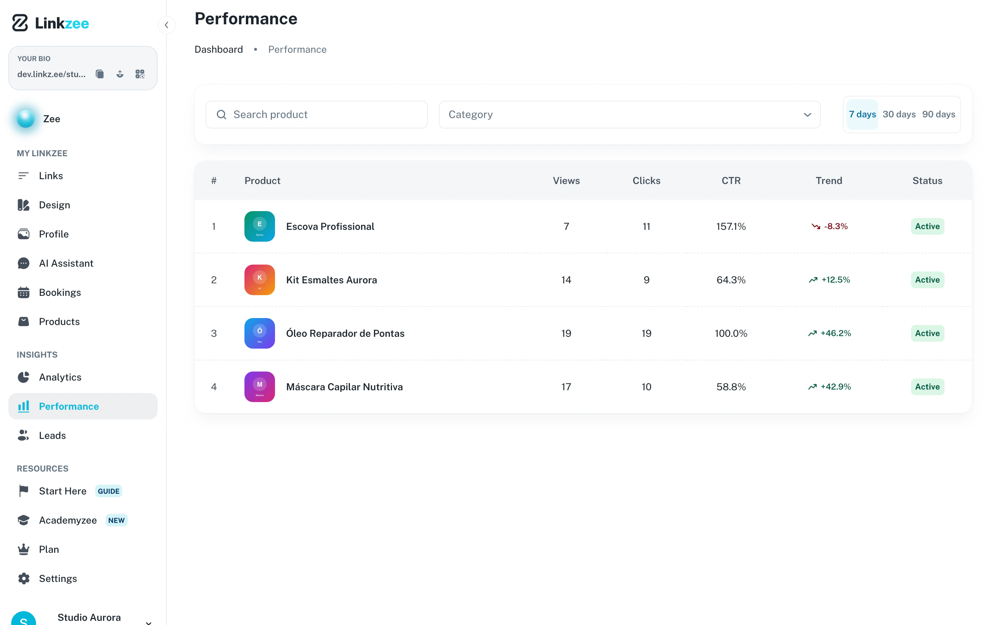

The **Analytics** screen shows how your Linkzee page is doing. It follows each
visit from the moment someone opens your page to the moment they click, book or
leave their contact, so you can see what works and do more of it.

The screen has three tabs (**Summary**, **Where they came from** and
**Buttons**) and a period selector at the top. Under the title you see when the
numbers were last updated: they refresh about **once an hour**.

## Your history by plan

How far back you can look depends on the plan of the store you're in:

| Plan | History | Periods you can pick |
| --- | --- | --- |
| Free | 7 days | Today · 7 days |
| Essential | 90 days | Today · 7 days · 30 days · 90 days |
| Pro and Scale | 12 months | Today · 7 days · 30 days · 90 days · 12 months |

Periods above your plan show a **crown**. Tapping one explains what each plan
shows and lets you upgrade. Your data keeps being saved either way: when you
subscribe, the longer history appears right away.

<Note>
  Every period ends **today** and uses your store's time zone. Comparisons
  ("vs. previous 30 days") only use days inside your plan's history, so there is
  no year-over-year comparison. **Today** and **12 months** don't show a
  comparison, and you see a dash instead of a number whenever there isn't enough history to
  compare.
</Note>

## Summary

The **Summary** tab gives you the whole picture on one screen:

- **A one-line headline**: for example, *"Out of every 100 visits, 41 clicked
  something and 3 booked."* With fewer than 100 visits it uses the real numbers
  instead.
- **Four key numbers**: **Visits**, **Visitors**, **% who clicked** and
  **Clicks**, each with its change against the previous period.
- **Visits and clicks**: a chart by day (by month on 12 months).
- **The funnel**: the path your visitors take (see below).
- **Where they came from**: your top sources, with **See all** to open the
  next tab.
- **Most clicked**: your top buttons, with **See all** to open the Buttons tab.
- **Devices**, **Cities** and **Countries**.
- A shortcut to **Product performance** (see [The Performance screen](#the-performance-screen)).

If your page has no visits yet, the tab shows **Share my link**, which opens the
share sheet. See [Tracked links & QR code](/analytics/tracked-links).

## The funnel

The funnel shows how many visitors moved forward at each step, and the share
that continued between steps. Each step only counts people from the step before,
so a step is never bigger than the previous one.

| Your page has… | Funnel |
| --- | --- |
| Scheduling | Visited → Clicked something → Opened the booking page → Booked |
| Lead capture, no scheduling | Visited → Clicked something → Became contacts |
| Neither | Visited → Clicked something |

With the [Qzee agenda](/scheduling/qzee-booking) on your bio, the Summary shows
the click funnel: bookings happen on Qzee and show up in your Qzee report.

## Where they came from

The **Where they came from** tab answers *"which place brings me clients?"*:

- **By source**: Instagram, TikTok, WhatsApp, Google, Printed QR and so on, with
  each one's share of visits, % who clicked and how many booked. Open a source to
  see where on that network the visit came from (**Bio**, **Stories**,
  **Direct**…) or **No tracked link** when the visit arrived without one of your
  links.
- **Direct (no source)**: visits with no information about where they came from
  (someone typed your address, or the app hid it). When this share is high, a note
  suggests **Get my links**, so each network gets its own link.
- **Campaign links**: the visits and bookings each of your campaign links brought
  in. Tap one to see its details. See [Campaign links](/analytics/tracked-links#campaign-links).
- **Ads and Google Analytics** (advanced): the UTM parameters that arrived from
  ads and external tools (`utm_source`, `utm_campaign`…).

## Buttons

The **Buttons** tab ranks every button on your page, from most to least clicked:
links, products, the booking button, social networks, the map and others. Use the
chips at the top (**All**, **Links**, **Products**, **Booking**, **Social
networks**, **Map**) to filter.

The [Qzee agenda](/scheduling/qzee-booking) card shows up as **Qzee agenda**: each
time a visitor opens it counts as a click, and the **Booking** chip adds it to the
Linkzee booking button. Its detail doesn't show how many booked, since those
bookings are in your Qzee report.

Tap a button to see its clicks per day, where those clicks came from and, for
the booking button, how many people booked. **Edit this button** takes you
straight to where you change it.

## What each number means

| Number | What it counts |
| --- | --- |
| **Visits** | Each time someone opens your page. Reloading or moving around the page in the same visit doesn't count again; a new visit starts after 30 minutes away or when the person arrives through a different link. |
| **Visitors** | Different browsers or devices that opened your page in the period. The same person in the Instagram browser and in Safari counts as 2. |
| **Clicks** | Taps on your links, products, booking button, Qzee agenda card, social networks, map, support and review buttons. |
| **% who clicked** | Out of all visits, the share in which the person clicked at least one thing. |
| **Clicks per visit** ("15 per 100 visits") | How many clicks a button got for every 100 visits. It can go above 100 when people click the same button more than once. |
| **Opened the booking page** | Visits in which the person opened your scheduling. |
| **Booked** | Bookings made from a visit to your page in the period, whatever their status. |
| **Became contacts** | New contacts captured from a visit to your page in the period. |
| **Mostly from** | The source that sent the most clicks to that button. |
| **vs. previous** | The change against the period of the same length just before. Counts change in %; rates change in points ("+3 points"). |

<Note>
  Linkzee measures your page with its **own anonymous measurement**, with no
  third-party cookies. This data is never shared with anyone and is only used for
  your store's statistics. Visitors who turn measurement off in the cookie banner
  are still counted as visits, but not as visitors.
</Note>

## The Performance screen

Next to Analytics in the menu there's a dedicated **Performance** screen: a
table of your **products**, each with its views, clicks and click-through rate
for the period you pick (**7 days, 30 days, 90 days or 12 months**, within your
plan's history). Use it to spot which products earn their place on the page, and
which ones need a better image, title or position.

<Frame caption="Performance: clicks per link and product, with period totals.">
  
</Frame>

## Make it work for you

Use your numbers to learn where your clients come from and what they tap most,
then double down on what works: give each network its own link, move your
strongest buttons to the top and refresh offers that are losing steam.

<CardGroup cols={2}>
  <Card title="Tracked links & QR code" icon="qrcode" href="/analytics/tracked-links">
    A link for each place you share your page, campaign links and a printable QR sign.
  </Card>
  <Card title="Grow your clicks" icon="arrow-trend-up" href="/best-practices/growing-clicks">
    Practical tips to turn more visits into taps.
  </Card>
</CardGroup>
