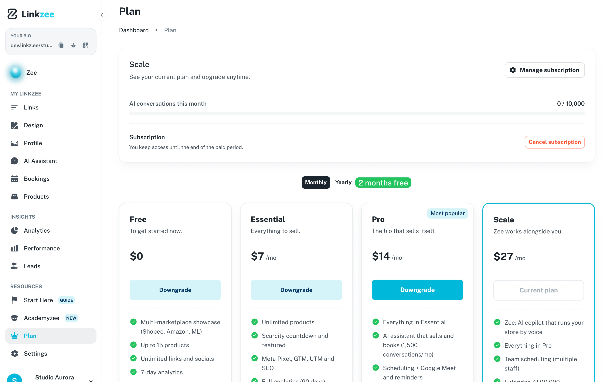

Linkzee has four plans — **Free, Essential, Pro and Scale** — and your first store
starts with a **14-day free trial with everything unlocked**. This page explains
what each plan includes, how much it costs in every country, and how billing works.

<Note>
  The plan belongs to a **store**, not to your account. If you run more than one
  store, each one carries its own plan, its own invoices and its own renewal
  date — see [Plan per store](/billing/plan-per-store).
</Note>

<Frame caption="The Plan page: your current plan, usage and every option side by side.">
  
</Frame>

## What each plan includes

### Free — to get started
- Product showcase across Shopee, Amazon BR and Mercado Livre
- Up to **15 products**
- Unlimited links and social networks
- **7-day** analytics, with a tracked link for every network and a QR code sign
- Your **first store** starts with a **14-day free trial** with all features (Scale level), no card required

### Essential — everything to sell
- **Unlimited products**
- Scarcity countdown and featured products
- Meta Pixel, GTM, UTM and SEO
- **90-day** analytics
- **Campaign links** — up to **10** active

### Pro — the bio that sells on its own
Everything in Essential, plus:
- **12 months** of analytics history
- **Unlimited** campaign links
- **AI assistant** that sells and books appointments — **1,500 conversations/month** per store
- Scheduling with Google Meet, e-mail reminders and **online booking payments** (deposit or full amount — 1% Linkzee fee per payment on this plan; **0% on Scale**)
- Meta Conversion API (CAPI)
- Public API, MCP and lead webhook

### Scale — for teams
Everything in Pro, plus:
- **Team scheduling** (multiple attendants; the visitor chooses who to book with)
- Expanded AI — **10,000 conversations/month** per store
- **Zee — AI voice copilot** that runs your store by voice and text (Scale only)

## Comparison

| Feature | Free | Essential | Pro | Scale |
| --- | :---: | :---: | :---: | :---: |
| Products | 15 | Unlimited | Unlimited | Unlimited |
| Links & social networks | Unlimited | Unlimited | Unlimited | Unlimited |
| Analytics history | 7 days | 90 days | 12 months | 12 months |
| Scarcity countdown & featured | — | ✓ | ✓ | ✓ |
| Meta Pixel, GTM, UTM, SEO | — | ✓ | ✓ | ✓ |
| Tracked links per network + QR code sign | ✓ | ✓ | ✓ | ✓ |
| Campaign links | — | 10 | Unlimited | Unlimited |
| AI assistant (sells & books) | — | — | 1,500/mo | 10,000/mo |
| Scheduling + Google Meet + e-mail reminders | — | — | ✓ | ✓ |
| Linkzee fee on booking payments | — | — | 1% | **0%** |
| Meta Conversion API (CAPI) | — | — | ✓ | ✓ |
| Public API + MCP | — | — | ✓ | ✓ |
| Lead webhook | — | — | ✓ | ✓ |
| Team scheduling | — | — | — | ✓ |
| Zee — AI copilot (voice & text) | — | — | — | ✓ |

<Note>
  Every limit and every feature in this table is read from the plan of **one
  store**, including the AI conversation quota and the Linkzee fee on booking
  payments. A store on Free keeps Free's limits even when another store in your
  account is on Scale. Payments at booking need scheduling, so they're only
  available on Pro and Scale.
</Note>

## Prices

On the **yearly** plan you get **2 months free** (you pay 10× the monthly price).

| Plan | Monthly | Yearly (2 months free) |
| --- | --- | --- |
| Free | R$0 / US$0 | R$0 / US$0 |
| Essential | R$27 / US$7 | R$270 / US$70 |
| Pro | R$47 / US$17 | R$470 / US$170 |
| Scale | R$147 / US$47 | R$1,470 / US$470 |

<Note>
  If you subscribed before a price change, **you keep the price you signed up
  at** while that subscription stays active **on the same plan**. Changing plans
  (upgrade or downgrade) moves the subscription to the price in force on that
  day. A store you subscribe later is charged at the price in force on the day
  you subscribe it.
</Note>

### Currency and countries

- **Checking out from Brazil:** you're billed in Brazilian reais (**R$**), at the fixed price above.
- **Every other country:** the price is based on the US dollar amount above, and at
  checkout it's automatically shown and charged in your **local currency** (the
  converted amount can vary slightly with the exchange rate). This works worldwide,
  with no separate price table per country.

The country is detected from where you are when you open the checkout, not from
your profile. If you're traveling or using a VPN, you may see prices in dollars
and no Pix. Once you subscribe, the subscription keeps that currency.

## 14-day free trial

Your **first store** begins on **Free** but with a **14-day trial that unlocks
every feature** (the Scale level) — **no credit card required**. Use it to try
the AI assistant, scheduling, tracking and everything else. When the 14 days end,
that store stays on Free unless you subscribe to a paid plan.

During the trial, the AI assistant can hold up to **1,500 conversations**,
the same as Pro.

While the trial runs, the **Content** screen shows **Your trial in numbers**:
the days left, a short list of missions to get the most out of it (publish 3
products, connect a social network, get your first click, turn on the AI
assistant, share your link) and your results so far (bio visits, product
clicks and your top product).

The trial is **one per person**, not one per store. Any store you create after
the first one starts on **Free with no trial**, and deleting a store doesn't give
the trial back. See [Multiple stores](/account/multiple-stores).

## Changing your plan

- **Upgrade or downgrade any time** from **Dashboard → Plan**, which always
  shows the plan of the **store you're currently in**. If you run more than one
  store, switch to the right one first.
- Changes between plans on the **same billing cycle** are **prorated**. Before
  you confirm, Linkzee shows you the **exact prorated amount**.
  - **Upgrade:** you pay only the difference for the remaining days, charged
    right away. The new plan starts as soon as that payment goes through. If it
    doesn't (a declined card, or a Pix code you haven't paid), your **current
    plan stays active** and nothing changes.
  - **Downgrade:** the unused amount becomes a credit on your account and is
    deducted from your next invoice. If you run more than one store, the credit
    can be used on the next invoice of any of them.
- An **upgrade** can't be made in the **24 hours before a renewal**, whatever
  the payment method. Upgrade after the renewal. Downgrades can be made any
  time.
- **One change at a time.** While a change is waiting for payment, pay it or
  let it expire before making another one. While a renewal payment is pending,
  pay it before changing plans.
- **Switching between monthly and yearly** works like a fresh subscription:
  cancel the current one, let it run to the end of the period you already paid
  for, and then subscribe on the new cycle (a new subscription can only start
  once the current one has fully ended).
- **Cancelling** keeps your paid features until the end of the period you
  already paid for; after that **that store** returns to Free. Your other
  stores keep their own plans.

## Payment methods

At checkout, Linkzee automatically shows the payment methods available in your
country:
- **Brazil:** credit card and **recurring Pix** (Pix Automático).
- **Other countries:** international cards and, depending on your country,
  other methods that support recurring payments, such as Apple Pay, Klarna,
  Cash App Pay, Amazon Pay or Satispay.

All payments are processed securely by **Stripe**. Linkzee is operated by
**Zee Labs LLC**, a US company, and card charges show on your statement as
**LINKZEE**. With Pix, your bank app shows **Ebanx**, Stripe's Pix partner, as
the recipient.

### IOF for payments from Brazil

Because Linkzee is a US company, payments from Brazil are international
purchases and include **IOF**, the Brazilian tax on international purchases
(currently 3.5%):

- **Pix:** the IOF is added to the plan price. You see the total at checkout
  and in your bank app before you confirm.
- **Card:** your bank charges the IOF on your card statement, as with any
  international purchase.

### Paying with recurring Pix

When you subscribe with Pix, you authorize **Pix Automático** in your bank app
once. After that, each renewal is debited automatically: your bank notifies you
of the amount in advance, and the debit usually happens about **3 days after
the renewal date**. There's nothing to pay by hand.

- **Yearly plan:** the checkout shows the yearly limit you're authorizing. The
  limit is a little higher than the plan price as a safety margin, but you're
  only charged your plan price, plus IOF (see above).
- **Upgrading with Pix:** the prorated difference isn't covered by the
  automatic debit, so you pay it once with a Pix code (or a card). Until you
  pay, your **current plan stays active** and nothing is charged. If the code
  expires, open the invoice again and a new code is generated. If the
  difference isn't paid within about a day, the change is cancelled and your
  plan stays the same.
- To upgrade a **yearly plan paid with Pix**, contact support.
- If the Pix Automático authorization is paused or cancelled in your bank app,
  or the bank doesn't schedule a renewal, you get an email so you can pay the
  renewal before anything is interrupted.

## When a payment is pending

If a renewal isn't paid, by card or by Pix, Linkzee usually **keeps your plan
active for a few more days** so you can pay. **Dashboard → Plan** shows
**Payment pending**, with the date until which your plan stays active, and a
**Pay now** button that opens the open invoice (Pix or card). The invoice also
shows **Pay** in your payment history.

If a payment for that subscription already failed recently, this extra time
may not be given again, and the store goes back to Free right away until the
invoice is paid.

If the invoice is still unpaid on that date, the paid features of that store
are paused and it goes back to Free. **Nothing is deleted** (products above the
Free limit are only hidden): as soon as the invoice is paid, everything comes
back where you left it. Linkzee emails you before and when this happens.

## Invoices & receipts

Every charge generates an invoice you can download as a **PDF receipt**:

1. Switch to the store whose invoices you want to see.
2. Go to **Dashboard → Plan**.
3. Open **Payment history**.
4. Each entry shows the amount, date and status — click **Receipt** to open or download the PDF.

Each store has its own payment history, so you'll find a store's invoices only
while that store is the active one.

<Note>
Not sure which plan fits? Write to support@linkz.ee and we'll help you choose.
</Note>
