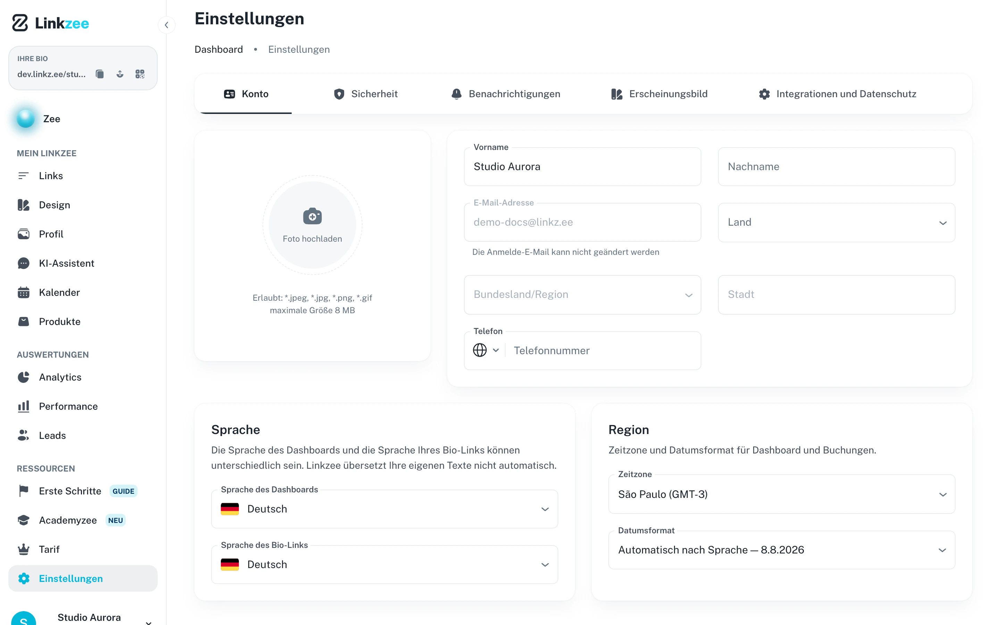

Deine **Konto**einstellungen befinden sich an einem Ort. Hier legst du fest, wie
Linkzee mit dir spricht, wo du dich befindest und wie die Oberfläche aussieht und
sich anfühlt.

<Frame caption="Der Konto-Tab: Sprache, Region, Zeitzone, Darstellung und Barrierefreiheit.">
  
</Frame>

## Sprache und Region

- **Sprache des Dashboards**: die Sprache, die Linkzee in deinem Editor verwendet.
- **Sprache des Bio-Links**: die Sprache der Buttons, Beschriftungen und
  Meldungen deiner öffentlichen Seite. Sie kann sich von der Sprache des
  Dashboards unterscheiden. Linkzee übersetzt keine Texte, die du selbst
  geschrieben hast.
- **Land** — wähle dein Land, und deine **Zeitzone** folgt automatisch.
- **Bundesland** und **Stadt** — grenze deinen Standort weiter ein.
- **Datumsformat** — wähle, wie Datumsangaben angezeigt werden.

All das findest du unter **Einstellungen → Sprache und Region**. Dein Konto und
deine Seite starten in der Sprache der Seite, auf der du dich registriert hast.

<Note>
  Diese Zeitzone gilt für **dein Dashboard** (Datumsangaben, Berichte). Deine
  Buchungszeiten folgen der **Zeitzone des Geschäfts**, die separat unter
  **Kalender → Einstellungen** festgelegt wird — ein Geschäft kann also in einer
  anderen Zeitzone arbeiten als dein Konto, und beide funktionieren unabhängig
  voneinander.
</Note>

### Sprachvorschlag für deine Seite

Ist deine öffentliche Seite in einer Sprache, die Kunden in deiner Region
meist nicht lesen, zeigt das Dashboard einen kurzen Hinweis, zum Beispiel:
„Deine öffentliche Seite ist auf Englisch. Kunden in deiner Region lesen meist
Portugiesisch.“ Tippe auf **Auf … umstellen**, um die Sprache der Seite mit
einem Tipp zu ändern, oder auf **So lassen**.

## Erscheinungsbild und Barrierefreiheit

- **Erscheinungsbild** — wechsle zwischen **Hell** und **Dunkel**.
- **Barrierefreiheit** — passe die **Schriftgröße** an und aktiviere **Hoher
  Kontrast** für besseres Lesen.

Jede Änderung, die du hier vornimmst, wird sofort wirksam — es gibt keine
Speichern-Schaltfläche, an die du denken musst.

## Verwandte Seiten

<CardGroup cols={2}>
  <Card title="Passwort und Sicherheit" icon="lock" href="/de/account/password-security">
    Ändere dein Passwort oder setze es zurück, falls du es vergessen hast.
  </Card>
  <Card title="SEO der öffentlichen Seite" icon="magnifying-glass" href="/de/account/public-page-seo">
    Lege den Titel und die Beschreibung fest, die Menschen bei Google und in
    Link-Vorschauen sehen.
  </Card>
</CardGroup>
