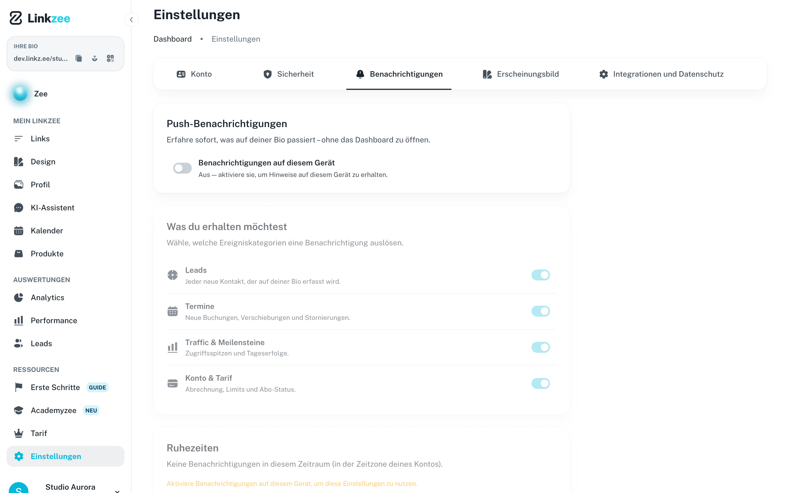

Mit Push-Benachrichtigungen meldet sich Linkzee in dem Moment bei dir, in dem etwas
auf deiner Seite passiert — ein neuer Lead, eine neue Buchung — damit du nie
verpassen, was wichtig ist, selbst wenn das Dashboard geschlossen ist.

<Frame caption="Benachrichtigungseinstellungen: wähle, was per E-Mail und Push ankommt.">
  
</Frame>

Sie sind optional: du aktivierst sie, wählst die gewünschten Arten und legst
Ruhezeiten fest, damit du nachts nicht gestört wirst.

## Worüber du benachrichtigt werden kannst

<CardGroup cols={2}>
  <Card title="Leads" icon="bullseye">
    Jemand Neues hat seine Kontaktdaten auf deiner Seite oder bei deinem KI-Assistenten
    hinterlassen.
  </Card>
  <Card title="Termine" icon="calendar">
    Eine neue Buchung, eine Verschiebung oder eine Stornierung. Wird eine
    Buchungszahlung bestätigt, erhältst du **„💰 Du hast \{Betrag\}
    erhalten"** statt der Meldung über die neue Buchung — ein Tipp darauf
    öffnet deine Einnahmen-Seite.
  </Card>
  <Card title="Traffic" icon="chart-line">
    Meilensteine und Spitzen, wenn deine Seite viele Besuche erhält.
  </Card>
  <Card title="Konto" icon="credit-card">
    Erreichte Tariflimits und zu lösende Zahlungsprobleme.
  </Card>
</CardGroup>

## Benachrichtigungen aktivieren

<Steps>
  <Step title="Öffne die Benachrichtigungseinstellungen">
    Gehe zu **Einstellungen → Benachrichtigungen**.
  </Step>
  <Step title="Aktiviere den Hauptschalter">
    Lege den Schalter oben um. Der Browser fragt nach der Erlaubnis, Meldungen zu
    senden — wähle **Zulassen**.
  </Step>
  <Step title="Sende einen Test">
    Tippe auf **Test senden**, um zu bestätigen, dass eine Benachrichtigung auf
    deinem Gerät ankommt.
  </Step>
</Steps>

<Note>
  Der Hauptschalter gilt **pro Gerät**. Aktiviere ihn auf jedem Telefon oder
  Computer, auf dem du Meldungen erhalten möchtest.
</Note>

## Wähle, welche Benachrichtigungen du erhältst

Schalte unter **Kategorien** jede Art ein oder aus — **Leads**, **Termine**,
**Traffic** und **Konto**. Diese Einstellungen gelten für alle deine Geräte.

## Ruhezeiten

Keine Meldungen über Nacht? Aktiviere die **Ruhezeiten** und lege eine Start-
und eine Endzeit fest (zum Beispiel 22:00 bis 08:00 Uhr). Während dieses Zeitraums
werden Benachrichtigungen zurückgehalten und dein Telefon bleibt still.

## Auf iPhone und iPad

Unter iOS funktionieren Push-Benachrichtigungen erst, wenn du **Linkzee als App**
auf deinem Startbildschirm installiert hast. Wenn du die Option zum Aktivieren nicht
siehst, installiere zuerst die App.

<Card title="App installieren" icon="mobile" href="/de/get-started/install-app">
  Füge Linkzee zu deinem Startbildschirm hinzu, um Benachrichtigungen auf iPhone
  und iPad freizuschalten.
</Card>

<Tip>
  Du bevorzugst E-Mail? Bei wichtigen Ereignissen wie neuen Leads sendet Linkzee auch
  eine E-Mail — so bist du abgesichert, selbst wenn ein Gerät offline ist.
</Tip>

## Verwandte Seiten

<CardGroup cols={2}>
  <Card title="App installieren" icon="mobile" href="/de/get-started/install-app">
    Hol dir die installierbare App auf dein Telefon.
  </Card>
  <Card title="Terminerinnerungen" icon="bell" href="/de/scheduling/reminders">
    Reduziere Nichterscheinen mit Bestätigungserinnerungen an deine Besucher.
  </Card>
</CardGroup>
