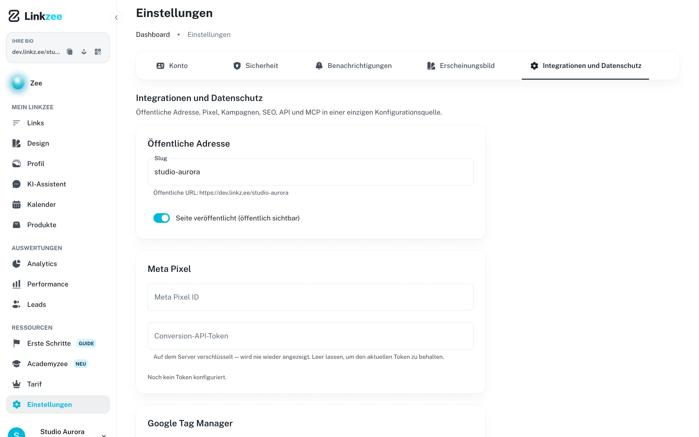

Linkzee hat eine eigene [Performance](/de/analytics/overview)-Seite, aber Sie können
Conversions auch mit Ihren **eigenen** Marketing-Tools messen. Verbinden Sie sie
einmal, und Linkzee sendet die Daten, während Besucher mit Ihrer Seite interagieren.

<Frame caption="Integrationen & Datenschutz: Meta Pixel, GTM und die öffentliche Adresse deiner Seite.">
  
</Frame>

Alles hier wird automatisch gespeichert, während Sie tippen. Es gibt keinen
Speichern-Button.

## Meta Pixel

Fügen Sie Ihre **Meta Pixel** ID hinzu, um Besucher und Conversions im Meta Events
Manager zu erfassen. Fügen Sie dann auch den Token Ihrer **Conversion-API** hinzu.

Der Token ist entscheidend: Browser und iOS blockieren das Pixel-Skript häufig,
sodass Ereignisse verloren gehen können. Die Conversion-API sendet die Conversion
direkt von Linkzee, sodass sie auch dann erfasst wird, wenn das Skript blockiert
ist. Beide zusammen sorgen für das vollständigste Tracking.

## Google Tag Manager

Fügen Sie die Container-ID Ihres **Google Tag Manager** hinzu, um Ihren
GTM-Container auf Ihrer öffentlichen Seite zu laden. Von dort aus können Sie Ihre
eigenen Tags und Trigger im Google Tag Manager verwalten.

Zum Schutz Ihrer Besucher läuft Ihr Container auf Ihrer Seite in einem
**eingeschränkten Modus**. Alle Bios liegen unter derselben Linkzee-Adresse,
deshalb sind Tags ausgeschaltet, die beliebigen Code ausführen können.

**Was funktioniert:**

- Google-Tags: Google Analytics 4, Google Ads und die Conversion-Verknüpfung.
- Meta-Pixel- und TikTok-Pixel-Tags aus der Community-Vorlagengalerie.
- Das Tag **Benutzerdefiniertes Bild**.

**Was nicht läuft:**

- Tags mit **Benutzerdefiniertem HTML** und Variablen mit
  **Benutzerdefiniertem JavaScript**.
- Die Variablen **JavaScript-Variable**, **Eigenes Cookie** und
  **DOM-Element**.
- Integrierte Tags anderer Anbieter, die ein eigenes Skript oder einen eigenen
  Frame laden.
- Universal-Analytics-Tags und ein zweiter Container, der aus Ihrem heraus
  geladen wird.

Wenn ein Tag auf Ihrer Seite nicht auslöst, prüfen Sie, ob es auf der Liste
dessen steht, was nicht läuft. Für Meta sind die Felder Meta Pixel und
Conversion-API oben die zuverlässigste Option.

## UTM-Parameter

Legen Sie Standard-**UTM**-Parameter fest, etwa Quelle, Medium und Kampagne,
die Linkzee automatisch zu Ihren ausgehenden Links hinzufügt. So kennzeichnen Sie
den Traffic, den Sie aussenden, damit Ihre Analyse ihn der richtigen Quelle und
Kampagne zuordnet.

<Note>
  Diese Werte finden Sie in Ihren Marketing-Tools: Ihre Pixel-ID und den Token
  der Conversion-API im **Meta Events Manager** und Ihre Container-ID im **Google
  Tag Manager**.
</Note>

## Wie Linkzee die eigenen Anzeigen misst

Die Einstellungen oben gehören Ihnen und gelten für Ihre öffentliche Seite.
Unabhängig davon misst Linkzee auf den eigenen Seiten (Website, Quiz,
Registrierung und Abonnement), und nur wenn Sie Werbe-Cookies akzeptieren, die
Ergebnisse der eigenen Anzeigen mit Meta (Pixel und Conversions API) und Google
Tag Manager. Dazu sendet Linkzee an Meta:

- E-Mail, Telefonnummer und Name in verschlüsselter Form (SHA-256-Hash) sowie
  eine interne Kennung, ebenfalls gehasht.
- Ihren ungefähren Standort aus der IP-Adresse (Stadt, Bundesland und Land, nie
  die Postleitzahl).
- Die IP-Adresse und den Browser zum Zeitpunkt des Ereignisses.
- Die Werbekennungen von Meta (Cookies `_fbp` und `_fbc`).

Bei Zahlungen kann die gegenüber Stripe angegebene Rechnungsadresse diese Daten
ergänzen. Die Telefonnummer kann aus Ihrem Konto stammen oder aus der WhatsApp-
oder Telefonnummer, die Sie beim Einrichten Ihrer Seite angegeben haben.

Diese Messdaten werden nur kurz gespeichert: der Zahlungskontext bis zu
**30 Tage** und der Registrierungskontext (ohne IP-Adresse) bis zu **90 Tage**.
Sie können Ihre Einwilligung jederzeit unter **Cookie-Einstellungen** widerrufen;
der Widerruf löscht diese Kontexte und beendet neue Übermittlungen. Wo das Gesetz
es verlangt, nutzt Linkzee den Modus zur eingeschränkten Datennutzung von Meta.
Schlägt die Übermittlung an Meta fehl, bleibt das Ereignis bis zu 2 Tage in einer
Warteschlange für den erneuten Versand, und Linkzee speichert einen minimalen
Nachweis bereits gesendeter Conversions (nur die Ereigniskennung, keine
personenbezogenen Daten), damit dieselbe Conversion nie doppelt gezählt wird. Die
Warteschlange wird auch gelöscht, wenn Sie Ihre Einwilligung widerrufen.

## Nächste Schritte

<CardGroup cols={2}>
  <Card title="Performance" icon="chart-line" href="/de/analytics/overview">
    Sehen Sie Klicks, Aufrufe und Ihre Top-Elemente direkt in Linkzee.
  </Card>
  <Card title="Kontoeinstellungen" icon="gear" href="/de/account/account">
    Legen Sie Sprache, Region, Erscheinungsbild und Barrierefreiheit fest.
  </Card>
</CardGroup>
