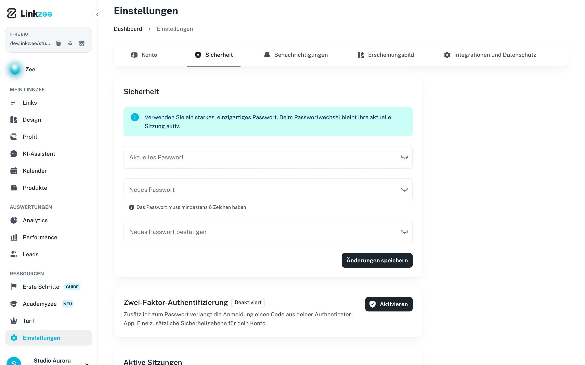

Die Zwei-Faktor-Authentifizierung (2FA) fügt deinem Konto eine zusätzliche
Sicherheitsebene hinzu. Zusätzlich zu deinem Passwort gibst du einen **6-stelligen
Code** aus einer Authenticator-App auf deinem Telefon ein — selbst wenn jemand dein
Passwort herausfindet, kommt er ohne dein Telefon nicht hinein.

<Frame caption="Der Tab Sicherheit: Zwei-Faktor-Authentifizierung aktivieren und Sitzungen verwalten.">
  
</Frame>

Sie ist völlig **optional** und standardmäßig deaktiviert. Du aktivierst sie selbst
und kannst sie jederzeit wieder deaktivieren.

## Zwei-Faktor-Authentifizierung aktivieren

Du benötigst eine kostenlose Authenticator-App wie **Google Authenticator**,
**Authy** oder **1Password**.

<Steps>
  <Step title="Öffne die Sicherheitseinstellungen">
    Gehe zu **Einstellungen → Sicherheit** und tippe unter
    **Bestätigung in zwei Schritten** auf **Aktivieren**.
  </Step>
  <Step title="Scanne den QR-Code">
    Öffne deine Authenticator-App und scanne den QR-Code auf dem Bildschirm.
    Kannst du nicht scannen? Kopiere den unter dem Code angezeigten Schlüssel und
    füge ihn manuell in die App ein.
  </Step>
  <Step title="Gib den 6-stelligen Code ein">
    Die App zeigt einen 6-stelligen Code, der sich alle 30 Sekunden ändert. Gib
    den aktuellen Code ein, um die Einrichtung zu bestätigen.
  </Step>
  <Step title="Speichere deine Backup-Codes">
    Linkzee zeigt **10 Backup-Codes**. Kopiere sie oder lade sie herunter und
    bewahre sie sicher auf — sie werden nur einmal angezeigt.
  </Step>
</Steps>

<Warning>
  Speichere deine Backup-Codes, bevor du fertig bist. Sie sind dein Weg zurück,
  falls du dein Telefon verlierst, und werden nur einmal angezeigt.
</Warning>

## Mit 2FA anmelden

Mit aktivierter 2FA erfolgt die Anmeldung in zwei schnellen Schritten:

<Steps>
  <Step title="Gib E-Mail und Passwort ein">
    Melde dich wie gewohnt an.
  </Step>
  <Step title="Gib deinen Code ein">
    Gib auf dem nächsten Bildschirm den aktuellen 6-stelligen Code aus deiner
    Authenticator-App ein.
  </Step>
</Steps>

## Backup-Codes

Backup-Codes sind Einmal-Codes, die anstelle der Authenticator-App funktionieren. Jeder
funktioniert **einmal** und wird dann verbraucht.

- Verwende einen, wenn die App nach einem Code fragt — tippe auf **Backup-Code
  verwenden** und gib ihn ein.
- Gehen sie zur Neige? Gehe zu **Einstellungen → Sicherheit** und wähle
  **Neue Backup-Codes generieren**. Ein neuer Satz **ersetzt** alle alten Codes.

## Telefon verloren?

Keine Sorge — du hast zwei Wege zurück:

- **Verwende einen Backup-Code** auf dem Code-Bildschirm bei der Anmeldung.
- Sobald du wieder drin bist, gehe zu **Einstellungen → Sicherheit**,
  deaktiviere die 2FA und richte sie auf deinem neuen Telefon erneut ein.

<Note>
  Wenn du sowohl dein Telefon als auch deine Backup-Codes verloren hast, wende dich
  an den [Support](mailto:support@linkz.ee), um dein Konto wiederherzustellen.
</Note>

## Mit Google registriert?

Wenn du dich mit **Google** anmeldest und die 2FA aktiviert hast, fragt Linkzee nach
Google trotzdem nach deinem 6-stelligen Code — so bleibt dein Konto in jedem Fall
geschützt.

## Zwei-Faktor-Authentifizierung deaktivieren

Gehe zu **Einstellungen → Sicherheit** und tippe auf **Deaktivieren**. Zu
deiner Sicherheit musst du einen gültigen Code (aus der App oder einen Backup-Code)
eingeben, um zu bestätigen.

## Verwandte Seiten

<CardGroup cols={2}>
  <Card title="Passwort und Sicherheit" icon="lock" href="/de/account/password-security">
    Ändere dein Passwort und melde dich sicher an.
  </Card>
  <Card title="Hilfe beim Kontozugriff" icon="key" href="/de/troubleshooting/account-access">
    Behebe Probleme bei Anmeldung, Aktivierung und Zugriff.
  </Card>
</CardGroup>
