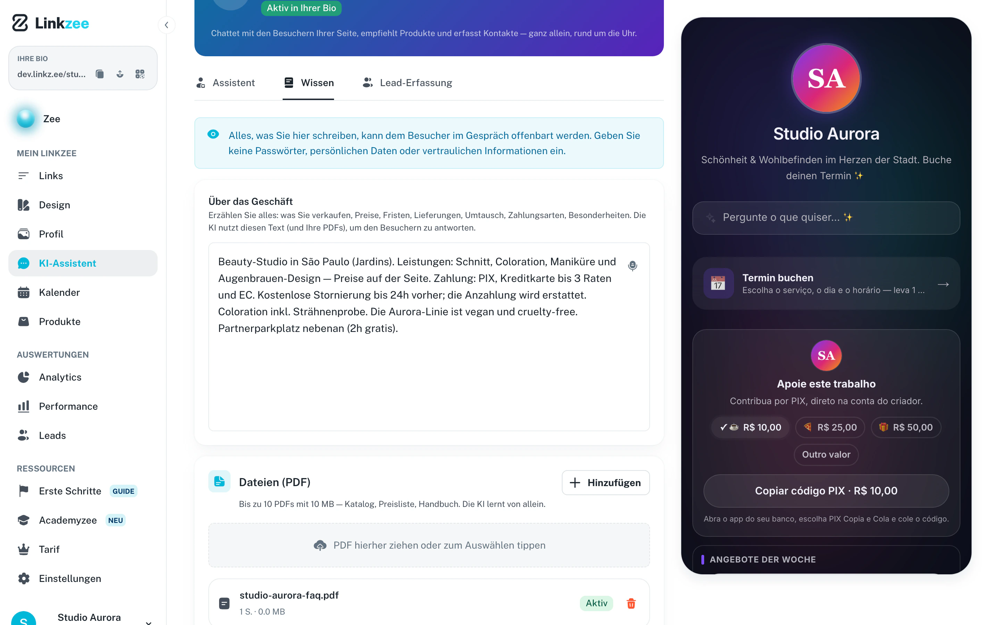

Dein KI-Assistent antwortet auf Basis dessen, was du ihm gibst. Mit der
**Wissensdatenbank** kannst du ihn mit Dokumenten füttern — statt jedes Detail
in seine Fakten einzutippen, lädst du einfach die Dateien hoch, die du ohnehin
schon hast, und lässt den Assistenten sie in seinen Antworten nutzen.

<Frame caption="Wissen: der Unternehmens-Text und die PDFs, mit denen die KI antwortet.">
  
</Frame>

## Was du hochladen kannst

Lade **PDFs** hoch, und der Assistent greift darauf zurück, wenn er
Besuchern antwortet. Gute Dokumente zum Hinzufügen sind zum Beispiel:

- **Kataloge** — dein komplettes Produktsortiment mit Details
- **Preislisten** — aktuelle Preise und Optionen
- **Richtlinien** — Versand, Rückgabe, Garantie und Bedingungen
- **FAQs** — die Fragen, die deine Kunden am häufigsten stellen

Je mehr deine Dokumente abdecken, desto besser kann der Assistent helfen,
empfehlen und den Verkauf abschließen.

## Ein Dokument hinzufügen

<Steps>
  <Step title="Öffne deinen KI-Assistenten">
    Gehe in deinem Editor zu **KI-Assistent** und öffne den Bereich
    **Wissensdatenbank**.
  </Step>
  <Step title="Ein PDF hochladen">
    Füge deine Datei hinzu. Jede Datei hat ein **Größenlimit**, halte
    Dokumente also in vernünftigem Rahmen — teile einen sehr großen Katalog
    bei Bedarf in kleinere PDFs auf.
  </Step>
  <Step title="Lass Linkzee den Rest erledigen">
    Nach dem Hochladen aktualisiert Linkzee das Wissen des Assistenten
    **automatisch** — es gibt nichts zu speichern oder zu veröffentlichen. Deine
    Änderungen werden von selbst wirksam.
  </Step>
</Steps>

<Note>
  Halte deine Dokumente aktuell. Der Assistent antwortet auf Basis dessen,
  was du hochlädst — wenn sich also Preise oder Richtlinien ändern, ersetze
  die alte Datei durch eine aktualisierte.
</Note>

## Verwandte Seiten

<CardGroup cols={2}>
  <Card title="Persona & Fakten" icon="id-card" href="/de/ai-assistant/persona">
    Gib dem Assistenten seine Stimme und teile ihm die Fakten über dein
    Unternehmen mit.
  </Card>
  <Card title="KI-Assistent im Überblick" icon="robot" href="/de/ai-assistant/overview">
    Sieh dir an, was der Assistent tut und wie er deinen Besuchern hilft.
  </Card>
</CardGroup>
