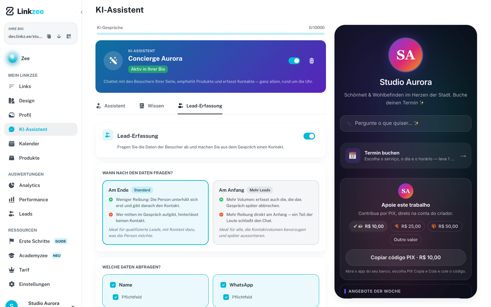

Jeder Chat mit deinem KI-Assistenten ist eine Chance, einen Kunden zu gewinnen. Mit der
**Lead-Erfassung** sammelt der Assistent während des Gesprächs die Daten eines Besuchers
und speichert sie, damit du später nachfassen kannst.

<Frame caption="Lead-Erfassung: wann nach Daten fragen und welche Felder.">
  
</Frame>

## Lead-Erfassung aktivieren

Öffne in deinem Editor den **KI-Assistent** und aktiviere die **Lead-Erfassung**. Wie
bei allem in Linkzee werden deine Änderungen automatisch gespeichert und die Live-Vorschau
aktualisiert sich, während du arbeitest.

## Wählen, was erfasst wird

Lege fest, welche Felder der Assistent abfragt, und markiere jedes einzelne als
Pflichtfeld oder optional:

| Feld | Was es erfasst |
| --- | --- |
| **Name** | Der Name des Besuchers |
| **WhatsApp** | Eine WhatsApp-Nummer, um ihn zu erreichen |
| **E-Mail** | Eine E-Mail-Adresse |
| **@Instagram** | Sein Instagram-Nutzername |

<Note>
  Frage nur ab, was du wirklich brauchst. Ein kürzeres Formular lässt sich leichter
  ausfüllen, sodass du mehr Leads erfasst.
</Note>

## Wählen, wann gefragt wird

Entscheide, in welchem Moment der Assistent die Daten sammelt:

<Steps>
  <Step title="Am Anfang">
    Zeige ein kurzes Formular, bevor der Chat beginnt. Wähle dies, wenn du für
    jedes Gespräch einen Kontakt möchtest.
  </Step>
  <Step title="Am Ende">
    Lass den Assistenten ganz natürlich fragen, wenn sich im Gespräch ein guter Moment
    ergibt. Wähle dies für ein freundlicheres, weniger forderndes Erlebnis.
  </Step>
</Steps>

## Deine Leads finden

Erfasste Kontakte erscheinen auf deiner Seite **Leads**. Von dort aus kannst du jeden
einzelnen ansehen, um nachzufassen, und deine Liste exportieren, um sie anderswo weiter zu
bearbeiten.

<CardGroup cols={2}>
  <Card title="Persona" icon="id-card" href="/de/ai-assistant/persona">
    Gib deinem Assistenten seine Stimme, seinen Ton und die Fakten über dein Unternehmen.
  </Card>
  <Card title="Performance" icon="chart-line" href="/de/analytics/overview">
    Sieh dir Klicks, Aufrufe und deine Top-Elemente an, um zu erfahren, was dein Publikum am
    häufigsten antippt.
  </Card>
</CardGroup>
