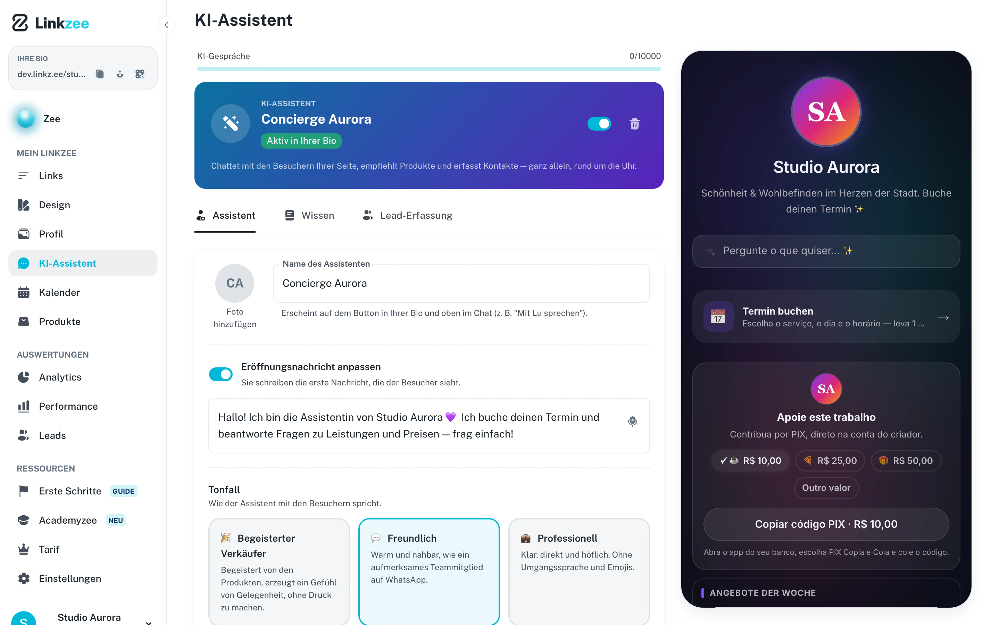
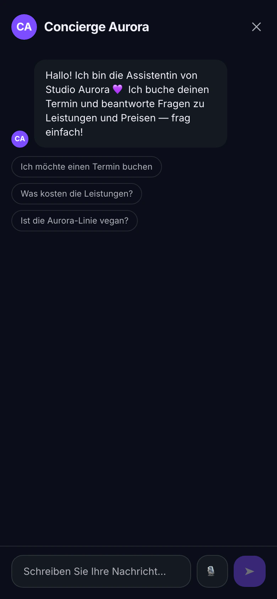

Der **KI-Assistent** ist ein smarter Helfer, den du zu deiner Seite hinzufügen
können. Besucher tippen darauf, um einen Chat zu öffnen, und er beantwortet ihre
Fragen, **empfiehlt deine Produkte** und hilft ihnen bei der Kaufentscheidung —
freundlich, markengerecht und zu jeder Tageszeit.

<Frame caption="Assistenten-Setup: Name, Begrüßung und Tonfall.">
  
</Frame>

Er kann mehr als nur reden. Der Assistent kann **den Kontakt eines Besuchers
erfassen**, damit du später nachfassen kannst, und er kann **Termine für dich
übernehmen** und so aus einer beiläufigen Frage eine Buchung machen. Er arbeitet
rund um die Uhr, sodass keine Besucherfrage unbeantwortet bleibt.

## Was er kann

- **Beantwortet Fragen** zu deinem Unternehmen, Tag und Nacht.
- **Empfiehlt deine Produkte** und hilft Besuchern bei der Entscheidung.
- **Erfasst Kontakte**, damit du bei interessierten Besuchern nachfassen kannst.
- **Übernimmt Termine**, sodass Menschen buchen können, ohne den Chat zu verlassen.

## Einrichtung

Du richtest den Assistenten in deinem Editor unter **KI-Assistent** ein. Dort gibst
du ihm eine Stimme, erzählst ihm von deinem Unternehmen und legst fest, was er von
Besuchern erfassen soll. Wie alles in Linkzee werden deine Änderungen
**automatisch gespeichert** und die **Vorschau aktualisiert sich live** — auf dem
Desktop rechts und auf dem Mobilgerät unter dem Editor.

<Note>
  Der Assistent spricht nur über das, was du ihm über dein Unternehmen mitteilst.
  Je mehr du darüber teilst, was du verkaufst, über deine Öffnungszeiten und deine
  Richtlinien, desto besser antwortet er — und er erfindet nie etwas.
</Note>

## Den Assistenten entdecken

<CardGroup cols={2}>
  <Card title="Persona" icon="id-card" href="/de/ai-assistant/persona">
    Gib dem Assistenten seinen Namen, seine Stimme, seine Begrüßungsnachricht und die Fakten, die er kennen sollte.
  </Card>
  <Card title="Lead-Erfassung" icon="address-book" href="/de/ai-assistant/lead-capture">
    Verwandle Gespräche in Kontakte, indem du Namen, WhatsApp, E-Mail und mehr erfasst.
  </Card>
  <Card title="Wissensdatenbank" icon="file-pdf" href="/de/ai-assistant/knowledge-base">
    Lade PDFs hoch, damit der Assistent aus deinen Katalogen, Preislisten und Richtlinien antwortet.
  </Card>
  <Card title="KI-Terminbuchung" icon="calendar" href="/de/scheduling/ai-scheduling">
    Lass den Assistenten Termine für Besucher direkt im Chat buchen.
  </Card>
</CardGroup>

<Frame caption="Der Chat auf deiner öffentlichen Seite: eigene Begrüßung und Fragevorschläge.">
  
</Frame>
