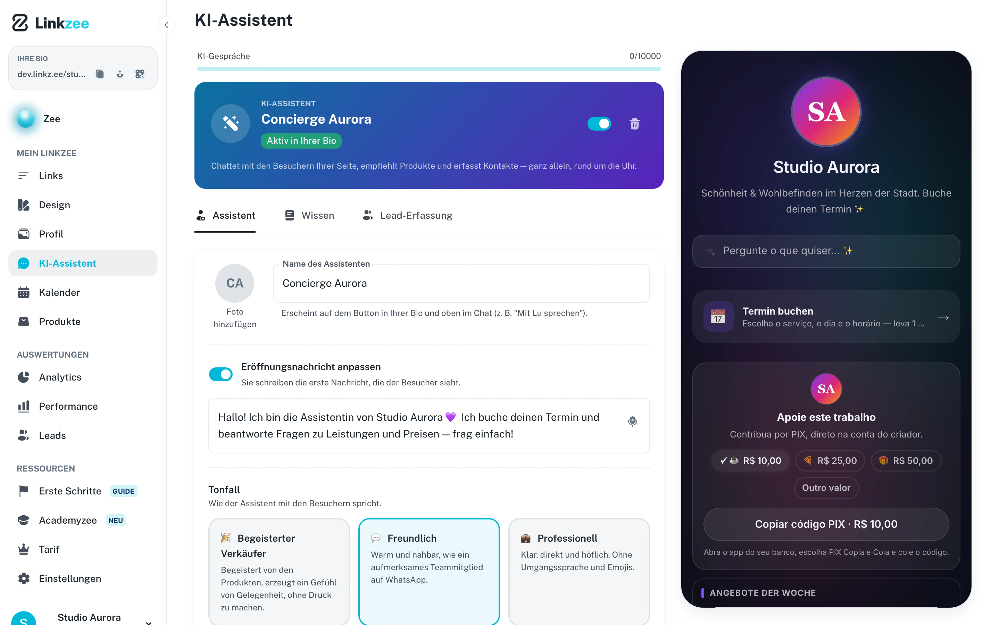

Dein KI-Assistent ist nur so gut wie das, was du ihm mitteilst. Beim Einrichten der
**Persona** gibst du ihm eine Stimme, eine Persönlichkeit und die Fakten, die er
braucht, um deinen Besuchern zu helfen. Öffne deinen Editor, gehe zu
**KI-Assistent** und fülle die untenstehenden Angaben aus. Alles wird
**automatisch gespeichert**, während du tippst, und deine Vorschau aktualisiert
sich live — auf dem Desktop rechts, auf dem Handy unter dem Editor.

<Frame caption="Assistenten-Setup: Name, Begrüßung und Tonfall.">
  
</Frame>

## Was du einrichtest

<Steps>
  <Step title="Name und Titel">
    Gib deinem Assistenten einen **Namen** und einen **Titel** — zum Beispiel
    einen freundlichen Vornamen und eine Rolle wie „Einkaufshelfer“. So stellt er
    sich im Chat vor.
  </Step>
  <Step title="Eröffnungsnachricht">
    Schreibe die **Eröffnungsnachricht**, die Besucher sehen, wenn sie den
    Chat starten. Nutze sie, um sie zu begrüßen und anzudeuten, wobei der
    Assistent helfen kann. Lässt du sie aus, schreibt Linkzee automatisch
    eine überzeugende Eröffnung für dich.
  </Step>
  <Step title="Tonfall">
    Wähle einen **Tonfall** — freundlich, professionell oder lebhaft. Der
    Assistent behält diese Stimme in jeder Antwort bei, sodass er immer nach dir
    klingt.
  </Step>
  <Step title="Fakten über dein Geschäft">
    Füge die **Fakten über dein Geschäft** hinzu, die der Assistent nutzen
    soll: was du verkaufst, Liefer- und Versanddetails, Öffnungszeiten,
    Richtlinien — alles, was er wissen soll. Je mehr du angibst, desto mehr kann
    er helfen.
  </Step>
</Steps>

## Erweiterte Personalisierung (optional)

Dein Assistent funktioniert bereits mit den obigen Schritten hervorragend. Wenn du
ihn auf deinen Shop zuschneiden möchtest, öffne **Erweiterte Personalisierung**
— sie ist versteckt und standardmäßig geschlossen, es gibt also nichts, was du
zusätzlich ausfüllen *musst*. Zwei optionale Freitextfelder:

<CardGroup cols={2}>
  <Card title="Wie er bedienen soll" icon="user-pen">
    Beschreibe die Art, die du dir wünschst, über den Tonfall hinaus — zum
    Beispiel: *„Bediene wie eine erfahrene, herzliche Beraterin. Einfache Sprache,
    kein Fachjargon, und lobe stets die Wahl des Kunden.“*
  </Card>
  <Card title="Regeln und Vorlieben" icon="list-check">
    Gib deine eigenen Regeln vor, die der Assistent immer befolgen soll — zum
    Beispiel: *„Zeige nie alle Zeiten — biete nur 2 auf einmal an, um ein Gefühl
    von Exklusivität zu erzeugen“* oder *„Erwähne immer den kostenlosen Versand ab
    R$99.“*
  </Card>
</CardGroup>

Es gibt fertige Beispiele, die du antippen kannst, um sie zu den Regeln
hinzuzufügen — ein schneller Weg, um loszulegen.

<Note>
  Diese Vorlieben prägen das Verhalten deines Assistenten, setzen aber niemals seine
  Sicherheitsregeln außer Kraft: Er erfindet weiterhin keine Produkte, Preise oder
  Buchungszeiten und verspricht nichts, was er nicht halten kann.
</Note>

## Er weiß nur, was du ihm mitteilst

Dein Assistent antwortet **ausschließlich** anhand der Fakten, die du bereitstellst.
Er erfindet niemals etwas, wenn also ein Besucher nach etwas fragt, das du nicht
abgedeckt haben, denkt er sich keine Antwort aus. So bleibt jede Antwort korrekt und
markengerecht.

Um noch weiterzugehen, kannst du ihm auch Dokumente bereitstellen, aus denen er
antwortet — siehe die **Wissensdatenbank**.

<Note>
  Schreibe die Fakten so, als würdest du einen neuen Verkäufer an seinem ersten
  Tag einweisen. Je klarer und konkreter du bist, desto besser verkauft dein
  Assistent für dich.
</Note>

## Verwandt

<CardGroup cols={2}>
  <Card title="Lead-Erfassung" icon="address-book" href="/de/ai-assistant/lead-capture">
    Verwandle Gespräche mit dem Assistenten in Kontakte, die du
    weiterverfolgen kannst.
  </Card>
  <Card title="Wissensdatenbank" icon="file-pdf" href="/de/ai-assistant/knowledge-base">
    Lade Kataloge, Preislisten und FAQs hoch, damit der Assistent daraus
    antwortet.
  </Card>
</CardGroup>
