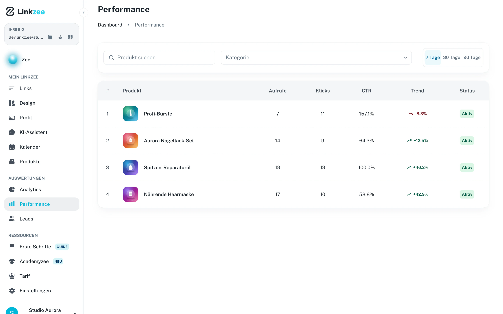

Der Bildschirm **Analytics** zeigt, wie deine Linkzee-Seite läuft. Er begleitet
jeden Besuch vom Öffnen deiner Seite bis zum Klick, zur Buchung oder zum Kontakt,
damit du siehst, was funktioniert, und mehr davon machst.

Der Bildschirm hat drei Tabs (**Übersicht**, **Herkunft** und **Buttons**) und
oben eine Zeitraumauswahl. Unter dem Titel siehst du, wann die Zahlen zuletzt
aktualisiert wurden: Sie werden **etwa einmal pro Stunde** erneuert.

## Dein Verlauf je nach Tarif

Wie weit du zurückblicken kannst, hängt vom Tarif des Geschäfts ab, in dem du
gerade sind:

| Tarif | Verlauf | Wählbare Zeiträume |
| --- | --- | --- |
| Free | 7 Tage | Heute · 7 Tage |
| Essential | 90 Tage | Heute · 7 Tage · 30 Tage · 90 Tage |
| Pro und Scale | 12 Monate | Heute · 7 Tage · 30 Tage · 90 Tage · 12 Monate |

Zeiträume über deinem Tarif tragen eine **Krone**. Tippst du darauf, siehst du,
was jeder Tarif zeigt, und kannst upgraden. Deine Daten werden in jedem Fall
weiter gespeichert: Mit einem Abo erscheint der längere Verlauf sofort.

<Note>
  Jeder Zeitraum endet **heute** und nutzt die Zeitzone deines Geschäfts.
  Vergleiche („vs. vorherige 30 Tage") nutzen nur Tage innerhalb des Verlaufs
  deines Tarifs, einen Vergleich mit dem Vorjahr gibt es daher nicht. **Heute**
  und **12 Monate** zeigen keinen Vergleich, und du siehst einen Strich statt einer Zahl, wenn der Verlauf
  für einen Vergleich nicht reicht.
</Note>

## Übersicht

Der Tab **Übersicht** zeigt dir das ganze Bild auf einem Bildschirm:

- **Ein Satz als Fazit**: zum Beispiel *„Von 100 Besuchen haben 41 etwas
  angeklickt und 3 gebucht."* Bei weniger als 100 Besuchen nennt er die echten
  Zahlen.
- **Vier Kennzahlen**: **Besuche**, **Besucher**, **% mit Klick** und
  **Klicks**, jeweils mit der Veränderung zum vorherigen Zeitraum.
- **Besuche und Klicks**: ein Diagramm pro Tag (pro Monat bei 12 Monaten).
- **Der Trichter**: der Weg deiner Besucher (siehe unten).
- **Herkunft**: deine wichtigsten Quellen, mit **Alle ansehen** für den nächsten
  Tab.
- **Meistgeklickt**: deine stärksten Buttons, mit **Alle ansehen** für den Tab
  Buttons.
- **Geräte**, **Städte** und **Länder**.
- Eine Verknüpfung zu **Produktleistung** (siehe [Der Performance-Bildschirm](#der-performance-bildschirm)).

Hat deine Seite noch keine Besuche, zeigt der Tab **Meinen Link teilen**. Das
öffnet das Teilen-Fenster, siehe [Getrackte Links und QR-Code](/de/analytics/tracked-links).

## Der Trichter

Der Trichter zeigt, wie viele Besucher bei jedem Schritt weitergegangen sind und
welcher Anteil von einem Schritt zum nächsten gefolgt ist. Jeder Schritt zählt
nur Personen aus dem Schritt davor, ein Schritt ist also nie größer als der
vorherige.

| Deine Seite hat… | Trichter |
| --- | --- |
| Terminbuchung | Besucht → Etwas angeklickt → Buchung geöffnet → Gebucht |
| Kontakterfassung, ohne Terminbuchung | Besucht → Etwas angeklickt → Zu Kontakten geworden |
| Keins von beiden | Besucht → Etwas angeklickt |

Ist der [Qzee-Kalender](/de/scheduling/qzee-booking) in deiner Bio, zeigt die
Übersicht den Klick-Trichter: Gebucht wird in Qzee, und die Buchungen erscheinen
im Qzee-Bericht.

## Herkunft

Der Tab **Herkunft** beantwortet die Frage *„Welcher Ort bringt mir Kunden?"*:

- **Nach Herkunft**: Instagram, TikTok, WhatsApp, Google, Gedruckter QR und so
  weiter, jeweils mit Anteil an den Besuchen, % mit Klick und Anzahl der
  Buchungen. Öffne eine Quelle, um zu sehen, von welcher Stelle dieses
  Netzwerks der Besuch kam (**Bio**, **Storys**, **Direktnachricht** …) oder
  **Ohne getrackten Link**, wenn der Besuch ohne einen deiner Links kam.
- **Direkt (ohne Herkunft)**: Besuche ohne Angabe, woher sie kamen (jemand hat
  deine Adresse eingetippt, oder die App hat sie verborgen). Ist dieser Anteil
  hoch, schlägt ein Hinweis **Meine Links holen** vor, damit jedes Netzwerk
  seinen eigenen Link bekommt.
- **Kampagnenlinks**: die Besuche und Buchungen, die jeder deiner Kampagnenlinks
  gebracht hat. Tippe auf einen, um die Details zu sehen. Siehe [Kampagnenlinks](/de/analytics/tracked-links#kampagnenlinks).
- **Anzeigen und Google Analytics** (erweitert): die UTM-Parameter, die aus
  Anzeigen und externen Tools kamen (`utm_source`, `utm_campaign` …).

## Buttons

Der Tab **Buttons** ordnet alle Buttons deiner Seite vom meist- zum
wenigstgeklickten: Links, Produkte, der Buchungs-Button, soziale Netzwerke, die
Karte und andere. Mit den Filtern oben (**Alle**, **Links**, **Produkte**,
**Buchung**, **Soziale Netzwerke**, **Karte**) grenzt du die Liste ein.

Die Karte des [Qzee-Kalenders](/de/scheduling/qzee-booking) erscheint als
**Qzee-Kalender**: Jedes Öffnen durch einen Besucher zählt als Klick, und der
Filter **Buchung** rechnet sie zum Linkzee-Buchungs-Button dazu. Ihr Detail zeigt
nicht, wie viele gebucht haben, denn diese Buchungen stehen im Qzee-Bericht.

Tippe auf einen Button, um seine Klicks pro Tag zu sehen, woher diese Klicks
kamen und, beim Buchungs-Button, wie viele Personen gebucht haben. **Diesen
Button bearbeiten** führt dich direkt dorthin, wo du ihn änderst.

## Was jede Zahl bedeutet

| Zahl | Was sie zählt |
| --- | --- |
| **Besuche** | Jedes Mal, wenn jemand deine Seite öffnet. Neu laden oder sich innerhalb desselben Besuchs auf der Seite bewegen zählt nicht erneut; ein neuer Besuch beginnt nach 30 Minuten Abwesenheit oder wenn die Person über einen anderen Link kommt. |
| **Besucher** | Verschiedene Browser oder Geräte, die deine Seite im Zeitraum geöffnet haben. Dieselbe Person im Instagram-Browser und in Safari zählt doppelt. |
| **Klicks** | Tipps auf deine Links, Produkte, den Buchungs-Button, die Qzee-Kalender-Karte, soziale Netzwerke, die Karte sowie Unterstützungs- und Bewertungs-Buttons. |
| **% mit Klick** | Der Anteil aller Besuche, bei denen die Person mindestens etwas angeklickt hat. |
| **Klicks pro Besuch** („15 pro 100 Besuche") | Wie viele Klicks ein Button pro 100 Besuche bekommen hat. Der Wert kann über 100 liegen, wenn Menschen denselben Button mehrmals anklicken. |
| **Buchung geöffnet** | Besuche, bei denen die Person deine Terminbuchung geöffnet hat. |
| **Gebucht** | Buchungen, die im Zeitraum aus einem Besuch deiner Seite entstanden sind, unabhängig vom Status. |
| **Zu Kontakten geworden** | Neue Kontakte, die im Zeitraum aus einem Besuch deiner Seite gewonnen wurden. |
| **Meist von** | Die Quelle, die diesem Button die meisten Klicks gebracht hat. |
| **vs. vorher** | Die Veränderung gegenüber dem gleich langen Zeitraum direkt davor. Anzahlen ändern sich in %, Raten in Punkten („+3 Punkte"). |

<Note>
  Linkzee misst deine Seite mit einer **eigenen, anonymen Messung**, ohne Cookies
  von Drittanbietern. Diese Daten werden nie weitergegeben und dienen nur der
  Statistik deines Geschäfts. Besucher, die die Messung im Cookie-Hinweis
  ausschalten, zählen weiterhin als Besuche, aber nicht als Besucher.
</Note>

## Der Performance-Bildschirm

Neben Analytics gibt es im Menü einen eigenen Bereich **Performance**: eine
Tabelle deiner **Produkte**, jeweils mit Aufrufen, Klicks und Klickrate für den
gewählten Zeitraum (**7 Tage, 30 Tage, 90 Tage oder 12 Monate**, im Rahmen des
Verlaufs deines Tarifs). Nutze sie, um zu erkennen, welche Produkte ihren
Platz auf der Seite verdienen, und welche ein besseres Bild, einen besseren
Titel oder eine bessere Position brauchen.

<Frame caption="Performance: Klicks pro Link und Produkt, mit Summen für den Zeitraum.">
  
</Frame>

## Mach es dir zunutze

Nutze deine Zahlen, um zu erfahren, woher deine Kunden kommen und worauf sie
am meisten tippen, und setze dann auf das, was funktioniert: Gib jedem
Netzwerk seinen eigenen Link, setze deine stärksten Buttons nach oben und
frische Angebote auf, die an Schwung verlieren.

<CardGroup cols={2}>
  <Card title="Getrackte Links und QR-Code" icon="qrcode" href="/de/analytics/tracked-links">
    Ein Link für jeden Ort, an dem du deine Seite teilst, Kampagnenlinks und ein Schild mit QR-Code zum Drucken.
  </Card>
  <Card title="Mehr Klicks" icon="arrow-trend-up" href="/de/best-practices/growing-clicks">
    Praktische Tipps, um mehr Besuche in Klicks zu verwandeln.
  </Card>
</CardGroup>
