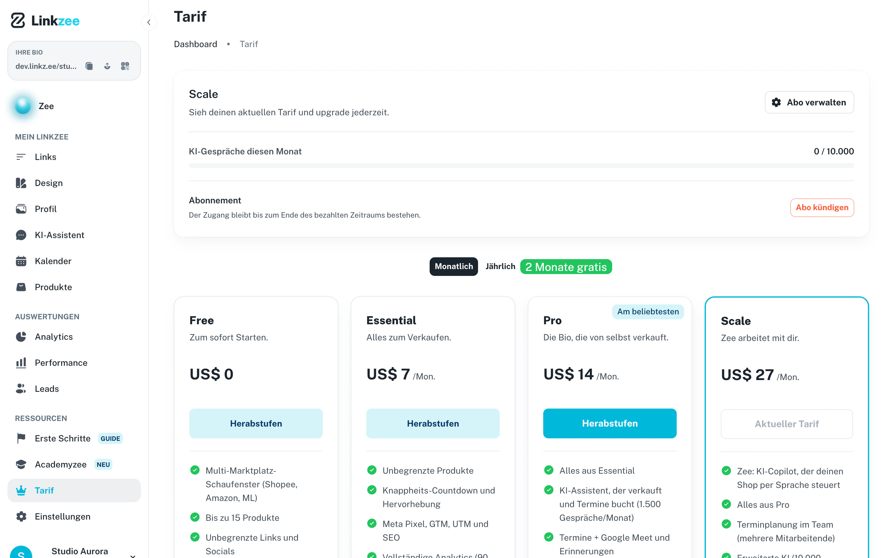

Linkzee hat vier Tarife — **Free, Essential, Pro und Scale** — und dein erstes Geschäft
startet mit einer **14-tägigen kostenlosen Testphase, in der alles freigeschaltet ist**.
Diese Seite erklärt, was jeder Tarif enthält, wie viel er in jedem Land kostet und wie
die Abrechnung funktioniert.

<Note>
  Der Tarif gehört zu einem **Geschäft**, nicht zu deinem Konto. Führst du mehr
  als ein Geschäft, trägt jedes seinen eigenen Tarif, seine eigenen Rechnungen und
  sein eigenes Verlängerungsdatum — siehe
  [Tarif pro Geschäft](/de/billing/plan-per-store).
</Note>

<Frame caption="Die Plan-Seite: Ihr aktueller Plan, die Nutzung und alle Optionen nebeneinander.">
  
</Frame>

## Was jeder Tarif enthält

### Free — zum Einstieg
- Produkt-Schaufenster für Shopee, Amazon BR und Mercado Livre
- Bis zu **15 Produkte**
- Unbegrenzte Links und soziale Netzwerke
- **7 Tage** Analysen, mit einem getrackten Link für jedes Netzwerk und einem Schild mit QR-Code
- Dein **erstes Geschäft** startet mit **14 Tagen kostenlos** mit allen Funktionen (Scale-Niveau), ohne Karte

### Essential — alles zum Verkaufen
- **Unbegrenzte Produkte**
- Knappheits-Countdown und hervorgehobene Produkte
- Meta Pixel, GTM, UTM und SEO
- **90 Tage** Analysen
- **Kampagnenlinks** — bis zu **10** aktive

### Pro — die Bio, die von allein verkauft
Alles aus Essential, plus:
- **12 Monate** Analyse-Verlauf
- **Unbegrenzt** Kampagnenlinks
- **KI-Assistent**, der verkauft und Termine bucht — **1.500 Gespräche/Monat** pro Geschäft
- Terminplanung mit Google Meet, E-Mail-Erinnerungen und **Online-Zahlung bei der Buchung** (Anzahlung oder Gesamtbetrag — 1 % Linkzee-Gebühr pro Zahlung in diesem Tarif; **0 % im Scale**)
- Meta Conversion API (CAPI)
- Öffentliche API, MCP und Lead-Webhook

### Scale — für Teams
Alles aus Pro, plus:
- **Team-Terminplanung** (mehrere Mitarbeitende; der Besucher wählt, bei wem er bucht)
- Erweiterte KI — **10.000 Gespräche/Monat** pro Geschäft
- **WhatsApp-Erinnerungen** — Terminerinnerung, Beleg, Bewertungsanfrage und Wartelisten-Benachrichtigung per WhatsApp an deine Kunden
- **Zee — KI-Sprachcopilot**, der deinen Shop per Sprache und Text steuert (nur Scale)

## Vergleich

| Funktion | Free | Essential | Pro | Scale |
| --- | :---: | :---: | :---: | :---: |
| Produkte | 15 | Unbegrenzt | Unbegrenzt | Unbegrenzt |
| Links und soziale Netzwerke | Unbegrenzt | Unbegrenzt | Unbegrenzt | Unbegrenzt |
| Analyse-Verlauf | 7 Tage | 90 Tage | 12 Monate | 12 Monate |
| Knappheits-Countdown und Hervorhebung | — | ✓ | ✓ | ✓ |
| Meta Pixel, GTM, UTM, SEO | — | ✓ | ✓ | ✓ |
| Getrackte Links pro Netzwerk + Schild mit QR | ✓ | ✓ | ✓ | ✓ |
| Kampagnenlinks | — | 10 | Unbegrenzt | Unbegrenzt |
| KI-Assistent (verkauft und bucht) | — | — | 1.500/Monat | 10.000/Monat |
| Terminplanung + Google Meet + E-Mail-Erinnerungen | — | — | ✓ | ✓ |
| WhatsApp-Erinnerungen an Kunden | — | — | — | ✓ |
| Linkzee-Gebühr auf Buchungszahlungen | 4 % | 2 % | 1 % | **0 %** |
| Meta Conversion API (CAPI) | — | — | ✓ | ✓ |
| Öffentliche API + MCP | — | — | ✓ | ✓ |
| Lead-Webhook | — | — | ✓ | ✓ |
| Team-Terminplanung | — | — | — | ✓ |
| Zee — KI-Copilot (Sprache & Text) | — | — | — | ✓ |

<Note>
  Jede Grenze und jede Funktion in dieser Tabelle wird aus dem Tarif **eines
  Geschäfts** gelesen — auch das Kontingent an KI-Gesprächen und die
  Linkzee-Gebühr auf Buchungszahlungen. Ein Geschäft im Free-Tarif behält die
  Free-Grenzen und seine 4 % Gebühr, selbst wenn ein anderes Geschäft in deinem
  Konto im Scale-Tarif ist.
</Note>

## Preise

Beim **Jahres**tarif erhältst du **2 Monate gratis** (du zahlst das 10-Fache des Monatspreises).

| Tarif | Monatlich | Jährlich (2 Monate gratis) |
| --- | --- | --- |
| Free | R$0 / US$0 | R$0 / US$0 |
| Essential | R$27 / US$7 | R$270 / US$70 |
| Pro | R$47 / US$17 | R$470 / US$170 |
| Scale | R$147 / US$47 | R$1.470 / US$470 |

<Note>
  Wenn du vor einer Preisänderung abonniert hast, **behältst du den Preis, zu
  dem du abgeschlossen hast** — solange dieses Abonnement aktiv bleibt. Der Preis
  hängt am jeweiligen Abo: Für ein Geschäft, das du später abonnierst, gilt der
  Preis, der am Tag des Abschlusses gültig ist.
</Note>

### Währung und Länder

- **Beim Bezahlen aus Brasilien:** Die Abrechnung erfolgt in brasilianischen Real (**R$**), zum oben genannten Festpreis.
- **Jedes andere Land:** Der Preis basiert auf dem oben genannten US-Dollar-Betrag und
  wird beim Bezahlen automatisch in deiner **Landeswährung** angezeigt und abgebucht
  (der umgerechnete Betrag kann je nach Wechselkurs leicht variieren). Das funktioniert
  weltweit — es gibt keine separate Preistabelle pro Land.

## 14 Tage kostenlos

Dein **erstes Geschäft** startet auf **Free**, aber mit einer **14-tägigen Testphase,
die alle Funktionen freischaltet** (das Scale-Niveau) — **ohne Kreditkarte**. Teste
damit den KI-Assistenten, die Terminplanung, das Tracking und alles andere. Nach 14
Tagen bleibt dieses Geschäft auf Free, sofern du keinen kostenpflichtigen Tarif
abschließt.

Während der Testphase zeigt der Bildschirm **Inhalt** die Karte **Dein Test in
Zahlen**: die verbleibenden Tage, eine kurze Liste von Missionen, um das Beste
daraus zu machen (3 Produkte veröffentlichen, ein soziales Netzwerk verbinden,
den ersten Klick erhalten, den KI-Assistenten aktivieren, deinen Link teilen),
und deine bisherigen Ergebnisse (Bio-Besuche, Produkt-Klicks und dein
Top-Produkt).

Die Testphase gilt **einmal pro Person**, nicht einmal pro Geschäft. Jedes Geschäft,
das du nach dem ersten anlegst, startet auf **Free ohne Testphase**, und ein
gelöschtes Geschäft gibt die Testphase nicht zurück. Siehe
[Mehrere Geschäfte](/de/account/multiple-stores).

## Tarif wechseln

- **Jederzeit up- oder downgraden** über **Dashboard → Tarif** — dort steht immer
  der Tarif des **Geschäfts, in dem du gerade bist**. Führst du mehr als ein
  Geschäft, wechsle vorher in das richtige.
- Wechsel zwischen Tarifen im **gleichen Abrechnungszyklus** werden **anteilig**
  berechnet: Beim Upgrade zahlst du nur die Differenz für die verbleibenden Tage;
  beim Downgrade wird das Guthaben auf die nächste Rechnung **dieses Geschäfts**
  angerechnet. Bevor du eine Änderung bestätigst, zeigt dir Linkzee den **genauen
  anteiligen Betrag**.
- **Der Wechsel zwischen monatlich und jährlich** funktioniert wie ein neues Abo:
  Kündige das aktuelle, lass den bereits bezahlten Zeitraum auslaufen und
  abonniere erst dann im neuen Zyklus (ein neues Abo kann erst starten, wenn das
  aktuelle vollständig beendet ist).
- **Kündigen** behält die kostenpflichtigen Funktionen bis zum Ende des bereits bezahlten
  Zeitraums; danach kehrt **dieses Geschäft** zu Free zurück. Deine anderen
  Geschäfte behalten ihre eigenen Tarife.
- Zahlungen werden sicher über **Stripe** abgewickelt.

## Zahlungsmethoden

Beim Bezahlen zeigt Linkzee automatisch die in deinem Land verfügbaren Zahlungsmethoden an:
- **Brasilien:** Kreditkarte und **wiederkehrendes Pix** (Pix Automático).
- **Andere Länder:** internationale Karten sowie lokale Methoden, die automatisch erscheinen (Klarna, Cash App, Amazon Pay, Bancontact und mehr, je nach deinem Land).

Alle Zahlungen werden sicher über **Stripe** abgewickelt.

### Mit wiederkehrendem Pix bezahlen

Wenn du mit Pix abonnierst, autorisierst du **Pix Automático** einmal in deiner
Banking-App. Danach wird jede Verlängerung automatisch abgebucht, meist wenige
Tage nach dem Verlängerungsdatum, sodass du nichts von Hand bezahlen musst.

- **Jahrestarif:** Beim Bezahlen siehst du das Jahreslimit, das du
  autorisierst. Das Limit liegt als Sicherheitspuffer etwas über dem
  Tarifpreis, berechnet wird aber immer nur dein Tarifpreis.
- **Upgrade mit Pix:** Die anteilige Differenz ist von der automatischen
  Abbuchung nicht gedeckt, daher bezahlst du sie einmalig mit einem Pix-Code
  (oder einer Karte). Bis du bezahlst, **bleibt dein aktueller Tarif aktiv**,
  und es wird nichts berechnet. Läuft der Code ab, öffne die Rechnung erneut,
  und ein neuer Code wird erzeugt. Wird die Differenz nicht innerhalb von etwa
  einem Tag bezahlt, wird der Wechsel abgebrochen und dein Tarif bleibt gleich.
- In den **24 Stunden vor einer Verlängerung** ist kein Tarifwechsel möglich.
  Wechsle nach der Verlängerung.
- Für ein Upgrade eines **mit Pix bezahlten Jahrestarifs** wende dich an den
  Support.
- Wird die Pix-Automático-Autorisierung in deiner Banking-App pausiert oder
  widerrufen, oder plant die Bank eine Verlängerung nicht ein, bekommst du eine
  E-Mail, damit du die Verlängerung bezahlen kannst, bevor etwas unterbrochen
  wird.

## Wenn eine Zahlung aussteht

Wird eine Verlängerung nicht bezahlt, stuft Linkzee dein Geschäft **nicht
sofort herab**. **Dashboard → Tarif** zeigt **Zahlung ausstehend**, mit dem
Datum, bis zu dem dein Tarif aktiv bleibt, und einen Button **Jetzt bezahlen**,
der die offene Rechnung öffnet (Pix oder Karte). Im Zahlungsverlauf zeigt die
Rechnung außerdem **Bezahlen**.

Ist die Rechnung an diesem Datum noch offen, werden die kostenpflichtigen
Funktionen dieses Geschäfts pausiert, und es kehrt zu Free zurück. **Nichts
wird gelöscht**: Sobald die Rechnung bezahlt ist, ist alles wieder da, wo du
aufgehört hast. Linkzee informiert dich vorher und in dem Moment per E-Mail.

## Rechnungen und Belege

Jede Abbuchung erzeugt eine Rechnung, die du als **PDF-Beleg** herunterladen kannst:

1. Wechsle in das Geschäft, dessen Rechnungen du sehen willst.
2. Gehe zu **Dashboard → Tarif**.
3. Öffne den **Zahlungsverlauf**.
4. Jeder Eintrag zeigt Betrag, Datum und Status — klicke auf **Beleg**, um das PDF zu öffnen oder herunterzuladen.

Jedes Geschäft hat seinen eigenen Zahlungsverlauf — die Rechnungen eines Geschäfts
findest du also nur, solange dieses Geschäft das aktive ist.

<Note>
Unsicher, welcher Tarif passt? Schreib an support@linkz.ee und wir helfen dir bei der Auswahl.
</Note>
