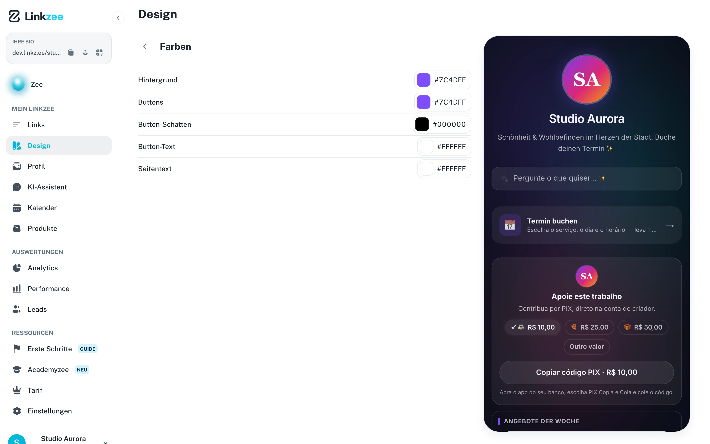

Ein Theme gibt dir mit einem Tipp einen kompletten Look. Wenn du weitergehen
möchtest, bietet dir Linkzee **kuratierte** Einstellungen, um die Details zu
verfeinern. Du wählst aus Optionen, die aufeinander abgestimmt sind, sodass
nichts jemals kollidiert.

<Frame caption="Das Farben-Panel: volles Spektrum, Hex und Vorschläge — mit Sofort-Vorschau.">
  
</Frame>

Jede Änderung erscheint sofort in der Live-Vorschau — auf dem Desktop rechts,
auf dem Handy unter dem Editor — und wird beim Arbeiten automatisch gespeichert.

## Was du anpassen kannst

<AccordionGroup>
  <Accordion title="Kopfbereich" icon="user">
    Lege fest, wie dein Name, dein Foto und dein Logo oben auf deiner Seite sitzen:
    - **Klassisch**: ein kompakter runder Avatar mit deinem Namen und deiner Bio.
    - **Hero**: ein Foto **oder ein kurzes Video**, das über den oberen Rand
      der Seite läuft (siehe [Profil](/de/your-page/header)).
    - **Banner**: ein Titelbild mit deinem darüber platzierten Avatar.
    - **Freisteller**: du, ohne Hintergrund, über deiner Seite. Lade ein
      **transparentes PNG oder WebP** hoch; ein Bild ohne Transparenz wird für
      dieses Layout nicht angenommen.
    - **Form**: dein Porträt in einer organischen Kontur. Wähle **Organisch**,
      **Organisch 2**, **Bogen** oder **Weiches Quadrat** und eine Farbe für
      die Form (oder lass die Themenfarbe).

    Mit **Bildausschnitt anpassen** ziehst und zoomst du das Foto im Layout.
    Mit einem Hero-Video kannst du außerdem dein Logo darüber platzieren,
    deckend oder als Glas (Premium), mit einem Rand in deiner Avatarfarbe.
  </Accordion>
  <Accordion title="Avatar" icon="circle-user">
    Lege fest, wie dein Foto oben auf der Seite erscheint: **Keiner**, **Ring**,
    **Farbiger Ring**, **Schatten** oder **Leuchten**, mit einer **Avatarfarbe**
    deiner Wahl. Solange du nichts auswählst, gilt der Effekt des Themes. Das
    Layout Hero zeigt das Foto randlos, daher gibt es dort keinen Avatar-Effekt.
  </Accordion>
  <Accordion title="Hintergrund" icon="image">
    Lege deinen Hintergrundstil fest. Jeder Stil zeigt ein echtes Muster, und
    seine Optionen erscheinen direkt darunter. Die Hauptfarbe kommt aus
    **Farben**; Stile, die zwei Farben mischen, ergänzen ein Feld **Zweite Farbe**.

    | Stil | Optionen |
    | --- | --- |
    | **Vollfarbe** | Nur die Farbe. |
    | **Verlauf** | **Benutzerdefiniert** (zwei Farben, Richtung **Nach oben**, **Nach unten** oder **Radial**) oder **Vorgefertigt** (15 fertige Verläufe wie Sonnenuntergang, Ozean und Mitternacht, mit Textfarben, die darauf gut lesbar sind). **Animieren** lässt ihn sanft wandern; **Körnige Textur** fügt eine dezente Körnung hinzu. |
    | **Blur** | Weiche Farbschleier mit **Intensität** und **Position** (Oben, Mitte oder Diffus). |
    | **Muster** | 10 Muster (Punkte, Raster, Wellen, Waben und mehr) in deiner Farbe, mit **Größe** und **Intensität**. |
    | **Netz** | Ineinanderfließende Farbflächen in drei Anordnungen: **Klassisch**, **Ecken** oder **Mitte**. |
    | **Bild** | Dein eigenes Foto, mit **Foto abdunkeln** (Leicht, Mittel, Stark), damit der Text lesbar bleibt, und optionalem **Weichzeichner**. Du kannst den Ausschnitt anpassen. |
    | **Duoton** | Dein Foto in zwei Farben: deiner Hauptfarbe und einer **Zweiten Farbe**. |
    | **Video** | Ein kurzer Clip in Endlosschleife. |

    **Video** nimmt eine MP4- oder MOV-Datei mit bis zu 40 MB an und
    optimiert sie genauso wie das Hero-Video (720p, die ersten 30 Sekunden,
    stumm und in Endlosschleife), damit sie schnell lädt. Du kannst es
    jederzeit **Ersetzen** oder **Entfernen**. Besucher, die reduzierte
    Bewegung bevorzugen oder den Datensparmodus aktiviert haben, sehen
    stattdessen das Cover-Bild.
  </Accordion>
  <Accordion title="Layout des Produkt-Schaufensters" icon="grip">
    Lege fest, wie dein Produkt-Schaufenster dargestellt wird: **Standard**,
    ein aufgeräumtes Raster; **Masonry**, ein Mosaik aus Karten mit
    unterschiedlichen Höhen; oder **Karussell**, bei dem jede Kategorie zu
    einem horizontalen Regal wird, das du auf dem Handy wischst (am Computer
    mit Pfeilen), mit einem Button **„Alle ansehen (n)"**, der die ganze
    Kategorie direkt an Ort und Stelle ausklappt. Du kannst auch den
    Kartenstil und die Darstellung der Fotos festlegen (siehe
    [Produkt-Schaufenster](/de/products/overview#schaufenster-einstellungen)).
  </Accordion>
  <Accordion title="Buttons" icon="square">
    Lege den **Stil** der Buttons fest (Gefüllt, Umrandet, Sanft oder **Glas**),
    die **Form** der Buttons (Abgerundet, Leicht abgerundet oder Eckig) und den
    **Schatten** des Buttons (Keine, Weich, Stark oder Hart). Den Schatten
    kannst du völlig frei einstellen.
  </Accordion>
  <Accordion title="Text" icon="font">
    Wähle deine **Schriftart** aus einer kuratierten Liste, gruppiert in
    Serifenlos, Serif sowie Mono & Display. Oder öffne **Paare** für fertige
    Kombinationen: eine Schrift für Name und Überschriften, eine für Fließtext,
    in Stimmungen wie Editorial, Modern, Boutique oder Verspielt.
  </Accordion>
  <Accordion title="Farben" icon="palette">
    Lege die Farbe von Hintergrund, Buttons, Button-Schatten, Button-Text und
    Seitentext fest. Jede Zeile öffnet einen **vollständigen Farbwähler**
    (Spektrum, Hex-Code, Pipette und vorgeschlagene Farbfelder), sodass du
    genau deine Markenfarbe treffen kannst, nicht nur Voreinstellungen.

    Ist eine Kombination schwer lesbar, erscheint der Hinweis **Geringer
    Kontrast, schwer lesbar** mit einem Vorschlag, damit deine Seite lesbar
    bleibt.
  </Accordion>
  <Accordion title="Social-Icons" icon="share-nodes">
    Lege fest, wie deine Social-Icons aussehen: **Standard** (folgt dem Theme),
    **Symbole**, **Gefüllt**, **Umrandet** oder **Buttons**. Gefüllt und
    Umrandet nutzen deine Buttonfarbe; Buttons zeigen den Namen jedes Netzwerks.
  </Accordion>
  <Accordion title="Karten" icon="clone">
    Lege den Look der Karten auf deiner Seite fest: **Einfarbig**, **Glas**,
    **Neon** oder **Sanft**, mit **Ecken**, die dezent, mittel oder rund sind.
  </Accordion>
  <Accordion title="Bewegung" icon="wand-magic-sparkles">
    Lege die **Intensität der Animationen** deiner öffentlichen Seite fest:
    **Aus**, **Dezent** oder **Standard**. Besucher, die weniger Bewegung
    bevorzugen, sehen immer die statische Version. Hier findest du auch den
    **Bühnenmodus** (Premium), mit dem deine Seite auf die Musik deiner
    Spotify-Karte reagiert (siehe [Spotify](/de/your-page/spotify)).
  </Accordion>
</AccordionGroup>

<Note>
  Die vorgeschlagenen Farbfelder und die integrierten Schriften sind kostenlos.
  Premium-Optionen sind mit einem Abzeichen markiert, und du kannst sie in
  jedem Tarif ausprobieren: eine **eigene Farbe** (außerhalb der
  vorgeschlagenen Farbfelder), der **Glas**-Button-Stil, die Hintergründe
  **Bild**, **Netz**, **Duoton** und **Video**, der **radiale** und die
  **vorgefertigten** Verläufe, **Animieren**, ein **Hero-Video**, das Glas-Logo
  über dem Video sowie Premium-Schriften und -Paare. Du siehst sie in der
  Live-Vorschau, aber ist **dieses Geschäft** auf Free, behält seine
  öffentliche Seite ihren letzten kostenlosen Look, bis du für dieses Geschäft
  upgradest (siehe [Tarif pro Geschäft](/de/billing/plan-per-store)).
</Note>

### Premium-Änderungen speichern oder verwerfen

Im Free-Tarif pausiert das automatische Speichern, sobald du eine
Premium-Option anwendest, und oben im Design-Bildschirm erscheinen die Buttons
**Speichern** und **Verwerfen**.

- **Verwerfen** stellt den aktuell veröffentlichten Look wieder her.
- **Speichern** öffnet die Upgrade-Optionen. Sobald das Geschäft einen
  bezahlten Tarif hat, wird alles veröffentlicht, was du eingestellt hast.

Kostenlose Optionen werden wie gewohnt automatisch gespeichert.

<Warning>
  Wenn du erneut ein fertiges Theme auswählst, werden diese Anpassungen auf den
  Look dieses Themes zurückgesetzt.
</Warning>

## Nächste Schritte

<CardGroup cols={2}>
  <Card title="Themes" icon="swatchbook" href="/de/design/themes">
    Starte mit einem kompletten, fertigen Look und verfeinere ihn dann hier.
  </Card>
  <Card title="Design im Überblick" icon="palette" href="/de/design/overview">
    Erfahre, wie Themes und Anpassungen zusammenspielen.
  </Card>
</CardGroup>
