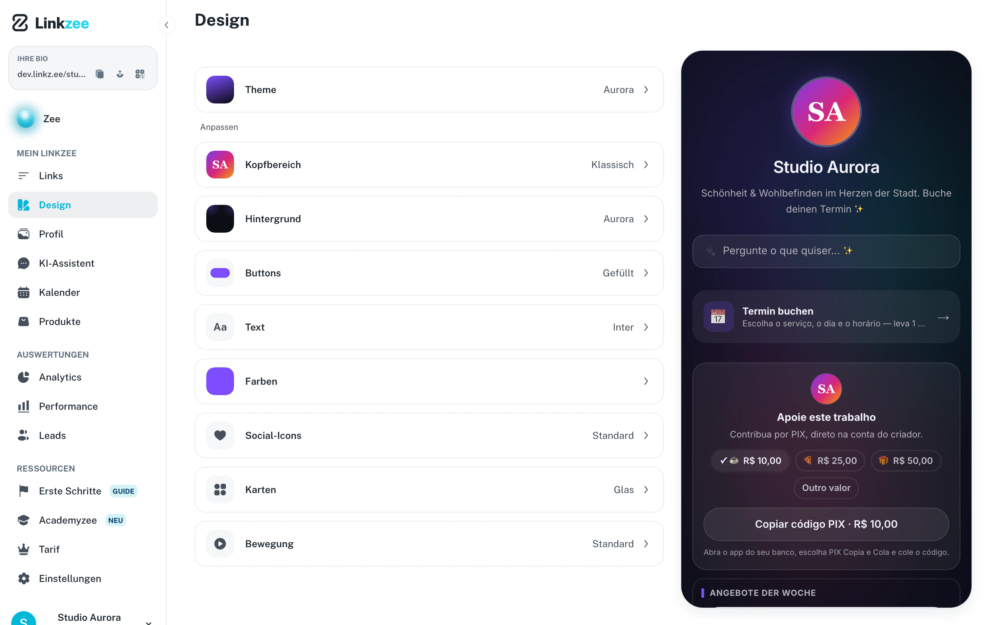

Die **Theme-Galerie** ist der Ort, an dem du deinen Look wählst. Jedes Theme ist
eine **vollständige, fertige Palette** — Hintergrund, Buttons, Schriften und
Textfarben, die bereits zusammenpassen — sodass ein einziger Tipp deine ganze
Seite auf einmal neu gestaltet.

<Frame caption="Design: Theme wählen und die Live-Vorschau folgt jeder Änderung.">
  
</Frame>

## Ein Theme wählen

Tippe auf ein Theme, um es sofort anzuwenden. Die Live-Vorschau
aktualisiert sich umgehend (auf dem Desktop rechts, auf dem Handy unter dem
Editor), und deine Auswahl wird automatisch gespeichert — es gibt keinen
**Speichern**-Button, an den du denken musst.

Du kannst das Theme jederzeit wechseln. Ein neues Theme ersetzt den bisherigen
Look, sodass du ganz einfach ein paar ausprobieren und dich für das richtige
entscheiden können.

## Premium-Themes

Einige Themes in der Galerie tragen das **Premium**-Abzeichen. Du kannst sie in
jedem Tarif anwenden und in der Vorschau ansehen; veröffentlicht werden sie auf
deiner Seite mit einem kostenpflichtigen Tarif.

- **Onyx** — warmes Schwarz und gebürstetes Gold, der Name in Serifenschrift und
  ein goldener Hauptbutton für die wichtigste Aktion (z. B. **Termin buchen**).
  Deine Social-Links erscheinen als Buttons mit dem Namen des Netzwerks. Gemacht
  für Barbershops, Salons und Studios.

- **Perle** — das helle Gegenstück zu Onyx: sanftes Porzellan, weiße Karten,
  Überschriften in Serifenschrift in Bronze und ein graphitfarbener Hauptbutton.
  Passt gut zu echten Fotos und Videos oben auf der Seite. Gemacht für Studios,
  Salons, Kliniken und Praxen.

- **Cinema** — ein dunkles Schaufenster für Produkte: warmes Kino-Schwarz, in
  dem Produktfotos mit weißem Hintergrund wie Leuchtkästen wirken, ein
  elfenbeinfarbener Hauptbutton und die Markenfarbe nur als Signatur (der Punkt
  bei „Im Fokus“, das Rabatt-Abzeichen). Gemacht für Affiliates und
  Produkt-Shops. Passt zum Kartenstil **Spotlight** (siehe
  [Produkte](/de/products/overview)).
## Selbst nachjustieren

Am Ende der Galerie findest du die Option **Individuell**. Damit passt du die
Details an — Kopfbereich-Layout, Hintergrund, Buttons, Schriften und Farben —
über das hinaus, was das Theme für dich festlegt.

<Note>
  Wenn du erneut ein fertiges Theme wählst, werden alle individuellen
  Anpassungen auf den Look dieses Themes zurückgesetzt.
</Note>

<CardGroup cols={2}>
  <Card title="Deine Seite anpassen" icon="sliders" href="/de/design/customizing">
    Feinabstimmung von Kopfbereich, Hintergrund, Buttons, Schriften und Farben.
  </Card>
  <Card title="Design-Überblick" icon="palette" href="/de/design/overview">
    Sieh dir alles an, was du auf deiner Linkzee-Seite gestalten kannst.
  </Card>
</CardGroup>
