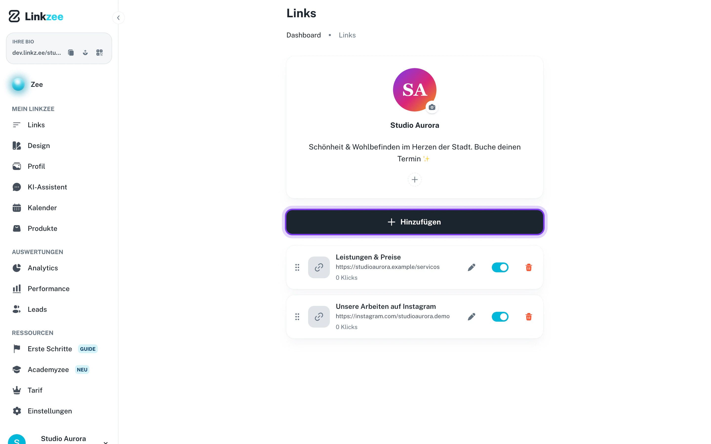
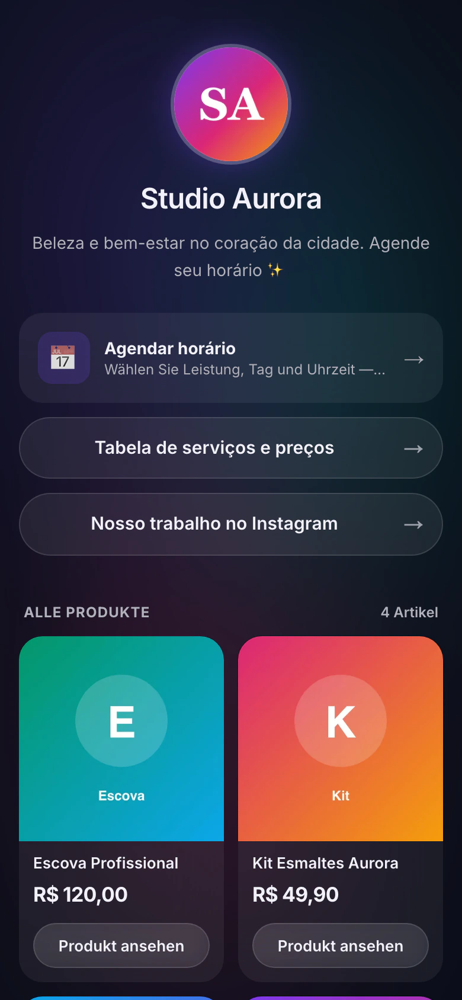

Diese Anleitung führt Sie von der Registrierung bis zu einer live geschalteten
Seite unter `linkz.ee/your-name`, bereit für Ihre Bio. Es dauert nur wenige Minuten.

<Frame caption="Der Mein-Linkzee-Editor: Links hinzufügen und die Live-Vorschau sehen.">
  
</Frame>

<Steps>
  <Step title="Konto erstellen">
    Registrieren Sie sich mit **E-Mail und Passwort** oder wählen Sie
    **Mit Google fortfahren** für den Start mit einem Klick, ohne sich ein
    Passwort merken zu müssen. Weitere Details finden Sie unter
    [Konto erstellen](/de/get-started/create-account).
  </Step>
  <Step title="E-Mail bestätigen">
    Wenn Sie sich mit E-Mail und Passwort registriert haben, öffnen Sie die
    Aktivierungs-E-Mail von Linkzee und klicken Sie auf den Link, um Ihr Konto
    zu aktivieren. Wenn Sie **Mit Google fortfahren** verwendet haben, ist Ihr
    Konto bereits aktiv — überspringen Sie diesen Schritt.
  </Step>
  <Step title="Erzählen Sie von Ihrer Arbeit">
    Das geführte Onboarding beginnt mit Ihrem Bereich und damit, wie Ihre Bio
    Ihnen helfen kann. Danach wählen Sie, wie Ihre Kunden Sie erreichen. Die
    vorgeschlagene Reihenfolge der Kanäle folgt der Gewohnheit in Ihrem Land
    (zum Beispiel WhatsApp zuerst in Brasilien, Telefon zuerst in Japan, SMS
    zuerst in den USA und Kanada), und Sie können das Land ändern. Mit
    **Text ändern** passen Sie den Text des Haupt-Buttons an. Links, die Sie
    hinzufügen, erhalten einen Namen nach ihrem Typ, und Sie können jeden
    Button umbenennen. Die WhatsApp- oder Telefonnummer, die Sie hier angeben,
    wird auch in Ihrem Konto gespeichert.
  </Step>
  <Step title="Fotos hinzufügen">
    Laden Sie ein **Profilfoto**, ein **Titelbild** und bis zu 3 Fotos von
    **Deine Arbeit** hoch. Mit **Neu zuschneiden** passen Sie den Ausschnitt von
    Profilfoto und Titelbild jederzeit an.
  </Step>
  <Step title="Prüfen und veröffentlichen">
    Wählen Sie in Schritt 4 die Adresse Ihrer Seite unter **Deine Adresse**.
    Linkzee prüft die Verfügbarkeit, während Sie tippen, und schlägt
    Alternativen vor, wenn Ihre Wunschadresse vergeben ist. Die Regeln finden
    Sie unter [Ihr Benutzername](/de/get-started/your-username). Ein fertiges
    Theme wird nach Ihren Logofarben gewählt und mit **Deine Marke**
    gekennzeichnet; Sie können jedes andere Theme wählen. Bei den Fotos Ihrer
    Arbeit bearbeiten Sie den Titel des Abschnitts und fügen auf Wunsch jedem
    Foto eine Bildunterschrift hinzu. Öffnen Sie **Vollbild ansehen**, um Ihre
    Bio so zu sehen wie Ihre Besucher, und tippen Sie dann auf **Bearbeiten**
    oder **Meine Bio veröffentlichen**.
  </Step>
  <Step title="Seite teilen und Dashboard kennenlernen">
    In Schritt 5 ist Ihre Bio unter `linkz.ee/your-name` online. Kopieren Sie
    den Link und setzen Sie ihn in Ihre Instagram- oder TikTok-Bio. Öffnen Sie
    dann **Lerne dein Dashboard kennen**: Dort ändern Sie alles, wann Sie
    wollen, und sehen, wer über Ihre Bio kommt. Klicken Sie auf **+ Hinzufügen**,
    um weitere Elemente hinzuzufügen, etwa einen **Link**, ein **Produkt** oder
    ein **Soziales Netzwerk**.
  </Step>
</Steps>

<Note>
  Es gibt keinen „Speichern"-Button — alles, was Sie bearbeiten, wird
  automatisch gespeichert, und die Live-Vorschau aktualisiert sich in Echtzeit
  (rechts am Desktop; am Handy tippen Sie auf **Vorschau**, um sie im
  Vollbild zu öffnen).
</Note>

## Wie geht es weiter

<CardGroup cols={2}>
  <Card title="Ihre Seite" icon="table-cells" href="/de/your-page/overview">
    Bauen Sie Ihre Seite auf: fügen Sie Links, soziale Netzwerke sowie Ihren
    Namen, Ihr Foto und Ihre Bio hinzu.
  </Card>
  <Card title="Design & Themes" icon="palette" href="/de/design/overview">
    Wählen Sie ein fertiges Theme und passen Sie Farben, Buttons und Hintergrund
    fein an.
  </Card>
</CardGroup>

<Frame caption="Deine öffentliche Seite: Bio, Termine, Schaufenster und Assistent in einem Link.">
  
</Frame>
