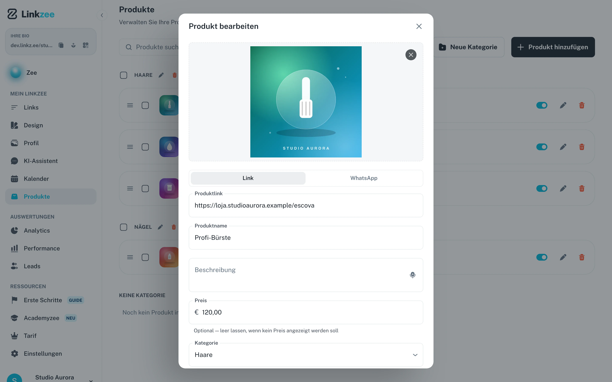

Wenn du ein Produkt hinzufügst, wird aus einem Affiliate-Link eine Karte in deinem
Schaufenster. Füge den Link ein, und Linkzee liest die Marktplatz-Seite aus, um
die Details zu ergänzen — so musst du nur selten etwas tippen.

<Frame caption="Produktbearbeitung: Name, Bild, Preis und Marketplace-Link an einem Ort.">
  
</Frame>

## Ein Produkt hinzufügen

<Steps>
  <Step title="Das Hinzufügen-Menü öffnen">
    Klicke auf deinem **Links**-Bildschirm auf den **+ Hinzufügen**-Button über die
    gesamte Breite.
  </Step>
  <Step title="Produkt auswählen">
    Wähle **Produkt** aus der Liste der Elementtypen.
  </Step>
  <Step title="Den Produktlink einfügen">
    Füge den **Produktlink** vom Marktplatz ein (Shopee, Amazon, Mercado Livre
    und mehr). Linkzee liest die Seite aus und **füllt** Name, Bild und Preis
    **automatisch aus**, wenn es möglich ist.
  </Step>
  <Step title="Prüfen und anpassen">
    Kontrolliere die Felder und bearbeite alles, was nicht automatisch
    ausgefüllt wurde. Dein Produkt erscheint sofort im Schaufenster.
  </Step>
</Steps>

## Produktfelder

| Feld | Hinweise |
| --- | --- |
| **Name** | Erforderlich. |
| **Beschreibung** | Optional, halte sie kurz. |
| **Bild** | Erforderlich — automatisch aus dem Link ausgefüllt oder selbst hochgeladen. |
| **Produktlink** | Die Marktplatz-URL, zu der dein Button die Besucher schickt. |
| **Preis** | Optional, in R$. |
| **Externe Referenz** | Optional. Deine eigene Referenz für dieses Produkt (eine CRM-/ERP-ID oder SKU), um es mit deinen Systemen abzugleichen. |
| **Barcode** | Optional. Der Produkt-Barcode (EAN, GTIN oder UPC). |

<Note>
  Wenn die automatische Ausfüllung einen Shop nicht auslesen kann, trag einfach
  selbst den **Namen** ein und lade ein **Bild** hoch — mehr braucht ein Produkt
  nicht.
</Note>

<Note>
  Externe Referenz und Barcode sind optional und werden nie auf deiner öffentlichen
  Seite angezeigt — sie sind nur für dich. Sie sind auch über die öffentliche
  [API](/de/api-reference/products) und [MCP](/de/integrations/mcp/overview)
  verfügbar, sodass Agenten und deine eigenen Tools sie lesen und schreiben können.
</Note>

Alles, was du bearbeitest, wird automatisch gespeichert, und die Live-Vorschau
aktualisiert sich währenddessen — auf dem Desktop rechts, auf dem Handy unter dem
Editor.

## Nächste Schritte

<CardGroup cols={2}>
  <Card title="Preise & Aktionen" icon="tag" href="/de/products/pricing-promotions">
    Zeig einen Preis, füge ein Aktions-Badge hinzu und hebe dein bestes
    Angebot hervor.
  </Card>
  <Card title="Verknappungs-Countdown" icon="hourglass-half" href="/de/products/scarcity-counter">
    Füge einen laufenden Countdown hinzu, um bei begrenzten Angeboten Dringlichkeit
    zu erzeugen.
  </Card>
</CardGroup>
