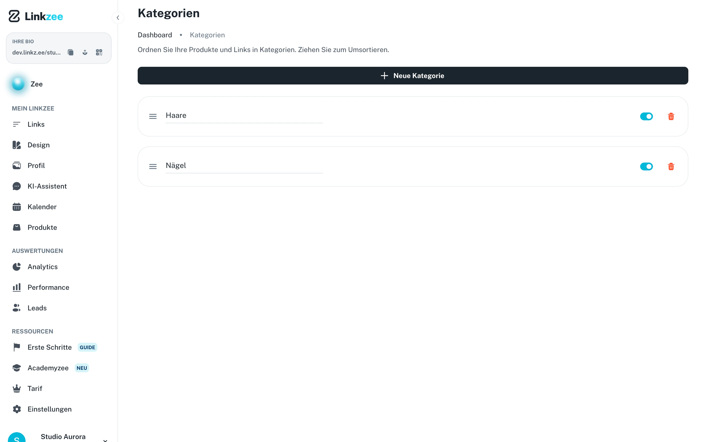

Kategorien halten dein Produkt-Schaufenster organisiert. Wenn du viele Artikel
verkaufst, macht das Gruppieren in **Kategorien** deine Seite übersichtlicher — und
lässt deine Besucher direkt zu dem gelangen, was sie interessiert.

<Frame caption="Schaufenster-Kategorien: Produkte in Gruppen mit Zähler und Reihenfolge.">
  
</Frame>

## So funktionieren Kategorien

Erstelle eine Kategorie, weise ihr Produkte zu und lege die
Reihenfolge fest. Auf deiner öffentlichen Seite können Besucher deine Produkte nach
Kategorie durchsuchen, statt durch eine lange Liste zu scrollen.

<Steps>
  <Step title="Eine Kategorie erstellen">
    Füge eine neue Kategorie hinzu und gib ihr einen klaren Namen, wie „Küche" oder „Bestseller".
  </Step>
  <Step title="Produkte zuweisen">
    Füge der Kategorie Produkte hinzu, damit sie in dieser Gruppe zusammen erscheinen.
  </Step>
  <Step title="Neu anordnen">
    Ziehe deine Kategorien, um die Reihenfolge festzulegen, in der sie in deinem Schaufenster erscheinen.
  </Step>
</Steps>

Alles wird automatisch gespeichert, während du arbeitest, und die Vorschau
aktualisiert sich live — auf dem Desktop rechts, auf dem Handy unter dem Editor.

<Note>
  Kategorien sind das richtige Werkzeug, wenn dein Schaufenster wächst. Wenn du nur
  wenige Produkte hast, kannst du sie überspringen und deine Produkte in einer
  einfachen Gruppe belassen.
</Note>

## Nächste Schritte

<CardGroup cols={2}>
  <Card title="Produkt-Schaufenster" icon="store" href="/de/products/overview">
    Erfahre, wie das Produkt-Schaufenster funktioniert und was jede Karte anzeigt.
  </Card>
  <Card title="Produkte hinzufügen" icon="plus" href="/de/products/adding-products">
    Füge ein Produkt hinzu, indem du den Marktplatz-Link einfügst, und lass Linkzee es ausfüllen.
  </Card>
</CardGroup>
