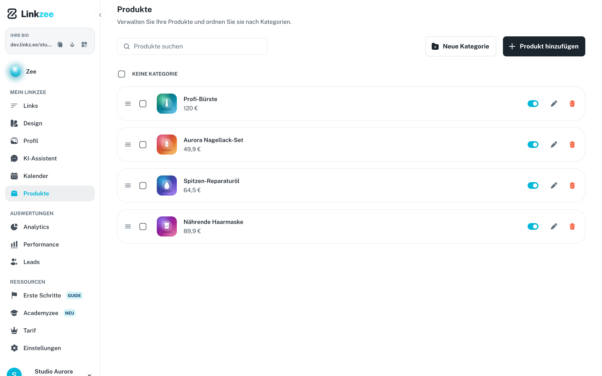

Das **Produkt-Schaufenster** ist Linkzees Vorteil für Affiliates: Es verwandelt
deine Marketplace-Links in einen echten Shop. Statt einer einfachen Linkliste
sehen deine Follower Produkte, die sie mit einem einzigen Tipp durchstöbern und
kaufen können, während du deine Affiliate-Provision behältst.

Es funktioniert mit **Shopee**, **Amazon**, **Mercado Livre** und weiteren
Marketplaces.

<Frame caption="Dein Produkt-Schaufenster im Dashboard.">
  
</Frame>

## So erscheint es auf deiner Seite

Deine Produkte erscheinen **zusammen gruppiert** als dein Schaufenster, damit
deine Seite übersichtlich und leicht durchstöberbar bleibt. Das Layout wählst
du selbst: Unter **Design** entscheidest du dich für das **Standard-Raster**,
das **Masonry-Mosaik** oder das **Karussell**, das jede Kategorie in ein
horizontales Regal mit „Alle ansehen"-Button verwandelt. Jede Produktkarte
zeigt:

| Element | Was es zeigt |
| --- | --- |
| **Bild** | Das Produktfoto |
| **Name** | Der Produkttitel |
| **Preis** | Der Preis in R$, falls du einen festlegst |
| **Aktions-Badge** | Ein kurzer Text wie „ANGEBOT", wenn aktiviert |
| **Verknappungs-Countdown** | Ein Timer, der weiter herunterzählt |
| **Aktions-Button** | Ein Button **unter** der Karte, der Besucher zum Angebot führt |

Wenn ein Besucher auf den Aktions-Button tippt, wird der Klick gezählt und der
Besucher zum Marketplace weitergeleitet, wobei dein **Affiliate-Link** intakt
bleibt.

<Note>
  Alles, was du bearbeitest, wird automatisch gespeichert und aktualisiert deine
  Live-Seite in Echtzeit. Am Desktop steht die Vorschau rechts; am Handy tippst
  du oben auf **Vorschau**, um deine Seite im Vollbild zu sehen.
</Note>

## Entdecke das Schaufenster

<CardGroup cols={2}>
  <Card title="Produkte hinzufügen" icon="plus" href="/de/products/adding-products">
    Füge einen Marketplace-Link ein und lass Linkzee Name, Bild und Preis automatisch ausfüllen.
  </Card>
  <Card title="Preise & Aktionen" icon="tag" href="/de/products/pricing-promotions">
    Lege einen Preis fest, füge ein Aktions-Badge hinzu und hebe dein bestes Angebot hervor.
  </Card>
  <Card title="Verknappungs-Countdown" icon="hourglass-half" href="/de/products/scarcity-counter">
    Erzeuge Dringlichkeit mit einem Countdown, der für jeden Besucher immer frisch wirkt.
  </Card>
  <Card title="Kategorien" icon="layer-group" href="/de/products/categories">
    Ordne ein großes Schaufenster, damit Besucher nach Kategorie stöbern können.
  </Card>
</CardGroup>

## Schaufenster-Einstellungen

Öffne die **Schaufenster-Einstellungen** über das Zahnrad auf der
Schaufenster-Karte unter **Inhalt** oder unter **Design → Vitrine**. Jede
Auswahl greift sofort:

| Einstellung | Optionen |
| --- | --- |
| **Raster-Spalten** | **2 Spalten** oder **1 Spalte**. |
| **Rasterstil** | **Standard**, **Masonry** oder **Karussell**. |
| **Kartenstil** | **Klassisch** oder **Spotlight** (siehe unten). |
| **Fotos** | **Intelligent (empfohlen)** entscheidet pro Foto: Ein quadratisches Foto füllt die Karte, ein Panorama wird zu einer zweispaltigen Karte, und der Rest erscheint vollständig auf einem weichen Hintergrund. **Immer vollständig** beschneidet das Foto nie und füllt den übrigen Platz mit einer unscharfen Version davon. **Ausfüllen** schneidet von der Mitte aus zu, sodass jede Karte gefüllt ist, ideal für einheitliche Studiofotos. |

Mit dem Schalter des Schaufensters kannst du es außerdem ganz von deiner
Seite ausblenden, ohne ein Produkt zu löschen.

## Reihenfolge im Schaufenster

Oben im Bereich **Produkte** legt die **Reihenfolge im Schaufenster** fest, wie
die Produkte auf deiner Seite stehen:

| Option | So funktioniert es |
| --- | --- |
| **Neueste zuerst** | Die Standardeinstellung. Neue Produkte erscheinen zuerst. |
| **Individuell** | Das Schaufenster folgt deiner Reihenfolge, und neue Produkte kommen nach oben. Beim ersten Mal startet die Reihenfolge mit der aktuellen Liste. |

Wenn du zurück zu **Neueste zuerst** wechselst, bleibt deine individuelle
Reihenfolge gespeichert: Wähle wieder **Individuell**, und sie ist zurück.
Die Änderung gilt sofort, ohne Bestätigung.

Auf dem Bildschirm **Schaufenster** im Menü ziehst du die Karten, um die
Reihenfolge zu ändern. Die neue Reihenfolge speichert sich von selbst und
schaltet **Individuell** ein.

Du kannst ein Produkt auch verschieben, indem du
[Zee](/de/zee/using-zee) darum bittest, zum Beispiel „setz den Geschenkgutschein
nach oben“, oder die [API](/de/api-reference/products) nutzt. Wenn du ein
Produkt verschieben, während das Schaufenster auf **Neueste zuerst** steht,
schaltet das **Individuell** ein, mit einer neuen Reihenfolge aus der Liste, die
du siehst, anstelle der gespeicherten.

## Kartenstil Spotlight

Unter **Design → Vitrine → Kartenstil** stellst du die Produktkarten von
**Klassisch** (Foto oben; Name, Preis und Button darunter) auf **Spotlight** um:
Das Foto füllt den Kartenrahmen, und Name, Preis und ein Glas-Button stehen
direkt darunter, auf einem sanften Schein aus den Farben des Fotos selbst. Der
Text verdeckt das Produkt nie. Abzeichen wie ein Rabatt erscheinen als kleine
Glas-Pillen am unteren Rand des Fotos. Deine Seite bleibt klassisch, bis du
wechseln.

Mit Spotlight bekommt die Vitrine außerdem:

- **Im Fokus**: eine Karte in voller Breite an der Stelle des Karussells mit
  dem Produkt, das du als Highlight markiert hast. Ohne Highlight übernimmt
  das meistgeklickte Produkt, beschriftet mit „diese Woche am meisten geklickt“.
- **Redaktioneller Rhythmus**: im Raster wird jede dritte von fünf Karten
  zweispaltig, wie in einem Lookbook.
- **Kategorien mit Foto**: die Kategorie-Chips werden zu Kreisen mit dem
  neuesten Produktfoto jeder Kategorie. Nach dem Scrollen heften sich die Chips
  unter der Suche fest.
- **Buttons ohne Zeilenumbruch**: lange Button-Texte werden auf halbbreiten
  Karten zu einem kurzen Verb mit dem Aktions-Icon („Bestellen“ + WhatsApp,
  „Ansehen“ + ↗); der volle Text erscheint auf der Fokus-Karte und den breiten
  Karten. Tipp: Texte in der Ich-Form verkaufen besser: „Ich will das“, „Will
  diesen Look“, „Meins sichern“ (das Produktformular schlägt sie vor).
- **Adresskarte**: im Kartenblock tauscht die Option **Darstellung** die
  offene Karte gegen eine kompakte Adresskarte mit Logo, Adresse, heutigen
  Öffnungszeiten und „Route“.
