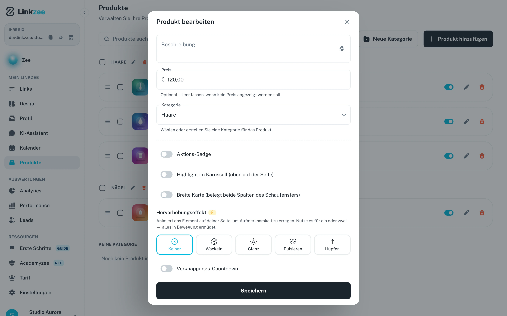

Lass deine Produkte im Schaufenster hervorstechen. Mit einem Preis, einem
Aktions-Badge und der Highlight-Option machst du aus einem schlichten
Affiliate-Link ein Angebot, auf das die Leute tippen möchten. Jede Änderung, die
du hier vornimmst, wird automatisch gespeichert und aktualisiert die
Live-Vorschau sofort.

<Frame caption="Aktionspreis, Angebots-Badge und Verknappungs-Countdown — im selben Fenster.">
  
</Frame>

## Einen Preis festlegen

**Preis** ist optional. Zeig ihn an, wenn er den Verkauf unterstützt, oder
lass ihn weg, wenn du das lieber nicht möchtest.

- Gib den Preis in **R$** ein, um ihn auf der Produktkarte anzuzeigen.
- Lass ihn leer, und die Karte zeigt einfach keinen Preis an.

<Note>
  Wenn du ein Produkt über einen Marktplatz-Link hinzugefügt hast, ist der
  Preis möglicherweise bereits für dich ausgefüllt. Du kannst ihn jederzeit
  anpassen oder löschen.
</Note>

## Einen Aktions-Badge hinzufügen

Der **Aktions-Badge** setzt eine kurze Beschriftung auf die Produktkarte, um ein
Angebot zu signalisieren.

<Steps>
  <Step title="Badge aktivieren">
    Öffne das Produkt und schalte **Aktions-Badge** ein.
  </Step>
  <Step title="Einen kurzen Text schreiben">
    Lege eine kurze Beschriftung fest, etwa `OFFER` oder `50% OFF`. Halte
    sie kurz, damit sie auf die Karte passt.
  </Step>
</Steps>

Der Badge erscheint auf der Karte in der Live-Vorschau, sobald du ihn festlegst.

## Dein bestes Angebot hervorheben

Aktiviere **Highlight**, damit ein Produkt größer und oben in deinem
Schaufenster erscheint, sodass es das Erste ist, was Besucher sehen.

Nutze Highlight für dein bestes Angebot — den Deal, auf den die Leute am
meisten aufmerksam werden sollen.

<CardGroup cols={2}>
  <Card title="Countdown zur Verknappung" icon="hourglass-half" href="/de/products/scarcity-counter">
    Füge einen tickenden Countdown hinzu, um deiner Aktion Dringlichkeit zu geben.
  </Card>
  <Card title="Produkte hinzufügen" icon="plus" href="/de/products/adding-products">
    Füge einen Marktplatz-Link ein und lass Linkzee die Details ausfüllen.
  </Card>
</CardGroup>
