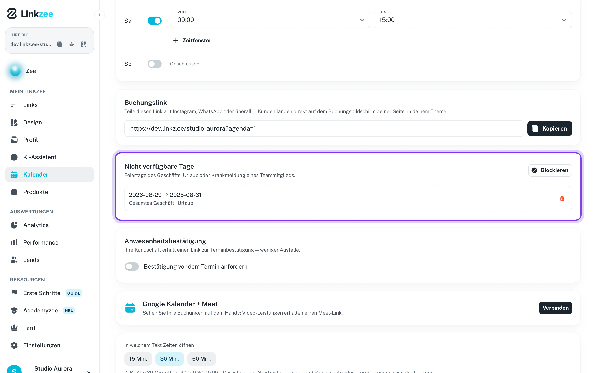

Manchmal kannst du keine Termine annehmen — ein Feiertag, ein freier Tag oder
jemand aus deinem Team ist abwesend. Mit **Sperrungen** schließt du diese Zeiten,
damit Besucher sie nicht buchen können.

<Frame caption="Nicht verfügbare Tage: Urlaub blocken — der Assistent blendet die Termine aus.">
  
</Frame>

Wenn eine Zeit gesperrt ist, wird sie im Buchungsassistenten einfach nicht mehr
angeboten. Deine regulären Geschäftszeiten bleiben unverändert; die Sperrung
schneidet nur die Zeiten heraus, in denen du nicht verfügbar bist.

## Zwei Arten von Sperrungen

<CardGroup cols={2}>
  <Card title="Geschäftssperre" icon="calendar-xmark">
    Schließt den gesamten Kalender — niemand kann buchen. Nutze sie für einen
    Feiertag oder einen Tag, an dem du komplett schließt.
  </Card>
  <Card title="Teammitglied-Sperre" icon="user-xmark">
    Schließt die Zeiten einer einzelnen Person — alle anderen bleiben buchbar.
    Nutze sie für den Urlaub oder einen Krankheitstag eines Teammitglieds.
  </Card>
</CardGroup>

<Note>
  Eine **Teammitglied-Sperre** betrifft nur die Person, die du auswählst. Der Rest
  deines Teams nimmt weiterhin wie gewohnt Termine an.
</Note>

Sobald eine Sperrung eingerichtet ist, verschwinden die betroffenen Zeiten sofort
aus den Optionen deiner Besucher, und deine Live-Seite aktualisiert sich automatisch.

## Sperren und verknüpfte Kalender

Eine Sperre gilt nur in diesem Betrieb: Sie wird **nicht** in die anderen Kalender der Person übertragen (oft gibt es die Sperre gerade, weil die Person am anderen Ort ist). Nur Termine werden übertragen. Siehe [Verknüpfte Kalender](/de/scheduling/linked-calendars).

<CardGroup cols={2}>
  <Card title="Geschäftszeiten" icon="clock" href="/de/scheduling/business-hours">
    Lege die Tage und Zeiträume fest, an denen du normalerweise verfügbar bist.
  </Card>
  <Card title="Team" icon="users" href="/de/scheduling/team">
    Füge die Personen hinzu, die Termine annehmen, und gib jeder ihre
    eigenen Zeiten.
  </Card>
</CardGroup>
