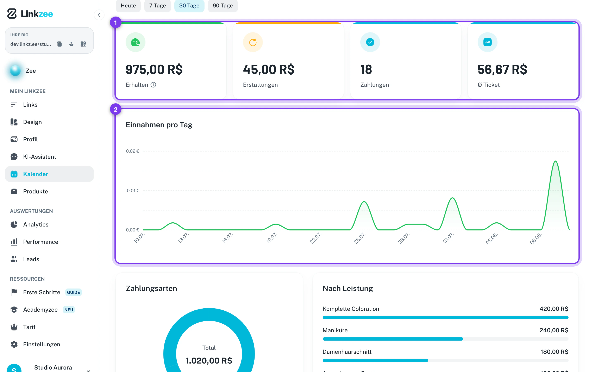

**Einnahmen** ist ein eigener Menüpunkt in deinem Dashboard — eine
Seite mit deiner gesamten Finanzübersicht: was reinkam, von wem, mit welcher
Zahlungsart, für welche Leistung — mit Diagrammen, einer durchsuchbaren
Transaktionsliste und deinen Auszahlungen direkt darunter.

<Note>
  Einnahmen war früher ein Tab im Kalender. Jetzt ist es eine eigene Seite im
  Hauptmenü — der alte Tab verweist nur noch hierher.
</Note>

Wenn eine Buchungszahlung bestätigt wird, schickt Linkzee dir außerdem eine
Push-Benachrichtigung — **„💰 Du hast \{Betrag\} erhalten"** — und ein Tipp
darauf öffnet diese Seite. Siehe
[Push-Benachrichtigungen](/de/account/notifications).

<Frame caption="Einnahmen — ① Zeitraumsummen, ② deine Einnahmen pro Tag.">
  
</Frame>

## Die Zahlen

Wähle den Zeitraum — **Heute**, **7 Tage**, **30 Tage** oder **90 Tage** —
und du siehst:

<CardGroup cols={2}>
  <Card title="Erhalten" icon="wallet">
    Von Kunden im Zeitraum gezahlter Gesamtbetrag, abzüglich Erstattungen.
  </Card>
  <Card title="Erstattungen" icon="rotate-left">
    An Kunden zurückgezahlte Beträge (Stornierungen innerhalb deiner Richtlinie).
  </Card>
  <Card title="Zahlungen" icon="circle-check">
    Wie viele Buchungszahlungen stattfanden.
  </Card>
  <Card title="Ø Ticket" icon="chart-line">
    Erhalten geteilt durch die Anzahl der Zahlungen.
  </Card>
</CardGroup>

Unter den Karten: ein **Tagesdiagramm** deiner Einnahmen, die Aufschlüsselung
nach **Zahlungsart** (Karte, PIX…) und deine **umsatzstärksten Leistungen**.

## Transaktionen

Die Liste liest sich wie ein Kontoauszug. Eine Zahlung erscheint als
**positive** Zeile — Kunde, Leistung, Zahlungsart, Datum und Betrag. Neben
Buchungszahlungen enthält die Liste auch **Paketverkäufe** und
**Abo-Abbuchungen**, jeweils entsprechend gekennzeichnet (siehe
[Sitzungspakete](/de/scheduling/packages) und
[Wiederkehrende Abos](/de/scheduling/subscription-plans)). Wird
eine Zahlung erstattet, bleibt die ursprüngliche Zeile stehen und eine
zweite, **negative** Zeile mit dem Label **Erstattung** erscheint am Datum
der Erstattung — du siehst immer die vollständige Bewegung, nicht nur das
Endergebnis. Über die Suche findest du eine Zahlung nach
**Name, Telefon, E-Mail oder Leistung**.

<Note>
  Erstattungen, die du direkt im Stripe-Dashboard vornimmst, erscheinen hier
  ebenfalls innerhalb weniger Augenblicke. Eine externe Erstattung storniert
  den Termin **nicht** — storniere die Buchung zusätzlich im Kalender,
  wenn der Termin nicht stattfindet.
</Note>

## Gebühren-Transparenz

Hat der Plan dieses Geschäfts eine Linkzee-Gebühr auf Buchungszahlungen, stehen
der exakte Betrag und der Prozentsatz des Zeitraums direkt unter den Zahlen — und
im **Scale**-Plan beträgt diese Gebühr **0 %**. Siehe die Tabelle unter
[Buchungen kassieren](/de/scheduling/payments#geb%C3%BChren).

<Note>
  Die Einnahmen zeigen das **aktive Geschäft**. Die Gebühr folgt dem Plan dieses
  Geschäfts — führst du mehr als eines, wechsle also das Geschäft, um die
  Zahlen des anderen zu sehen. Siehe
  [Tarif pro Geschäft](/de/billing/plan-per-store).
</Note>

## Auszahlungen — so kommt das Geld auf deine Bank

Der Abschnitt **Auszahlungen** auf der Einnahmen-Seite erklärt den Geldfluss
und zeigt die offiziellen Zahlen, direkt von Stripe:

1. **Kunde zahlt** — der Betrag landet sofort in deinem Stripe-Guthaben.
2. **Transparente Abzüge** — Stripe zieht die Verarbeitungsgebühr ab, plus die
   Linkzee-Gebühr des Plans dieses Geschäfts (falls vorhanden).
3. **Kommt auf deiner Bank an** — die Auszahlung erfolgt automatisch nach dem
   üblichen Zeitplan deines Landes und der Zahlungsart (PIX ist schneller als
   Karte).

Jede Auszahlung in der Liste zeigt den **exakten Nettobetrag**, der auf deiner
Bank ankommt — mit jedem Abzug im Detail, derselbe offizielle Kontoauszug wie
bei Stripe.

<Note>
  Die Dashboard-Zahlen sind die brutto verarbeiteten Buchungsbeträge. Die
  Stripe-Gebühren werden bei der Auszahlung abgezogen — die endgültigen
  Nettowerte siehst du in der Auszahlungsliste.
</Note>
