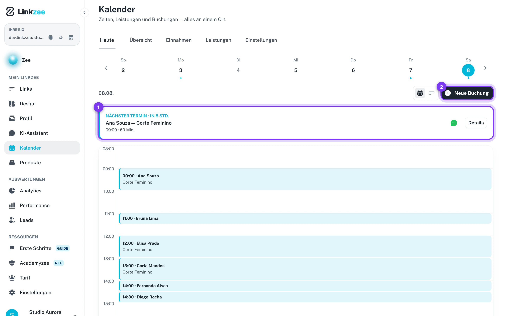

Mit der Terminbuchung kann deine Kundschaft **Termine für deine Leistungen direkt
aus deiner Bio buchen**. Aktiviere sie unter **Kalender**, und auf deiner
Seite erscheint eine Buchungskarte, sodass Besucher einen Termin reservieren
können, ohne dein Linkzee zu verlassen.

<Frame caption="Der Kalender öffnet in Heute: Wochenleiste, nächster Termin und die Tages-Zeitleiste.">
  
</Frame>

## Drei Einrichtungen, eine Engine

Die Terminbuchung passt sich an deine Arbeitsweise an. Wähle die Einrichtung,
die zu deinem Geschäft passt: alle laufen auf derselben zugrunde liegenden Engine.

| Modus | Für wen | So funktioniert es |
| --- | --- | --- |
| **Nur ich** | Eine Person (Nageldesign, Tätowierer:in) | Besucher wählen einfach eine Uhrzeit. |
| **Mein Team** | Praxen, Salons | Jedes Teammitglied hat eigene Zeiten und Leistungen, und der Besucher wählt die Person. |
| **Nach Plätzen** | Sportplätze, Gruppenkurse | Pro Zeitfenster sind mehrere Plätze verfügbar. |

## So buchen Besucher

Auf deiner Seite erscheint eine Buchungskarte im Stil deines Themes. Besucher buchen
in einem einfachen, schrittweisen Assistenten: sie wählen, was sie brauchen,
sehen die tatsächlich freien Zeiten und bestätigen. Die verfügbaren Zeiten richten
sich nach der **Zeitzone deines Geschäfts**, die du unter **Kalender →
Einstellungen** festlegen, sodass alle die richtigen Zeitfenster sehen.

<Note>
  Wie alles in Linkzee werden deine Änderungen an der Terminplanung automatisch
  gespeichert, und die Vorschau aktualisiert sich live. Am Desktop steht sie
  rechts; am Handy tippst du oben auf **Vorschau**, um deine Seite im Vollbild
  zu sehen.
</Note>

### Das Telefonfeld

Jedes Telefonfeld auf deiner Seite (Buchung, Warteliste, Pakete und Abos,
Kundenbereich und Kontaktformulare) zeigt neben der Nummer die **Landesflagge
und die Ländervorwahl**. Es startet im Land des Besuchers, erkannt über seine
Verbindung, sonst im Land deines Unternehmens. Besucher tippen auf die Flagge,
um aus einer Liste ein anderes Land zu wählen, die sich nach Name oder Vorwahl
durchsuchen lässt. Eine Nummer, die mit `+` und einer Vorwahl beginnt, stellt
die Flagge von selbst um.

Scheint eine Nummer aus einem anderen Land zu sein, schlägt das Feld vor, dieses
Land zu **verwenden**. Passt sie zu beiden Ländern, bestätigt der Besucher vor
dem Senden, welches gilt. So bleibt jeder Kunde bei einer einzigen
Telefonnummer, und seine Buchungen, Guthaben und sein Kundenbereich bleiben
zusammen. Das Gerät merkt sich das gewählte Land für das nächste Mal.

### Die Buchungskarte oben

Die Buchungskarte ist **oben auf deiner Seite fixiert**, direkt unter deinem Namen.
Sie ist die wichtigste Aktion deiner Bio. Neben dem Button **Termin buchen** zeigt
sie die **nächsten freien Termine** einer Leistung: Besucher tippen auf eine Zeit
und landen direkt bei der Bestätigung, Leistung und Uhrzeit sind schon gewählt.

Welche Leistung dort erscheint, wählst du unter **Links** in der Agenda-Karte bei
**Hervorgehobene Leistung**. Bei **Automatisch** zeigen wir die in den letzten
30 Tagen am häufigsten gebuchte Leistung.

### Die Buchungskarte ausblenden

Die Buchungskarte ist standardmäßig eingeschaltet. Um sie auszublenden, geh
zu **Kalender → Einstellungen** und schalte **Buchungskarte oben auf
der Seite anzeigen** aus, direkt unter **Kalender auf meiner Seite aktiv**. Nur
die Karte verschwindet von deiner Seite: Die Terminbuchung bleibt aktiv, und
Besucher buchen weiterhin über:

- deinen [Buchungslink](/de/scheduling/booking-link) (`linkz.ee/ihr-name?agenda=1`);
- die [Leistungsübersicht](/de/scheduling/services) auf deiner Seite;
- die Schaltflächen **„Jetzt buchen“** deiner [Links](/de/your-page/links) und jede
  andere Schaltfläche, die mit einer Leistung oder einem Paket verknüpft ist.

Kunden, die auf ihrem Gerät schon gebucht haben, behalten oben eine Abkürzung:
Sie sehen **Dein nächster Termin**, wenn einer ansteht, sonst **Meine
Buchungen**.

<Warning>
  Ist auch die Leistungsübersicht ausgeschaltet, warnt dich das Panel: Ohne die
  Karte oben können Kunden nur über deinen Buchungslink oder mit Leistungen
  verknüpfte Schaltflächen buchen. Tippe auf **Buchungslink ansehen**, um
  dorthin zu springen und ihn zu teilen, damit dir keine Buchungen entgehen.
</Warning>

Über den [MCP-Server](/de/integrations/mcp/tools-reference) macht
`configure_agenda` dasselbe mit `showTopCard: false` (oder `true`, um die Karte
wieder anzuzeigen).

## Du nutzt schon Qzee?

Wenn dein Unternehmen seine Termine in Qzee verwaltet, kannst du deinen
**Qzee-Kalender** statt des Linkzee-Kalenders oben in die Bio setzen. Kunden
buchen direkt in Qzee, und deine Bio nimmt Buchungen immer nur über einen
Kalender an. Siehe [Qzee-Kalender in der Bio](/de/scheduling/qzee-booking).

## Einrichten

<CardGroup cols={2}>
  <Card title="Leistungen" icon="list-check" href="/de/scheduling/services">
    Lege die Leistungen an, die gebucht werden können, mit Dauer, Preis und mehr.
  </Card>
  <Card title="Tage und Zeiten" icon="clock" href="/de/scheduling/business-hours">
    Lege fest, wann du verfügbar bist, und deine Buchungsregeln.
  </Card>
  <Card title="Team" icon="users" href="/de/scheduling/team">
    Füge die Personen hinzu, die Termine annehmen, und die Leistungen, die sie anbieten.
  </Card>
  <Card title="Buchungen kassieren" icon="credit-card" href="/de/scheduling/payments">
    Anzahlung oder Gesamtbetrag bei der Buchung, direkt an dich gezahlt.
  </Card>
  <Card title="Einnahmen & Auszahlungen" icon="sack-dollar" href="/de/scheduling/earnings">
    Was du erhalten hast, wer gezahlt hat und wie es auf deine Bank kommt.
  </Card>
  <Card title="Bewertungen" icon="star" href="/de/scheduling/reviews">
    Echte Bewertungen nach jedem Termin, angezeigt dort, wo gebucht wird.
  </Card>
  <Card title="Warteliste" icon="user-clock" href="/de/scheduling/waitlist">
    Stornierte Termine automatisch der nächsten Person angeboten.
  </Card>
  <Card title="Google Calendar" icon="calendar-plus" href="/de/scheduling/google-calendar">
    Verbinde deinen Kalender, damit Buchungen mit Google Meet auf deinem Handy erscheinen.
  </Card>
  <Card title="Sitzungspakete" icon="ticket" href="/de/scheduling/packages">
    Verkaufe Sitzungsbündel im Voraus. Die Guthaben werden bei der Buchung automatisch eingelöst.
  </Card>
  <Card title="Wiederkehrende Abos" icon="arrows-rotate" href="/de/scheduling/subscription-plans">
    Monatliche oder jährliche Abonnements mit unbegrenzten Sitzungen, Guthaben oder Rabatten.
  </Card>
  <Card title="Kundenbereich" icon="circle-user" href="/de/scheduling/customer-area">
    Eine private Seite, auf der Kunden Buchungen, Guthaben und Abonnements im Blick behalten.
  </Card>
  <Card title="Qzee-Kalender" icon="calendar-days" href="/de/scheduling/qzee-booking">
    Schon bei Qzee? Setz deinen Qzee-Kalender oben in die Bio.
  </Card>
</CardGroup>
