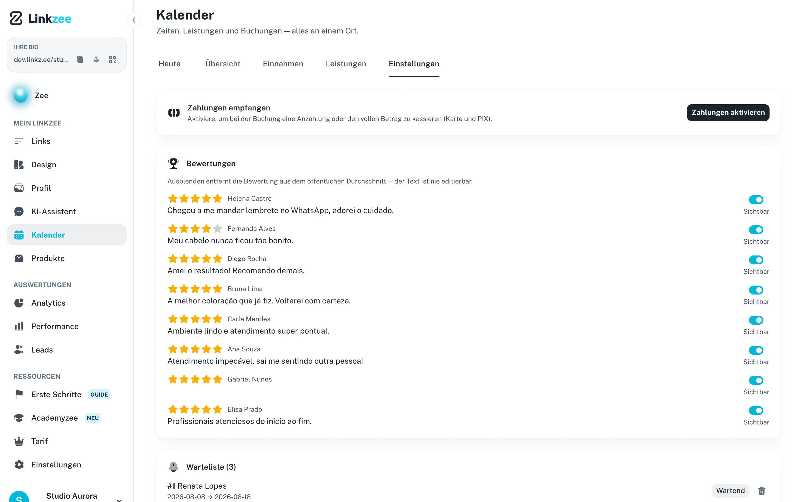

Mach aus jeder Leistung eine bezahlte Buchung: Verlange eine
**Anzahlung** oder den **Gesamtbetrag** in dem Moment, in dem der Besucher
bucht. Das Geld geht **direkt an dich** über Stripe, den Zahlungspartner von
Linkzee — Linkzee hält dein Geld zu keinem Zeitpunkt.

<Frame caption="Die Einnahmen-Seite: Zahlungen aktivieren und Guthaben und Auszahlungen am selben Ort verfolgen.">
  
</Frame>

## Zahlungen aktivieren

1. Öffne **Einnahmen** im Dashboard-Menü und suche die Karte
   **Zahlungen empfangen**.
2. Tippe auf **Zahlungen aktivieren**. Du wirst zu **Stripe**
   weitergeleitet, um dein sicheres Zahlungskonto mit eigenem Login anzulegen —
   das passiert **nur beim ersten Mal**. Halte deine Daten (privat oder
   Unternehmen) und deine Bankverbindung bereit.
3. Danach zeigt die Karte **Aktiv** — und dein Guthaben und deine Auszahlungen
   erscheinen direkt dort auf der **Einnahmen**-Seite.

<Note>
  Das Stripe-Konto gehört dir: Guthaben, Auszahlungsplan und das vollständige
  Stripe-Dashboard sind deine. Falls Stripe später eine zusätzliche Verifizierung
  benötigt, erscheint ein Hinweis auf der Einnahmen-Seite — und ein
  schließbarer Warnhinweis im gesamten Dashboard — lösbar, ohne Linkzee zu
  verlassen.
</Note>

## Lege fest, was jede Leistung kassiert

Öffne eine Leistung unter **Kalender → Leistungen** und wähle die
**Online-Bezahlung**:

| Modus | Was passiert |
| --- | --- |
| **Nicht kassieren** | Die Buchung funktioniert wie bisher — ohne Zahlungsschritt. |
| **Anzahlung** | Der Besucher zahlt einen Teil im Voraus — einen **Prozentsatz** des Preises oder einen **festen Betrag**, den du festlegst. |
| **Gesamtbetrag** | Der Besucher zahlt die komplette Leistung, um zu bestätigen. |

## Was dein Besucher sieht

Wenn die Leistung kassiert, erscheint am Ende der Buchung ein
**Zahlungsschritt** — außer die
[Paket- oder Abo-Guthaben](/de/scheduling/packages) des Besuchers decken den
gesamten Betrag; dann wird der Zahlungsschritt übersprungen:

1. Der Termin wird **20 Minuten reserviert**, während bezahlt wird.
2. Bezahlt wird per **Karte** — oder per **PIX**, wenn du PIX in den
   Zahlungsmethoden deines Stripe-Kontos aktiviert hast (Brasilien).
3. Die Buchung wird **in dem Moment bestätigt, in dem die Zahlung durchgeht** —
   dann gehen Bestätigungen, Erinnerungen und der Google-Meet-Link (falls
   vorhanden) raus.

Ein **Countdown** im Zahlungsformular zeigt, wie lange der Termin noch
reserviert ist. Läuft die Zeit ab, weicht das Formular einem klaren Hinweis
mit der Schaltfläche **Erneut buchen** — und der Termin wird automatisch
wieder frei, keine toten Slots.

### Nach der Zahlung

Der Bestätigungsbildschirm zeigt alles zur Buchung — Leistung, Datum und
Uhrzeit, Teammitglied und den **bezahlten Betrag** — plus den
Verwaltungslink. Bei Online-Leistungen erscheint der **Google-Meet-Link**
direkt auf diesem Bildschirm, sobald er erzeugt wurde. Bezahlte Buchungen
erhalten außerdem den Link **Beleg ansehen** mit dem Stripe-Beleg — er ist
auch in der Bestätigungs-E-Mail enthalten und bleibt auf der
Verwaltungsseite der Buchung verfügbar.

## Erstattungen

Wird eine bezahlte Buchung **innerhalb deiner Stornierungsrichtlinie**
storniert (vom Besucher oder von dir), wird die Zahlung **automatisch
vollständig erstattet** — inklusive der Linkzee-Gebühr.

Dein Kunde bleibt informiert: die **Storno-E-Mail** erklärt, dass der Betrag
auf die ursprüngliche Zahlungsmethode zurückgeht, und die Verwaltungsseite
der Buchung zeigt **Erstattung läuft**, bis daraus **Zahlung erstattet**
wird.

Du kannst eine Zahlung auch direkt in deinem **Stripe-Dashboard** erstatten.
Sie erscheint innerhalb weniger Augenblicke in deinen Linkzee-**Einnahmen** —
und der Termin wird dadurch **nicht** storniert: Geld und Kalender sind
getrennte Entscheidungen; storniere die Buchung zusätzlich, wenn der
Termin nicht stattfindet.

## Gebühren

Stripe berechnet seine übliche Verarbeitungsgebühr pro Transaktion
(aufgeschlüsselt in jeder Auszahlung). Zusätzlich behält Linkzee eine kleine
Gebühr pro Buchungszahlung, abhängig vom Plan des **Geschäfts, in dem die
Buchung entstanden ist**:

| Plan | Linkzee fee per payment |
| --- | --- |
| Free | 4% |
| Essential | 2% |
| Pro | 1% |
| **Scale** | **0%** |

Stripe's processing fee for your country applies on top (for example, in
Brazil: 3.99% + R$0.39 for domestic cards, 1.19% for Pix). The exact total of
every payment always shows up in **Earnings**.

<Note>
  Pläne gehören zu jedem einzelnen Geschäft. Führst du mehr als eines, folgt
  die Gebühr also dem Geschäft, in dem die Buchung entstanden ist — bei einer
  Buchung in einem Free-Geschäft bleiben es 4 %, selbst wenn ein anderes
  Geschäft von dir im Scale-Plan ist. Siehe
  [Tarif pro Geschäft](/de/billing/plan-per-store).
</Note>

Die Gebühr wird in dem Moment festgelegt, in dem die Zahlung erzeugt wird — ein
späteres Upgrade ändert also die Gebühr neuer Buchungen, nicht die bereits
bezahlter.

Die exakten Beträge siehst du jederzeit unter **Einnahmen**, direkt im
Dashboard-Menü — nichts bleibt verborgen. Siehe
[Einnahmen & Auszahlungen](/de/scheduling/earnings).
