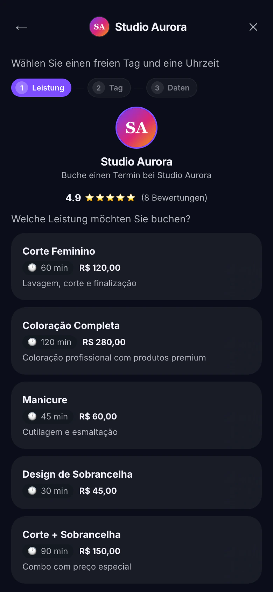

Sozialer Beweis verkauft. Nach jedem Termin bittet Linkzee deinen Kunden um eine
kurze Bewertung — deine **Durchschnittsnote mit Sternen** erscheint genau dort,
wo neue Besucher entscheiden, und der Tab **Bewertungen** verwandelt dieses
Feedback in Gespräche.

<Frame caption="Deine Durchschnittsnote erscheint genau dort, wo Besucher eine Leistung wählen.">
  
</Frame>

## So werden Bewertungen gesammelt

Etwa **2 Stunden nach Ende des Termins** erhält der Kunde die Bitte um eine
Bewertung — per **WhatsApp** (wenn dein WhatsApp-Kanal aktiv ist) oder per
**E-Mail**. Der Link öffnet eine einfache Seite: **1 bis 5 Sterne** und ein
optionaler Kommentar. Kein Konto, keine Hürden.

<Note>
  Bewerten kann nur, wer **tatsächlich gebucht hat** — jeder Bewertungslink
  gehört zu genau einem Termin, und jeder Termin kann **nur einmal** bewertet
  werden. Keine Fake-Bewertungen, keine Duplikate.
</Note>

## Der Tab Bewertungen

Öffne **Kalender → Bewertungen**. Der obere Bereich der Seite zeigt deinen
Ruf auf einen Blick: **Durchschnittsnote**, wie viele Bewertungen du hast,
und die Verteilung von 5 bis 1 Stern.

Daneben steht die Zahl, die am meisten zählt: wie viele Bewertungen
**Aufmerksamkeit brauchen**.

### Bewertungen, die Aufmerksamkeit brauchen

Jede Bewertung mit **3 Sternen oder weniger**, um die du dich noch nicht
gekümmert hast, landet in dieser Warteschlange. Sie ist nicht dazu da, versteckt
zu werden — sie ist dazu da, **beantwortet** zu werden.

<Steps>
  <Step title="Öffne den Filter Aufmerksamkeit">
    Klicke auf den Chip **Aufmerksamkeit** (oder den Zähler oben), um nur
    die Bewertungen zu sehen, die noch auf dich warten.
  </Step>
  <Step title="Sprich mit dem Kunden">
    Nutze die Schaltfläche **WhatsApp** oder **E-Mail** an der Bewertung.
    Die WhatsApp-Nachricht ist bereits für die Situation vorformuliert — du
    kannst sie vor dem Senden bearbeiten.
  </Step>
  <Step title="Als bearbeitet markieren">
    Sobald du mit der Person gesprochen hast, klicke auf das
    Häkchen-Symbol. Die Bewertung verlässt die Warteschlange und erhält das
    Label **Erledigt**.
  </Step>
</Steps>

<Tip>
  Ein Kunde, der sich beschwert und einen Rückruf erhält, kommt oft wieder. Die
  Warteschlange sorgt dafür, dass keine schlechte Bewertung unbeantwortet
  bleibt — und dass du an einem Ort siehst, was immer wieder schiefläuft.
</Tip>

### Eine bestimmte Bewertung finden

Filtere nach **Bewertung**, **Leistung**, **Fachkraft**, oder suche
nach dem Namen des Kunden. Die Chips über der Liste wechseln zwischen **Alle**,
**Aufmerksamkeit**, **Hervorgehoben** und **Ausgeblendet**. Lange Listen laden
in Seiten — klicke unten auf **Mehr laden**.

Nach Fachkraft zu filtern beantwortet eine Frage, die sonst schwer zu erkennen
ist: ob eine Person in deinem Team den Durchschnitt nach oben oder unten zieht.

### Was jede Bewertung zeigt

| Element | Was es dir sagt |
| --- | --- |
| Sterne und Kommentar | Genau das, was der Kunde geschrieben hat — nie bearbeitbar |
| Name des Kunden | Der Name aus der Buchung |
| Kontakt | WhatsApp- und E-Mail-Schaltflächen, um mit diesem Kunden zu sprechen |
| Leistung | Welche Leistung bewertet wurde |
| Fachkraft | Wer den Termin übernommen hat, wenn du ein Team hast |
| Datum | Wann die Bewertung eingegangen ist |

## Per WhatsApp um eine Bewertung bitten

Zusätzlich zur automatischen Anfrage per E-Mail (einige Stunden nach dem Termin,
an Kunden mit E-Mail-Adresse) kannst du über **dein eigenes WhatsApp** fragen:
Öffne den Termin unter **Heute** oder in der **Liste** und tippe auf
**Per WhatsApp um Bewertung bitten**. Die Nachricht ist fertig formuliert, mit
dem Bewertungslink dieses Termins. Die Option erscheint für Termine der letzten
14 Tage, die noch nicht bewertet wurden.

Nach der Bewertung werden deine Kunden eingeladen, **auch bei Google zu
bewerten** (wenn dein Google-Link eingerichtet ist) – unabhängig von der Note.

## Hervorheben und Ausblenden

Zwei Aktionen steuern, was die Öffentlichkeit sieht:

- **Hervorheben** (Stern-Symbol) — die Bewertung wandert an die erste Stelle im
  [Bewertungsblock](/de/your-page/reviews-block) auf deiner Seite.
- **Ausblenden** (Augen-Symbol) — die Bewertung zählt nicht mehr in deinen
  öffentlichen Durchschnitt und erscheint nie auf deiner Seite. Für dich bleibt
  sie sichtbar, und du kannst sie jederzeit wieder einblenden.

<Note>
  Bewertungen können ausgeblendet, aber niemals **bearbeitet oder gelöscht**
  werden — genau das hält deine Note für Besucher glaubwürdig. Ausblenden
  entfernt eine Bewertung auch nicht aus der Aufmerksamkeits-Warteschlange: Das
  Gespräch mit diesem Kunden zählt weiterhin.
</Note>

## Wo deine Note erscheint

Im Bewertungsblock deiner Seite baut das Layout **Komplett** den Bereich
**Bewertungen** auf: die Durchschnittsnote deiner verifizierten Bewertungen, die
Schaltfläche **Bewerten** (zu deinem Google-Link) und Kundenstimmen im Karussell,
mit **Alle ansehen**. Der Durchschnitt zählt alle Bewertungen, die du nicht
ausgeblendet haben; die gewählte Mindestnote gilt nur für die angezeigten
Kundenstimmen.

- Auf deiner **Buchungsseite**, als Durchschnitt und Anzahl (zum Beispiel
  ⭐ 4,9 · 23), genau dort, wo Besucher eine Leistung wählen.
- Auf deiner **Linkzee-Seite**, wenn du den
  [Bewertungsblock](/de/your-page/reviews-block) hinzufügen — mit den
  Bewertungen selbst, nicht nur der Zahl.

<CardGroup cols={2}>
  <Card title="Bewertungsblock" icon="comment-dots" href="/de/your-page/reviews-block">
    Zeig deine verifizierten Bewertungen auf deiner Linkzee-Seite.
  </Card>
  <Card title="Team" icon="users" href="/de/scheduling/team">
    Füge Fachkräfte hinzu und sieh dir die Bewertung jeder einzelnen an.
  </Card>
</CardGroup>
