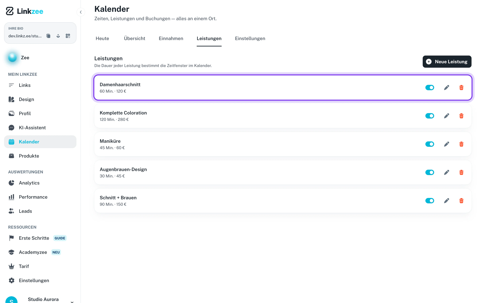

Leistungen sind das, was deine Besucher buchen. Bevor jemand eine Uhrzeit wählen
kann, richtest du die Liste der Leistungen ein, die du anbietest — jede mit
eigener Dauer, eigenem Preis und eigenem Stil. Lege sie unter **Kalender**
an; alles, was du änderst, wird automatisch gespeichert und erscheint sofort in
der Live-Vorschau.

<Frame caption="Deine Leistungen: Dauer, Preis und ein Schalter zum Pausieren.">
  
</Frame>

## Eine Leistung anlegen

Lege für jede buchbare Sache eine Leistung an — einen Haarschnitt, eine
Beratung, eine Tattoo-Sitzung. Für jede Leistung legst du fest:

| Feld | Was es bewirkt |
| --- | --- |
| **Name** | Wie die Leistung heißt (zum Beispiel „Gel-Maniküre"). |
| **Dauer** | Wie lange der Termin dauert. |
| **Preis** | Optional — anzeigen oder weglassen. |
| **Pause nach dem Termin** | Zusätzliche Zeit, die *nach* dem Termin reserviert wird, damit du nie Termin an Termin gebucht bist. Die Zeit direkt nach einem Termin erscheint erst wieder auf deiner Seite, wenn die Pause vorbei ist. |
| **Farbe** | Eine Farbe, um deine Leistungen auf einen Blick zu unterscheiden. |
| **Beschreibung** | Eine kurze Zeile, die erklärt, was enthalten ist. |
| **Online-Meeting** | Aktivieren, um automatisch einen **Google Meet**-Link zu erstellen. |

Lege die Felder fest, die für jede Leistung wichtig sind — nur **Name** und
**Dauer** sind zwingend erforderlich, der Rest bleibt dir überlassen.

## Kombis

Ein **Kombi** bündelt 2 oder mehr deiner Leistungen in einem buchbaren Element —
„Schnitt + Bart", „Beratung + Nachtermin" — mit **eigenem Preis und eigener
Dauer** (oft günstiger als einzeln zu buchen). Erstelle ihn unter
**Leistungen**, indem du den Typ **Kombi** wählst und die enthaltenen
Leistungen markierst; deine Seite listet den Inhalt automatisch auf.

Besucher können ihr Paket auch selbst zusammenstellen: Nach der Wahl einer
Leistung können sie **eine weitere Leistung** zum selben Besuch hinzufügen —
Linkzee addiert die Dauern und findet einen Termin, in den alles passt (mit
Team werden nur Fachkräfte angeboten, die *alle* gewählten Leistungen
ausführen).

## Leistungsübersicht auf deiner Seite

Mit aktiver Agenda zeigt deine Seite eine **Leistungsübersicht** – wie eine
Preisliste: Name, Dauer, Preis (oder „Auf Anfrage“, wenn die Leistung keinen
Preis hat) und eine Schaltfläche zum Buchen. Tippt man auf eine Leistung,
öffnet sich die Buchung direkt mit ihr – deine Kunden müssen sie nicht erneut
auswählen.

- **Kategorien werden zu Tabs.** Füll beim Anlegen **Kategorie** aus
  (z. B. Haare, Bart, Pflege). Die Tabs folgen der Reihenfolge deiner
  Leistungen; ohne Kategorien erscheint eine einzige Liste.
- **Bis zu 4 Leistungen pro Tab**, und **Alle ansehen** öffnet die ganze Liste.
- **Abzeichen „Beliebt“**: erscheint automatisch bei der Leistung mit den
  meisten Buchungen der letzten 30 Tage (mindestens 3 Buchungen, kein
  Gleichstand). Es sind immer echte Daten.
- **Kombis** sind mit „Kombi“ gekennzeichnet.

Um die Übersicht auf deiner Seite zu verschieben oder auszublenden, nutze
die Karte **Leistungsübersicht** unter **Links**: zieh sie an eine andere
Stelle oder schalte sie aus.

## Leistung kassieren

Jede Leistung kann bei der Buchung online kassieren — eine **Anzahlung**
(prozentual oder fest) oder den **Gesamtbetrag**. Stell es pro Leistung
unter **Online-Bezahlung** ein; siehe
[Buchungen kassieren](/de/scheduling/payments) zum Aktivieren der Zahlungen.

Leistungen lassen sich auch im Voraus in
[Sitzungspaketen](/de/scheduling/packages) verkaufen oder als Vorteile in
[wiederkehrende Abos](/de/scheduling/subscription-plans) aufnehmen.

## Online-Meetings

Aktiviere **Online-Meeting** für jede Leistung, die per Video stattfindet.
Wenn es aktiviert ist, erstellt Linkzee für jede Buchung automatisch einen
**Google Meet**-Link, sodass du keinen von Hand versenden musst.

<Note>
  Wenn bei einer Leistung **Online-Meeting** aktiviert ist, wird die **E-Mail-Adresse
  des Besuchers bei der Buchung zur Pflicht** — so wird ihm der Meet-Link
  zugestellt.
</Note>

Um Online-Meetings zu nutzen, verbinde zuerst deinen Google Calendar. Siehe
[Google Calendar](/de/scheduling/google-calendar) für die Einrichtung.

## Nächste Schritte

<CardGroup cols={2}>
  <Card title="Geschäftszeiten" icon="clock" href="/de/scheduling/business-hours">
    Lege fest, wann du verfügbar bist und nach welchen Regeln gebucht werden kann.
  </Card>
  <Card title="Google Calendar" icon="calendar-plus" href="/de/scheduling/google-calendar">
    Verbinde Google, um Buchungen zu synchronisieren und automatisch Meet-Links zu erstellen.
  </Card>
</CardGroup>
