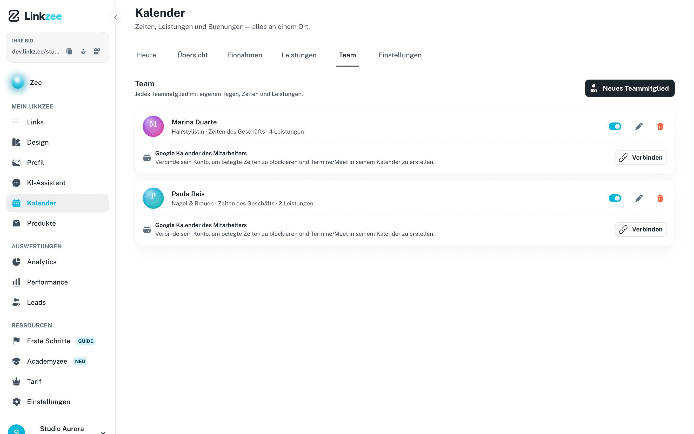

Füge die Personen hinzu, die Termine in deinem Kalender wahrnehmen. Sobald
du ein Team hast, können Besucher **wählen**, bei wem sie buchen möchten,
bevor sie eine Uhrzeit auswählen.

<Frame caption="Der Team-Tab: Profis mit Foto, Rolle und den Leistungen, die jede:r übernimmt.">
  
</Frame>

## Ein Teammitglied hinzufügen

<Steps>
  <Step title="Kalender öffnen">
    Geh zu **Kalender** und öffne den Bereich **Team**.
  </Step>
  <Step title="Die Person hinzufügen">
    Klicke auf **+ Hinzufügen** und trag die Angaben ein.
  </Step>
  <Step title="Leistungen auswählen">
    Wähle, welche deiner Leistungen diese Person anbietet.
  </Step>
</Steps>

Für jedes Teammitglied legst du fest:

| Sieht und macht | Sieht nie |
| --- | --- |
| Den eigenen Tagesplan (dieselbe Ansicht wie deine): eigene Termine bestätigen, abschließen, als nicht erschienen markieren, verschieben und absagen | Die Termine der anderen Mitarbeiter |
| Einen Kunden in den eigenen Plan einschieben und die eigene Zeit sperren (frei, Mittag) | Deinen Umsatz, Gebühren oder Auszahlungen |
| Name, Telefon und Leistung des Kunden bei eigenen Terminen; eigene Provisionen und Abrechnung | Deinen Seiteneditor, Einstellungen oder Tarif |
| Eigene Zeiten und Leistungen (nur lesen — du legst sie fest) und den eigenen Google Kalender | Zeiten und Leistungen der anderen |
Wer einen bezahlten Termin über das Portal absagt, löst dieselbe Erstattung
aus wie du. Jeder Abschluss (erledigt oder nicht erschienen) speichert, wer
ihn gemacht hat. Außerhalb der Zeiten einschieben bleibt dir vorbehalten:
Mitarbeiter schieben nur in freie Zeiten ein. Tippt ein Mitarbeiter auf die
Terminbenachrichtigung am Handy, öffnet sich der Termin direkt im eigenen Plan.
| **Leistungen** | Die Leistungen, für die diese Person Buchungen annehmen kann. |
| **Eigene Zeiten** | Optional. Die persönliche Verfügbarkeit dieser Person. |

## Eigene Zeiten

Jede Person kann **eigene Zeiten** haben. Lässt du sie leer, übernimmt die
Person einfach deine Geschäftszeiten. Lege sie fest, wenn jemand nach einem
anderen Zeitplan als das übrige Team arbeitet — siehe [Geschäftszeiten](/de/scheduling/business-hours).

## Von Einzelperson zum Team

Sobald du dein **erstes** Teammitglied hinzufügst, wird aus einem Einzelkalender
ein **Team**-Kalender — ohne Migration und ohne zusätzliche Einrichtung. Alles,
was du bereits erstellt hast, funktioniert weiter; Besucher erhalten nur den
zusätzlichen Schritt, zu wählen, bei wem sie buchen.

<Note>
  Alles, was du hier änderst, wird automatisch gespeichert, und die Vorschau
  aktualisiert sich live — auf dem Desktop rechts und auf dem Handy unter dem
  Editor.
</Note>

## Gib jeder Fachkraft einen eigenen Bereich

Eine Fachkraft kann einen **eigenen Zugang** zu Linkzee haben — mit ihrem
Kalender und ihren Provisionen, und sonst nichts von deinem Geschäft.

<Steps>
  <Step title="Sende die Einladung">
    Klicke auf der Karte der Fachkraft auf **Einladen** und gib ihre
    E-Mail-Adresse ein.
  </Step>
  <Step title="Sie nimmt an">
    Sie erhält eine E-Mail mit einem Link, der **7 Tage** gültig ist. Hat sie
    noch kein Linkzee-Konto, erstellt sie es direkt dort (E-Mail und Passwort oder **Mit Google fortfahren**) — das Konto gehört
    ihr, ist kostenlos und hat keine eigene Seite.
  </Step>
  <Step title="Sie ist dabei">
    Ab diesem Moment zeigt ihr eigenes Dashboard **Kalender**, **Provisionen**
    und **Einstellungen** für dein Geschäft — dieselbe App wie bei dir, nur mit
    ihrem Teil. Für das Profilfoto gilt eine einzige Regel: **das neueste Foto
    gilt**. Das Kontofoto erscheint von selbst (und folgt jeder Änderung); lädst
    du später eines auf der Karte hoch, wird deines gezeigt. Beide Seiten sehen,
    woher das Foto stammt, und haben eine Aktion mit einem Tipp (**Foto von
    {Name} verwenden** auf deiner Karte, **Mein Foto verwenden** im Konto) — kein
    Schalter, der synchron gehalten werden muss.
  </Step>
</Steps>

Solange die Einladung offen ist, zeigt die Karte das Label **Eingeladen**. Du
kannst eine Einladung jederzeit widerrufen und eine neue senden — der
vorherige Link funktioniert dann nicht mehr.

### Was sie sieht (und was nicht)

| Sichtbar für die Fachkraft | Nie sichtbar |
| --- | --- |
| Ihre eigenen anstehenden Termine | Die Termine anderer Fachkräfte |
| Ihre eigenen Provisionen und der Kontoauszug | Dein Umsatz, Gebühren oder Auszahlungen |
| Name des Kunden und Leistung für ihre eigenen Termine | Dein Seiteneditor, Einstellungen oder Plan |

Uhrzeiten werden immer in der **Zeitzone deines Geschäfts** angezeigt, sodass
keine Verwirrung entsteht, wenn jemand in einer anderen Region lebt.

### Was sie im eigenen Kalender tun darf

Standardmäßig verwaltet ein Mitglied den eigenen Kalender im Portal: buchen,
verschieben, stornieren, Zeiten blockieren und Anwesenheit markieren (erledigt /
nicht erschienen) für die eigenen Termine. Unter **Kalender → Einstellungen →
Team im eigenen Kalender** legst du fest, was aktiv bleibt:

- **Mitglieder verwalten ihren eigenen Kalender** ist der Hauptschalter.
  Ausschalten deaktiviert alles; Wiedereinschalten stellt die Feineinstellungen
  wieder her.
- **Buchen · Verschieben · Stornieren · Zeiten blockieren · Anwesenheit
  markieren** lassen sich einzeln ausschalten. Üblich ist alles an außer
  Stornieren, damit Stornierungen immer über dich laufen.

Die Regel setzt Linkzee durch, sie wird nicht nur im Portal ausgeblendet: eine
ausgeschaltete Aktion wird mit „Der Inhaber hat diese Aktion für das Team nicht
freigegeben“ abgelehnt. Kalender ansehen und Benachrichtigungen bleiben immer
erlaubt.

### Zugang beenden

Den Zugang zu entfernen, nimmt die Person sofort aus deinem Geschäft — löscht
aber **nicht die Fachkraft**. Ihr Verlauf, ihre Termine und ihr
Provisions-Kontoauszug bleiben genau dort, wo sie sind, und sie behält
Lesezugriff auf den eigenen Kontoauszug.

<Note>
  Der Zugang wird bei jeder Anfrage geprüft, der Widerruf ist also sofort
  wirksam — es gibt kein Zeitfenster, in dem ein ehemaliges Teammitglied noch
  hineinkommt.
</Note>

## Plätze-Modus

Läuft dein Kalender im **Plätze**-Modus — für Plätze, Gruppenkurse oder alles mit
mehreren Plätzen pro Zeitfenster —, legst du statt namentlicher Teammitglieder
eine **Kapazität** pro Uhrzeit fest. Jedes Zeitfenster nimmt dann entsprechend
viele Buchungen an.

## Verknüpfte Kalender

Nimmt eine Fachkraft auch anderswo über Linkzee Termine an (im eigenen Betrieb zum Beispiel), verknüpfst du die Kalender, damit ein Termin dort die Zeit hier blockiert – und umgekehrt. Die Zeile **Verknüpfter Kalender** erscheint auf der Karte der Fachkraft, sobald sie die Team-Einladung angenommen hat. Du siehst nur „Belegt“ – nie den Kunden, die Leistung oder den Namen des anderen Orts. Siehe [Verknüpfte Kalender](/de/scheduling/linked-calendars).

<CardGroup cols={2}>
  <Card title="Geschäftszeiten" icon="clock" href="/de/scheduling/business-hours">
    Lege fest, wann du und dein Team verfügbar seid.
  </Card>
  <Card title="Blockierungen" icon="ban" href="/de/scheduling/blocks">
    Sperre Zeiten für Feiertage, Urlaub oder Krankheitstage.
  </Card>
  <Card title="Team & Google Kalender" icon="user-clock" href="/de/scheduling/team-google-calendar">
    Lass jedes Teammitglied den eigenen Kalender verbinden.
  </Card>
  <Card title="Provisionen" icon="percent" href="/de/scheduling/commissions">
    Lege fest, was jede Fachkraft verdient, und schließe den Zeitraum ab.
  </Card>
</CardGroup>

<Frame caption="Im öffentlichen Assistenten wählen Kund:innen, bei wem sie buchen.">
  
</Frame>
