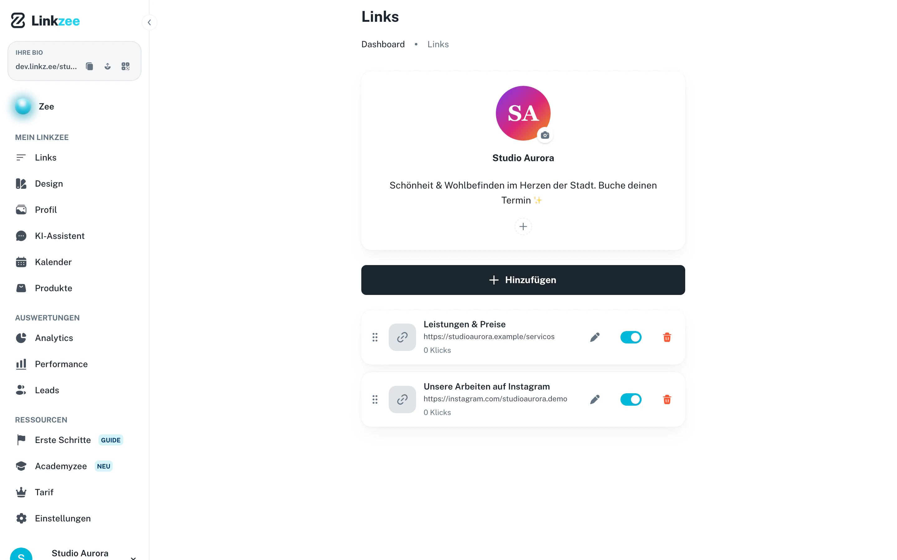

Sammlungen fassen deine Links in beschriftete Abschnitte auf deiner Seite zusammen –
zum Beispiel **Meine Kurse** oder **Rabattgutscheine**. Statt einer langen Liste
stehen deine Links unter klaren Überschriften, die Besucher auf einen Blick erfassen.

<Frame caption="Die Sammlung „Angebote der Woche“: Links gruppiert unter eigenem Titel.">
  
</Frame>

## Eine Sammlung erstellen

<Steps>
  <Step title="Sammlung hinzufügen">
    Erstelle auf dem Bildschirm **Links** eine neue Sammlung und gib ihr
    einen Namen, der beschreibt, was sich darin befindet, etwa **Meine Kurse** oder
    **Rabattgutscheine**.
  </Step>
  <Step title="Links hinzufügen">
    Verschiebe deine Links in die Sammlung, damit sie zusammen unter ihrer
    Überschrift erscheinen.
  </Step>
  <Step title="Jederzeit umbenennen">
    Ändere den Namen der Sammlung, wann immer du möchtest – die neue
    Beschriftung erscheint sofort auf deiner Seite.
  </Step>
  <Step title="Neu anordnen">
    Ziehe Sammlungen und die Links darin, um die Reihenfolge festzulegen, die
    Besucher sehen.
  </Step>
</Steps>

Alles wird automatisch gespeichert, während du arbeitest, und die Vorschau
aktualisiert sich live – auf dem Desktop rechts, auf dem Handy unter dem Editor.

<Note>
  Sammlungen sind für **Links**. Deine Produkte gehören nicht in Sammlungen – sie
  befinden sich stattdessen im Schaufenster. Siehe [Produkte](/de/products/overview).
</Note>

## Verwandt

<CardGroup cols={2}>
  <Card title="Links" icon="link" href="/de/your-page/links">
    Füge die Links auf deiner Seite hinzu und verwalte sie.
  </Card>
  <Card title="Schaufenster" icon="store" href="/de/products/overview">
    Verwandle deine Affiliate-Links in einen echten Shop.
  </Card>
</CardGroup>
