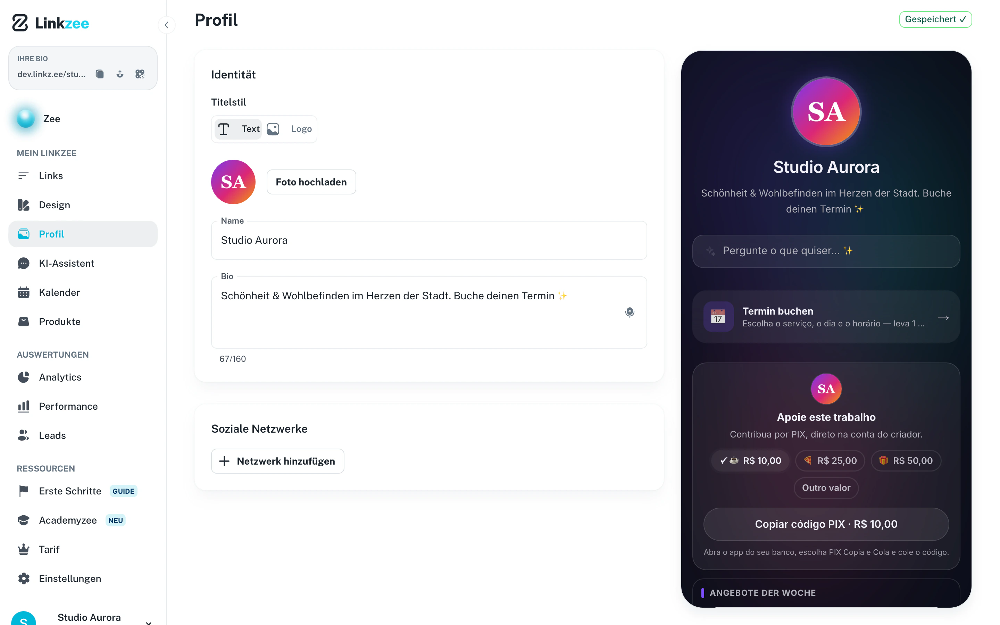

Das **Profil** ist die Identität deiner Seite — das Erste, was Besucher oben auf
deinem Linkzee sehen. Hier legst du fest, wie dein Name erscheint, fügst eine
kurze Bio hinzu und lädst dein Profilfoto hoch.

<Frame caption="Profil: Name, Bio, Foto und die Social-Icons oben auf deiner Seite.">
  
</Frame>

## Titelstil wählen

Wähle, wie dein Titel oben auf deiner Seite angezeigt wird:

- **Text**: Dein Name erscheint als gestalteter Text.
- **Logo**: Dein Profilfoto trägt deine Identität, und der Name als Text wird
  ausgeblendet.

### Logo statt des Namens

Wenn **Logo** ausgewählt ist, erscheint das optionale Feld **Logo statt des
Namens**. Lade die horizontale Version deiner Marke hoch, und sie wird
genau dort angezeigt, wo sonst dein Name stünde. Besucher und Suchmaschinen
lesen deinen Namen weiterhin, er erscheint nur als dein Logo.

- Verwende ein **PNG- oder WebP-Bild** bis **8 MB**.
- Am besten wirkt ein **transparenter Hintergrund** in einer Farbe, die sich
  von deinem Theme abhebt. Hat das Bild keine Transparenz, wird es trotzdem
  gespeichert, und Linkzee weist dich darauf hin, dass sein Hintergrund auf der
  Seite sichtbar ist.
- Mit **Entfernen** nimmst du es jederzeit wieder heraus. Ohne dieses Bild
  funktioniert der Logo-Modus wie bisher.

## Namen und Bio hinzufügen

Gib deinen **Namen** und eine kurze **Bio** ein, die den Besuchern verrät,
wer du bist oder was du teilst. Die Bio darf bis zu **160 Zeichen** lang sein,
und ein Zähler zeigt dir beim Tippen, wie viel Platz noch übrig ist.

<Note>
  Halte deine Bio kurz und klar — eine Zeile, die dich auf den Punkt bringt,
  wirkt auf einem mobilen Bildschirm am besten.
</Note>

### Signatur

Unter der Bio kannst du eine optionale **Signatur** hinzufügen: einen kurzen
Satz deiner Marke, etwa einen Slogan (zum Beispiel „The Art of Beauty.“). Sie
erscheint zentriert unter der Bio, in der Überschriftenschrift deines Themes.
Sie passt in eine Zeile, mit bis zu 60 Zeichen.

## Profilfoto hochladen

Füge ein **Profilfoto** hinzu, damit deine Seite persönlich und
wiedererkennbar wirkt. Es erscheint neben deinem Namen oben auf deiner Seite.

Alles, was du hier änderst, wird sofort in der Live-Vorschau angezeigt — rechts
auf dem Desktop und unter dem Editor auf dem Mobilgerät. Alles wird automatisch
gespeichert, sodass du dir keinen Speichern-Button merken musst.

## Hero-Video

Mit dem Kopfbereich-Layout **Hero** kannst du oben auf deiner Seite statt deines
Fotos ein kurzes Video in Endlosschleife zeigen. Das Hero-Video ist eine
**Premium**-Funktion: Im kostenlosen Tarif siehst du das Schloss, bevor du eine
Datei auswählen, und es wird nichts hochgeladen.

Lade eine **MP4- oder MOV-Datei** mit bis zu **40 MB** hoch — ein Clip vom
Handy oder ein KI-generiertes Video funktionieren gleichermaßen. Linkzee
optimiert das Video automatisch:

- auf **720p** verkleinert und auf die **ersten 30 Sekunden** gekürzt;
- **stumm** — die Tonspur wird immer entfernt, deine Seite spielt also nie Ton ab;
- in Endlosschleife und höchstens **~6 MB** groß, damit es bei Besuchern sofort startet.

Während der Verarbeitung siehst du **„Wird hochgeladen… N %"** und danach
**„Wird optimiert…"**. Wenn gerade viele Videos gleichzeitig verarbeitet
werden, siehst du deinen Platz in der Warteschlange (**„In der Warteschlange:
N vor deinem"**). Du kannst den Bildschirm verlassen: Die Verarbeitung
läuft im Hintergrund weiter, und das Video wird auf deiner Seite angewendet,
sobald es fertig ist.

Das erste Bild wird zum **Cover** des Videos: Es wird angezeigt, während das
Video lädt, und ist das, was Besucher sehen, die reduzierte Bewegung bevorzugen
oder den Datensparmodus aktiviert haben.

Dein Name und deine Bio liegen auf einer sanften Leseplatte in der Grundfarbe
deines Themes, damit der Text auf hellen wie dunklen Videos gleichermaßen lesbar
bleibt — ganz ohne Einstellung.

### Dein Hero-Video verwalten

- Mit dem Umschalter **Foto | Video** wählst du, was der Hero zeigt. Zurück zu
  Foto zu wechseln behält dein Video — nichts wird gelöscht.
- Öffne das Menü **⋯** für weitere Optionen:
  - **Ausschnitt** — zieh und zoome über das Cover, um den Bildausschnitt
    zu wählen; derselbe Ausschnitt gilt für das Video.
  - **Ersetzen** — ein anderes Video hochladen.
  - **Entfernen** — das Video löschen (mit Sicherheitsabfrage).

Besucher bekommen ein kleines ⏯-Steuerelement, um das Video anzuhalten oder
abzuspielen. Auf Geräten, die Autoplay blockieren, erscheint stattdessen ein
▶-Button, mit dem sie es selbst starten können.

<Note>
  Fällt dein Tarif auf Free zurück, wird das Hero-Video auf deiner öffentlichen
  Seite ausgeblendet — nicht gelöscht. Es kehrt zurück, sobald du wieder
  upgraden.
</Note>

### Logo über dem Video

Mit einem Hero-Video kannst du außerdem dein Profilfoto — dein Logo — über dem
Video anzeigen, oberhalb deines Namens. Wähle eine von drei Optionen:

- **Keins** (Standard) — nur das Video.
- **Deckend** — dein Foto über dem Video, so wie es ist.
- **Glas** — dein Foto wird leicht durchscheinend auf einer weich verwischten
  Platte, sodass das Video durchscheint. Glas ist eine **Premium**-Option: Im
  kostenlosen Tarif siehst du sie in der Editor-Vorschau mit einem Schloss, und
  deine öffentliche Seite veröffentlicht die deckende Version.

Der Rand nutzt deine **Avatarfarbe** — derselbe Farbwähler wie beim klassischen
Avatar; die Palette enthält jetzt einen Goldton, etwa für Barbershops und
Premium-Marken — und die Avatar-Effekte (Ring, Leuchten, Schatten…) gelten hier
ebenfalls.

Diese Option braucht ein Profilfoto. Bei einem Hero nur mit Foto (ohne Video)
wird sie nicht angezeigt, weil das Foto selbst der Kopfbereich ist.

### Das Video aus den Produktfotos erstellen

Noch kein Video? Unter **Design → Header → Hero-Medien** tippst du auf **Aus
Produktfotos erstellen**. Linkzee baut eine kurze kinoreife Montage (langsame
Kamerafahrten und Überblendungen über bis zu 6 aktuelle Produktfotos, rund 14
Sekunden in Schleife) und wendet sie auf den Hero an — genau wie ein
hochgeladenes Video, gleiche Verarbeitung, gleiches Titelbild. Du brauchst
mindestens 3 Produkte mit Foto und einen bezahlten Tarif. Über das Video-Menü
kannst du es jederzeit neu erstellen.

## Öffnungszeiten

Unter **Profil → Öffnungszeiten** schaltest du **„Jetzt geöffnet“ auf der Seite
anzeigen** ein – direkt unter deiner Bio erscheint dann ein Live-Hinweis:

- **● Jetzt geöffnet · schließt um 20 Uhr** – und kurz vor Schluss **Schließt in 15 Min.**
- **● Geschlossen · öffnet morgen um 9 Uhr** (oder „öffnet Mo. um 9 Uhr“).
- Bei längeren Schließungen wie Urlaub: **Geschlossen · wieder ab 28.11.**

Der Status wird in der Zeitzone deines Shops berechnet – Besucher sehen also auch
aus einer anderen Stadt das Richtige.

**Woher die Zeiten kommen:**

- **Aus der Agenda** – wenn du die Agenda nutzt, folgt der Hinweis deren
  Arbeitstagen und -zeiten (im Team zählen die Zeiten der Person, die arbeitet),
  und ganztägige Sperren gelten als geschlossen.
- **Eigene Zeiten** – stell deine Woche mit einem oder mehreren Zeitfenstern
  pro Tag zusammen (z. B. 9–12 und 14–19 Uhr). Die Option, wenn du die Agenda
  nicht nutzen.

**Schließtage:** Füge Feiertage und freie Tage hinzu. An diesen Tagen zeigt
die Seite „Geschlossen“. Der Grund, den du einträgst (z. B. „Feiertag“), ist
nur für dich sichtbar.

Alles wird automatisch gespeichert. Du kannst auch Zee fragen: *„Wir haben am
25. Dezember geschlossen“* oder *„Samstag 9 bis 13 Uhr geöffnet“*.

<CardGroup cols={2}>
  <Card title="Design & Themes" icon="palette" href="/de/design/overview">
    Wähle ein Theme und optimiere das Aussehen deiner Seite.
  </Card>
  <Card title="Deine Seite" icon="table-cells" href="/de/your-page/overview">
    Gestalte deine Seite mit Links, Produkten und sozialen Netzwerken.
  </Card>
</CardGroup>
