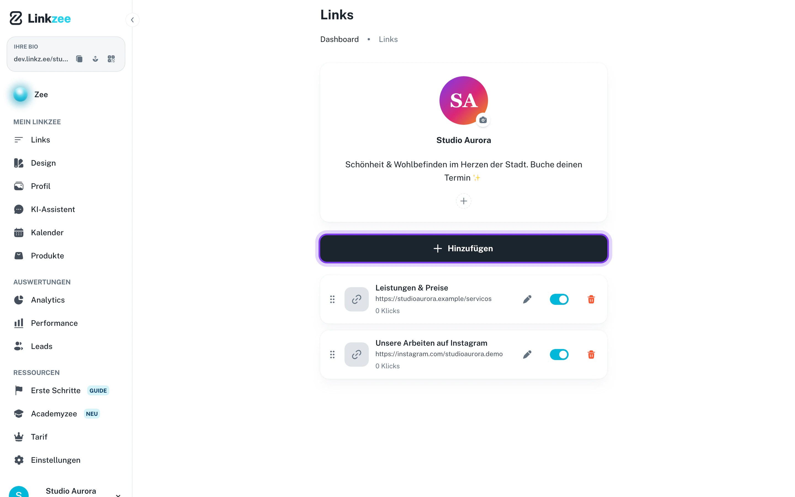
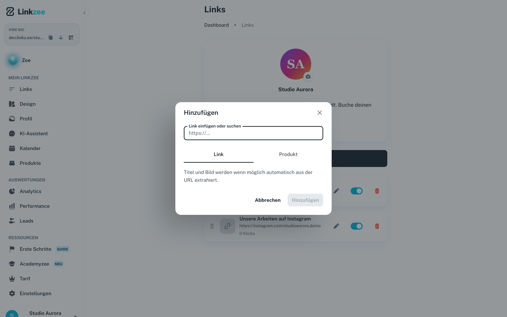

Links sind das Herzstück Ihrer Linkzee-Seite. Fügen Sie jede beliebige URL hinzu,
die Sie teilen möchten — einen Blogbeitrag, einen Gutschein, ein YouTube-Video,
Ihren Shop — und sie erscheint sofort auf Ihrer Seite.

<Frame caption="Mein Linkzee: Ihr Kopfbereich, der Hinzufügen-Button und alle Links in einer Liste.">
  
</Frame>

## Einen Link hinzufügen

<Steps>
  <Step title="Öffnen Sie den Content-Bereich">
    Hier bauen Sie Ihre Seite auf.
  </Step>
  <Step title="Klicken Sie auf + Hinzufügen">
    Verwenden Sie die vollbreite Schaltfläche **+ Hinzufügen** und wählen Sie
    dann **Link**.
  </Step>
  <Step title="Geben Sie die Details ein">
    Geben Sie einen **Titel** ein und fügen Sie die **URL** ein. Das war's — der
    Link erscheint sofort auf Ihrer Seite.
  </Step>
</Steps>

<Frame caption="Das Hinzufügen-Fenster: Link, Produkt, Social oder Support — alles beginnt hier.">
  
</Frame>

<Note>
  Alles wird beim Tippen automatisch gespeichert — es gibt keine
  **Speichern**-Schaltfläche. Ihre Live-Vorschau aktualisiert sich in Echtzeit,
  auf dem Desktop rechts und auf dem Handy unter dem Editor.
</Note>

## WhatsApp-Links

Sie möchten einen Link, der ein **WhatsApp-Gespräch** mit Ihnen öffnet? Wählen
Sie beim Hinzufügen eines Links das Ziel **WhatsApp**: Nummer und optional
eine vorausgefüllte Nachricht eingeben, und Linkzee baut den korrekten
`wa.me`-Link für Sie — ohne URL-Bastelei. Funktioniert auch auf
Produkt-Buttons.

## Medien am Link

Ein Link kann mehr sein als Text — geben Sie ihm eine visuelle Karte:

| Medium | Funktion |
| --- | --- |
| **Bild** | Ein Foto oder Thumbnail auf der Karte; Besucher können es antippen und im Vollbild ansehen. |
| **Video** | Ein kurzer Clip (bis zu **60 Sekunden / 40 MB**), der direkt auf Ihrer Seite abgespielt wird. |
| **Embed** | Fügen Sie eine **YouTube- oder Vimeo-URL** ein, und der Player wird in die Karte eingebettet. |

Öffnen Sie einen beliebigen Link und wählen Sie den Medientyp im Link-Editor.
Für ein eingebettetes Video wählen Sie die Option **Embed** und fügen dort die
YouTube- oder Vimeo-URL ein.

## Vorher-&-Nachher- und Galerie-Blöcke

Neben Links mit Medien kann Ihre Seite **Fotoblöcke** zeigen — Karten, deren
Inhalt die Fotos selbst sind, ohne Ziel-URL (Premium-Funktion):

| Block | Was er tut |
| --- | --- |
| **Vorher & Nachher** | Zwei übereinanderliegende Fotos mit einer **verschiebbaren Kante**: Besucher ziehen sie, um das Ergebnis zu vergleichen. Sie können die Beschriftungen „Vorher“/„Nachher“ umbenennen und festlegen, wo die Kante startet. |
| **Galerie** | **2 bis 10 Fotos**, durch die Besucher wischen, mit Punkten und Zähler. |

<Steps>
  <Step title="Klicken Sie auf + Hinzufügen und wählen Sie Vorher & Nachher oder Galerie">
    Jeder Block hat seinen eigenen Editor. Fotoblöcke können nicht in Sammlungen liegen.
  </Step>
  <Step title="Fotos hinzufügen">
    Vorher & Nachher nutzt genau zwei Fotos (vorher links, nachher rechts). Für
    eine Galerie fügen Sie 2–10 Fotos hinzu – am Computer ziehen Sie die Dateien
    direkt aus dem Ordner in den Fotobereich – und ziehen die Vorschaubilder zum
    Sortieren. Ein Foto nachjustieren? Mit **Ausrichten** verschieben und zoomen
    Sie es im Rahmen, wie beim Profilfoto – was Sie sehen, wird veröffentlicht. Verwenden Sie Fotos mit gleichem Ausschnitt — **4:5
    (Hochformat)** funktioniert am besten; Fotos mit anderen Seitenverhältnissen
    werden an den Rändern beschnitten.
  </Step>
  <Step title="Bestätigen Sie die Erlaubnis">
    Kundenfotos sind personenbezogene Daten. Setzen Sie das Häkchen, dass die
    fotografierten Personen der Veröffentlichung zugestimmt haben — einmal pro
    Block erforderlich; das Datum Ihrer Bestätigung wird gespeichert.
  </Step>
  <Step title="Speichern">
    Die Vorschau im Editor zeigt den echten Block vor dem Speichern. Die Fotos
    werden beim Klick auf **Speichern** hochgeladen; ein Block, dem noch Fotos
    fehlen, bleibt auf der Seite verborgen, bis er vollständig ist.
  </Step>
</Steps>

<Note>
  Fotoblöcke sind **Premium**. Im kostenlosen Plan können Sie sie bauen und in
  der Vorschau sehen, beim Speichern wird ein Upgrade verlangt. Die optionale
  Bildunterschrift erscheint über den Fotos; der Blockname ist intern (er hilft
  Ihnen und Zee, den Block zu finden). Fotoblöcke bekommen keinen animierten
  Hervorhebungseffekt – die Fotos stehen im Mittelpunkt.
</Note>

### Daraus einen Ergebnis-Abschnitt machen

Ein **Vorher-&-Nachher**-Block kann zu einem vollständigen
**Ergebnis**-Abschnitt im Schaufenster-Stil werden:

- **Abschnittstitel:** der **Name des Blocks** (z. B. „Ergebnisse“).
- **Bildunterschrift und Untertitel** erscheinen auf dem Foto, auf einem
  dunklen Verlauf unten (z. B. „Haarsystem“ · „Ergebnis am selben Tag“).
- **Schaltfläche „Jetzt buchen“:** Wählen Sie im Feld **Schaltfläche „Jetzt
  buchen“** eine Leistung aus Ihrer Agenda – Ihre Kunden kommen direkt zur Buchung
  dieser Leistung, ohne sie erneut auszuwählen. Die Schaltfläche erscheint nur,
  wenn die Leistung aktiv ist und die Agenda zu Ihrem Tarif gehört.
- **Galerie als Miniaturen:** Wählen Sie in einer Galerie **Darstellung →
  Miniaturen**. Direkt unter dem Vorher-&-Nachher in Ihrer Liste landet sie im
  selben Abschnitt: 3 Miniaturen und **Galerie (N)**, das alle Fotos im
  Vollbild öffnet (mit „Jetzt buchen“, wenn eine Leistung verknüpft ist).

Ein Vorher-&-Nachher ohne Untertitel, Leistung oder Miniaturen-Galerie
erscheint weiterhin wie bisher.

### Hochformat-Galerie

Eine **Galerie** kann auch zur **Hochformat-Galerie** werden: hohe Karten mit
Fotos und Videos, nebeneinander wie Stories. Ideal für Portfolios, Looks und
fertige Arbeiten (zum Beispiel „Unsere Arbeiten“).

<Steps>
  <Step title="Layout wählen">
    Stellen Sie im Galerie-Editor **Darstellung → Hochformat-Galerie** ein. Der
    Name des Blocks wird zum Abschnittstitel auf Ihrer Seite (zum Beispiel
    „Portfolio“).
  </Step>
  <Step title="Fotos und Videos hinzufügen">
    Fügen Sie **2 bis 10 Elemente** im Hochformat (**9:16**) hinzu. Fotos bis
    jeweils 8 MB, Videos im Format **MP4 oder MOV** bis 40 MB. Videos werden
    automatisch optimiert, damit sie schnell laden, und behalten ihre ersten
    **30 Sekunden**. Während ein Video optimiert wird, zeigt es **Wird
    optimiert…** und erscheint auf Ihrer Seite, sobald es fertig ist.
  </Step>
  <Step title="Jedes Element benennen">
    Der Name erscheint auf der Karte (bis zu 40 Zeichen).
  </Step>
  <Step title="Festlegen, was ein Tippen bewirkt">
    Jedes Element hat eine **Aktion beim Tippen**: **Services** (ein Button
    „Jetzt buchen“, der direkt zur Buchung dieses Services führt),
    **Produkte** (ein Button „Will ich“, der das Produkt öffnet), **Per
    WhatsApp bestellen**, **Kein Button** oder **Standard des Blocks**. Die
    **Standardaktion der Fotos** gilt für jedes Element ohne eigenen Service
    oder eigenes Produkt.
  </Step>
</Steps>

Auf Ihrer Seite tippen Besucher auf eine Karte, um sie im Vollbild zu öffnen,
und tippen dann auf die Ränder oder wischen, um die nächste zu sehen. Videos
starten stumm, Besucher können den Ton einschalten oder pausieren. **Alle
ansehen (N)** öffnet alle Elemente.

**Per WhatsApp bestellen** öffnet ein Gespräch mit der Nummer Ihres Shops, mit
einer fertigen Nachricht, die das Element nennt, und einem Link zu genau
diesem Foto. Der Link zeigt beim Senden eine Vorschau des Fotos, sodass Sie
genau wissen, welches Stück die Kundin oder der Kunde möchte. Tragen Sie dafür
die WhatsApp-Nummer Ihres Shops unter **Netzwerke** ein.

<Note>
  Enthält die Galerie Videos, bleibt sie im Layout Hochformat-Galerie.
  Entfernen Sie die Videos, um ein anderes Layout zu wählen. Das
  Einwilligungs-Häkchen umfasst auch die Stimme der Personen in Videos und,
  bei Minderjährigen, die Zustimmung der Eltern oder Erziehungsberechtigten.
</Note>

## Animiertes Highlight

Soll ein Link besonders herausstechen? Der Link-Editor bietet einen Effekt
**animiertes Highlight**, der den Blick auf diese Karte auf Ihrer öffentlichen
Seite lenkt — derselbe Effekt ist auch bei Produkten verfügbar. Es ist eine
**Premium-Funktion**: Einen Link mit diesem Effekt zu speichern erfordert, dass
**dieses Geschäft** in einem kostenpflichtigen Tarif ist — ist das Geschäft, das
Sie gerade bearbeiten, auf Free, zeigt der Editor die Einladung zum Upgrade
(siehe [Tarife und Preise](/de/billing/plans) und
[Tarif pro Geschäft](/de/billing/plan-per-store)).

## Ihre Links verwalten

Jeder Link hat einige Steuerelemente, damit Sie Ihre Seite genau so gestalten
können, wie Sie möchten.

| Steuerelement | Funktion |
| --- | --- |
| Stift | Bearbeiten Sie den Titel direkt an Ort und Stelle. |
| Ein/Aus-Schalter | Blenden Sie den Link ein oder aus, ohne ihn zu löschen. |
| Klickzähler | Sehen Sie, wie oft Besucher auf den Link getippt haben. |
| Ziehpunkt | Ordnen Sie Links durch Ziehen nach oben oder unten neu an. |
| Löschen | Entfernen Sie den Link — Sie werden zuvor um Bestätigung gebeten. |

Das Neuanordnen geschieht live: Ziehen Sie einen Link und die Vorschau folgt,
anschließend wird die neue Reihenfolge von selbst gespeichert.

## Links in Sammlungen gruppieren

Wenn Sie viele Links haben, gruppieren Sie sie in **Sammlungen**, um beschriftete
Bereiche auf Ihrer Seite zu erstellen — wie „Meine Kurse" oder „Rabattgutscheine".
So bleibt Ihre Seite aufgeräumt und übersichtlich.

<CardGroup cols={2}>
  <Card title="Sammlungen" icon="folder" href="/de/your-page/collections">
    Gruppieren Sie Ihre Links in beschriftete Bereiche auf Ihrer Seite.
  </Card>
  <Card title="Ihre Seite" icon="table-cells" href="/de/your-page/overview">
    Bauen und organisieren Sie alles in Ihrem Content-Bereich.
  </Card>
</CardGroup>
