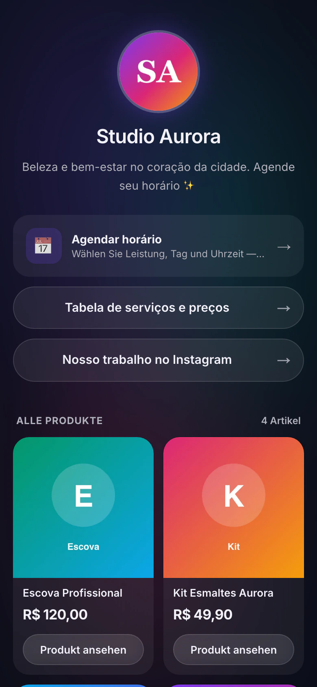

Im Bereich **Links** baust du deine Seite auf. Er ist die Startseite deines
Linkzee. Von hier aus fügst du alles hinzu, was deine Follower sehen werden, und
ordnest es genau so an, wie du möchtest.

<Frame caption="Eine Linkzee-Seite: Kopfbereich, Buchungskarte, Links und Produkt-Schaufenster.">
  
</Frame>

## Füge dein erstes Element hinzu

Am oberen Rand des Bildschirms findest du eine bildschirmbreite Schaltfläche
**+ Hinzufügen**. Tippe darauf, um eine von drei Arten von Elementen
hinzuzufügen:

<CardGroup cols={3}>
  <Card title="Link" icon="link" href="/de/your-page/links">
    Eine Schaltfläche, die auf eine beliebige Webadresse verweist.
  </Card>
  <Card title="Produkt" icon="store" href="/de/products/overview">
    Ein Marktplatz-Angebot in deinem Schaufenster.
  </Card>
  <Card title="Soziales Netzwerk" icon="share-nodes" href="/de/your-page/social-networks">
    Icons, die zu deinen Social-Media-Profilen verlinken.
  </Card>
</CardGroup>

## Weitere Blöcke, die du hinzufügen kannst

Über Links, Produkte und Social-Icons hinaus bietet das Menü **+ Hinzufügen**
Blöcke, die als Karten auf deiner Seite erscheinen. Jeder lässt sich wie ein
Link an jede beliebige Position ziehen:

| Block | Was er macht |
| --- | --- |
| **Bewertungen** | Deine verifizierten Bewertungen aus echten Terminen. Siehe [Bewertungsblock](/de/your-page/reviews-block) |
| **Karte** | Die Adresse deines Geschäfts, mit einer Karte, die die Route öffnet |
| **Instagram** | Ein Raster mit deinen 6 neuesten Beiträgen, das sich selbst aktualisiert |
| **Bei Google bewerten** | Eine Schaltfläche, die Besucher direkt zu deiner Google-Bewertungsseite schickt |
| **Unterstützung** | Eine PIX-Karte, mit der Fans dich direkt unterstützen können. Siehe [Seite teilen & Unterstützung](/de/your-page/share-and-support) |
| **Buchung** | Die Karte, die deinen Kalender öffnet, hinzugefügt, sobald du die [Terminbuchung](/de/scheduling/overview) aktivierst |
| **Qzee-Kalender** | Unter **Integrationen**: ein oben fixierter Button, der deinen Qzee-Kalender öffnet, für Unternehmen, die schon über Qzee buchen. Siehe [Qzee-Kalender in der Bio](/de/scheduling/qzee-booking) |

<Note>
  Blöcke erscheinen nur, wenn sie etwas zu zeigen haben. Der Bewertungsblock
  bleibt versteckt, bis du Bewertungen hast; die Karte braucht eine Adresse.
  Deine Seite zeigt nie einen leeren Abschnitt.
</Note>

### Der Karten-Block

Füge deine **Adresse** hinzu und deine Seite erhält den Bereich
**Anfahrt**: die Karte mit einer Stecknadel in deiner Designfarbe und deinem
Logo, die Adresse, den Live-Status (**Jetzt geöffnet · Mo–Sa 9–20 Uhr** oder
**Geschlossen · öffnet morgen um 9 Uhr**, aus deinen Öffnungszeiten) und die
Schaltfläche **Route planen**, die die Karten-App des Besuchers öffnet. Das Aussehen
kann **automatisch**, **hell** oder **dunkel** sein (ein dunkler Schleier über
der Karte).

Datenschutz: Für Besucher aus der Europäischen Union und dem Vereinigten
Königreich oder wenn funktionale Cookies abgelehnt wurden, lädt die
Google-Karte erst nach einem Tippen auf **Karte anzeigen**. Für alle anderen
lädt sie normal.

### Der Instagram-Block

Verbinde dein Instagram unter **+ Hinzufügen → Instagram**, und deine
Seite erhält den Abschnitt **Auf Instagram**: ein Raster mit deinen 6 neuesten
Beiträgen (Reels mit ▶-Symbol), deinem Benutzernamen und der Schaltfläche
**Auf Instagram folgen**. Jeder Beitrag öffnet sich auf Instagram. Das Raster
aktualisiert sich mehrmals täglich selbst; die Karte unter Inhalt bietet
**Jetzt aktualisieren**, einen Schalter zum Ein- und Ausblenden und
**Trennen**.

- Funktioniert mit einem **professionellen** Instagram-Konto (**Unternehmen**
  oder **Creator**). Zum Wechseln in der Instagram-App: Einstellungen →
  Kontotyp und Tools → Zu professionellem Konto wechseln.
- Linkzee liest nur dein Profil und deine Beiträge: Es veröffentlicht nichts,
  liest keine Nachrichten und greift nicht auf Follower zu. Beim Trennen
  verschwindet das Raster von deiner Seite, und die kopierten Bilder werden
  sofort gelöscht.
- Das Raster erscheint ab 3 Beiträgen, immer in vollständigen Reihen.
- Läuft die Verbindung ab (zum Beispiel nach einer Änderung des
  Instagram-Passworts), verschwindet das Raster von deiner Seite, und die
  Karte zeigt **Neu verbinden**.

<Note>
  Instagram wird schrittweise freigeschaltet. Wenn die Option in deinem Menü
  **+ Hinzufügen** noch nicht erscheint, kommt sie bald.
</Note>

### Bei Google bewerten

Füge deine **Google-Bewertungs-URL** ein (aus deinem Google
Business Profile), und die Karte schickt Besucher direkt zu deinem
Bewertungsformular, ein einfacher Weg, zufriedene Kunden zu öffentlichen
Bewertungen zu machen. Klicks auf die Karte werden wie bei jedem Link gemessen.

## Jedes Element verwalten

Jedes Element im Bereich **Links** bietet dir dieselben Steuerelemente:

| Steuerelement | Funktion |
| --- | --- |
| Ziehpunkt | Ordnet das Element innerhalb seiner Gruppe neu an |
| Stift | Bearbeitet den Titel direkt (inline) |
| URL | Die Adresse, auf die das Element verweist |
| Ein/Aus-Schalter | Blendet das Element auf deiner Seite ein oder aus |
| Klickzähler | Zeigt, wie viele Klicks das Element erhalten hat |
| Löschen | Entfernt das Element (du wirst um Bestätigung gebeten) |

## Wie Elemente gruppiert werden

Elemente bleiben in festen Gruppen organisiert, damit deine Seite immer
aufgeräumt aussieht:

- **Produkte bleiben immer zusammen gruppiert** als dein Schaufenster, an einer
  festen Position.
- **Links bleiben zusammen gruppiert** in ihrem eigenen Abschnitt.

Durch Ziehen ordnest du deine **Links** *innerhalb* ihres Abschnitts neu an,
Produkte und Links werden dabei nie vermischt. Dein Produkt-Schaufenster folgt
der **Reihenfolge im Schaufenster**, die du wählst: **Neueste zuerst** oder
**Individuell**. Siehe
[Reihenfolge im Schaufenster](/de/products/overview#reihenfolge-im-schaufenster).

<Note>
  Alles, was du bearbeitest, wird automatisch gespeichert, eine Schaltfläche
  **Speichern** gibt es nicht. Am Desktop wird deine Seite live in der
  Handy-Vorschau rechts aktualisiert; am Handy tippst du oben auf **Vorschau**,
  um deine Seite im Vollbild zu sehen.
</Note>

## Weiter geht's

<CardGroup cols={2}>
  <Card title="Links" icon="link" href="/de/your-page/links">
    Füge die Links auf deiner Seite hinzu und verwalte sie.
  </Card>
  <Card title="Schaufenster" icon="store" href="/de/products/overview">
    Verwandle deine Marktplatz-Links in einen echten Shop.
  </Card>
  <Card title="Soziale Netzwerke" icon="share-nodes" href="/de/your-page/social-networks">
    Zeig deine Social-Media-Profile oben oder unten an.
  </Card>
  <Card title="Profil" icon="heading" href="/de/your-page/header">
    Lege Namen, Foto, Bio und Titelstil fest.
  </Card>
</CardGroup>
