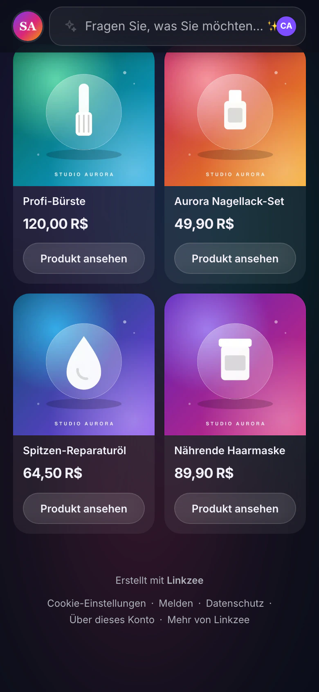

Ihre Seite ist zum Teilen gemacht. Linkzee gibt Ihnen einen **QR-Code** zum
Herunterladen, ein gepflegtes **Vorschaubild** für Apps — und auf Wunsch eine
**PIX-Unterstützungskarte**, mit der Besucher Ihnen direkt einen Beitrag
senden können.

## QR-Code

Tippen Sie auf **Teilen** (im Seitenmenü oder auf dem Handy oben auf dem
Bildschirm) und dann auf den Button **QR-Code**, um den QR-Code Ihrer Seite
herunterzuladen oder ein druckfertiges **Schild mit QR-Code** zu erstellen
(A5-Schild oder quadratischer Aufkleber als PDF für die Druckerei, oder Story-
und Post-Bilder für Social Media). Wer ihn scannt, landet direkt auf Ihrer
öffentlichen Seite, und der Besuch erscheint in Analytics als **Gedruckter QR**.
Siehe [Getrackte Links und QR-Code](/de/analytics/tracked-links).

## Vorschaubild beim Teilen

Teilt jemand Ihren Link — auf WhatsApp, Instagram, X, wo auch immer — zeigt
die App eine **automatisch generierte Vorschaukarte** mit Ihrem Foto und Namen.
Nichts zu konfigurieren: Sie aktualisiert sich, sobald Sie den Kopfbereich
Ihrer Seite ändern.

## PIX-Unterstützungskarte (Brasilien)

Lassen Sie Besucher Ihre Arbeit mit einem direkten PIX unterstützen — ohne
Zwischenhändler, ohne Gebühr, direkt auf Ihren Schlüssel:

1. Wählen Sie unter **Mein Linkzee → Hinzufügen** die Option **Unterstützung**.
2. Geben Sie Ihren **PIX-Schlüssel** ein (CPF/CNPJ, E-Mail, Telefon oder
   Zufallsschlüssel) und, wenn Sie möchten, vorgeschlagene Beträge.
3. Eine Unterstützungskarte erscheint auf Ihrer Seite: Besucher scannen den
   **QR-Code** oder tippen auf **Code kopieren** und zahlen in ihrer
   Banking-App.

<Note>
  Der PIX geht **direkt von der Bank des Besuchers zu Ihrer** — Linkzee rührt
  das Geld nicht an und berechnet nichts darauf. Die Karte lässt sich wie jedes
  andere Element auf der Seite verschieben.
</Note>

<Frame caption="Die PIX-Support-Karte auf deiner öffentlichen Seite: Beträge und Copy-Paste-Code.">
  
</Frame>
