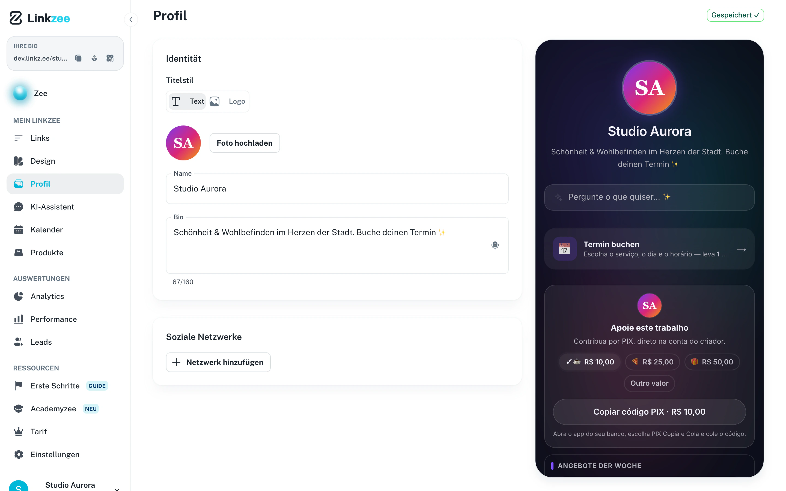

Füge deine sozialen Netzwerke hinzu, damit ihre Icons auf deiner Linkzee-Seite
erscheinen. Besucher tippen auf ein Icon und gelangen direkt zu deinem Profil —
ohne Login oder Autorisierung.

<Frame caption="Profil: Name, Bio, Foto und die Social-Icons oben auf deiner Seite.">
  
</Frame>

## Ein soziales Netzwerk hinzufügen

<Steps>
  <Step title="Das Menü Hinzufügen öffnen">
    Klicke auf dem Bildschirm **Links** auf den bildschirmbreiten Button **+ Hinzufügen**.
  </Step>
  <Step title="Soziales Netzwerk auswählen">
    Wähle **Soziales Netzwerk** aus der Liste der Elementtypen.
  </Step>
  <Step title="Ein Netzwerk auswählen">
    Wähle ein Netzwerk aus dem Raster.
  </Step>
  <Step title="Deinen Benutzernamen eingeben">
    Gib deinen **@Benutzernamen** oder deine **URL** ein und füge ihn hinzu.
    Das war's — dein Icon erscheint sofort auf deiner Seite.
  </Step>
</Steps>

<Note>
  Es gibt keinen Login- oder Autorisierungsschritt. Du fügst einfach deinen
  Benutzernamen oder Link ein, und Linkzee erstellt das Icon für dich.
</Note>

## Unterstützte Netzwerke

- Instagram
- WhatsApp
- TikTok
- YouTube
- X
- Facebook
- Threads
- Pinterest
- Website (ein generischer Link für alles andere)

## Ein soziales Netzwerk als Karte

Neben der Icon-Reihe kannst du eines deiner Netzwerke zu einer **vollwertigen
Karte** auf der Seite machen — ideal für den Kanal, den deine Besucher am
ehesten besuchen sollen. Die Karte gibt es in zwei Größen: **breit** (nimmt
die ganze Zeile ein) oder **kompakt** (ein Quadrat, das neben anderen
Elementen sitzt). Die Icon-Reihe bleibt, wie sie ist; die Karte ist eine
zusätzliche Platzierung für dieses Netzwerk.

## Wählen, wo die Icons erscheinen

Lege die **Position auf der Seite** für deine Social-Icons fest:

- **Oben** — über deinen Inhalten.
- **Fußzeile** — unter deinen Inhalten.

Alles wird automatisch gespeichert und die Vorschau aktualisiert sich live — auf
dem Desktop rechts, auf dem Mobilgerät unter dem Editor — sodass du genau siehst,
wo deine Icons landen, während du die Position änderst.

<CardGroup cols={2}>
  <Card title="Deine Seite" icon="table-cells" href="/de/your-page/overview">
    Sieh dir an, wie der Bildschirm Links deine Links, Produkte und sozialen Netzwerke zusammenbringt.
  </Card>
  <Card title="Profil" icon="heading" href="/de/your-page/header">
    Lege die Identität deiner Seite mit Namen, Bio und Text- oder Logo-Titel fest.
  </Card>
</CardGroup>
