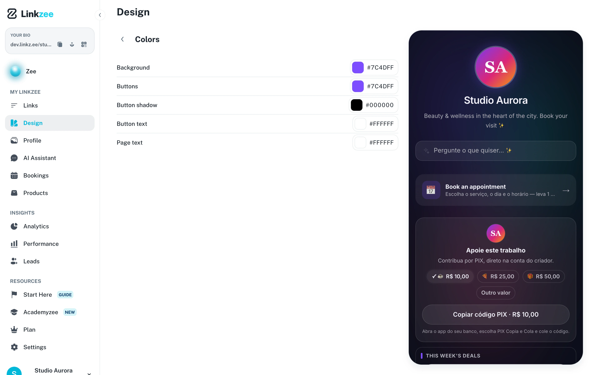

A theme gives you a complete look in one tap. When you want to go further,
Linkzee gives you **curated** controls to fine-tune the details. You pick from
options that are made to work together, so nothing ever clashes.

<Frame caption="The Colors panel: full spectrum, hex and suggestions — with instant preview.">
  
</Frame>

Every change shows instantly in the live preview — on the right on desktop, or
below the editor on mobile — and saves automatically as you go.

## What you can adjust

<AccordionGroup>
  <Accordion title="Header" icon="user">
    Choose how your name, photo and logo sit at the top of your page:
    - **Classic**: a compact round avatar with your name and bio.
    - **Hero**: a photo **or a short video** that bleeds across the top of the
      page (see [Header](/your-page/header#hero-video)).
    - **Banner**: a cover image with your avatar placed over it.
    - **Cutout**: you, without a background, standing over your page. Upload a
      **transparent PNG or WebP**; an image without transparency isn't
      accepted for this layout.
    - **Shape**: your portrait inside an organic outline. Pick **Organic**,
      **Organic 2**, **Arch** or **Soft square**, and a color for the shape
      (or leave it on the theme color).

    **Adjust framing** lets you drag and zoom the photo inside the layout.
    With a hero video you can also place your logo over it, solid or glass
    (Premium), with a border in your avatar color.
  </Accordion>
  <Accordion title="Avatar" icon="circle-user">
    Pick how your photo appears at the top of the page: **None**, **Ring**,
    **Colored ring**, **Shadow** or **Glow**, with an **Avatar color** of your
    choice. Until you pick one, the theme's effect is used. The Hero layout
    shows the photo full-bleed, so it has no avatar effect.
  </Accordion>
  <Accordion title="Wallpaper" icon="image">
    Set your background style. Each style shows a real sample, and its options
    appear right below it. The main color comes from **Colors**; styles that
    blend two colors add a **Second color** field.

    | Style | Options |
    | --- | --- |
    | **Solid color** | Just the color. |
    | **Gradient** | **Custom** (two colors, direction **Upward**, **Downward** or **Radial**) or **Pre-made** (15 ready gradients, like Sunset, Ocean and Midnight, with text colors that read well on them). **Animate** makes it drift gently; **Grain texture** adds a subtle grain. |
    | **Blur** | Soft color blurs, with **Intensity** and **Position** (top, center or diffuse). |
    | **Pattern** | 10 patterns (dots, grid, waves, honeycomb and more) tinted with your color, with **Size** and **Intensity**. |
    | **Mesh** | Blended color fields in three layouts: **Classic**, **Corners** or **Center**. |
    | **Image** | Your own photo, with **Darken the photo** (light, medium, strong) to keep text readable, and an optional **Blur**. You can reframe it. |
    | **Duotone** | Your photo in two colors: your main color and a **Second color**. |
    | **Video** | A short looping clip. |

    **Video** takes an MP4 or MOV file up to 40 MB and optimizes it the same
    way as the hero video (720p, the first 30 seconds, silent and looped) so
    it loads fast. You can **Replace** or **Remove** it at any time. Visitors
    who prefer reduced motion or have data saver on see its cover image
    instead.
  </Accordion>
  <Accordion title="Product showcase layout" icon="grip">
    Choose how your product showcase is laid out: **Standard**, a clean grid;
    **Masonry**, a mosaic of cards with varying heights; or **Carousel**, where
    each category becomes a horizontal shelf you can swipe on mobile (arrows
    on desktop), with a **"See all (n)"** button that expands the full
    category in place. You can also set the card style and how photos fit
    (see [Product showcase](/products/overview#showcase-settings)).
  </Accordion>
  <Accordion title="Buttons" icon="square">
    Set the button **style** (filled, outline, soft or **glass**), the button
    **shape** (rounded, slightly rounded or square) and the button **shadow**
    (none, soft, strong or hard). Shadow is fully open, so you can dial in
    exactly the depth you want.
  </Accordion>
  <Accordion title="Text" icon="font">
    Pick your **font** from a curated list, grouped into sans-serif, serif and
    mono & display. Or open **Pairs** for ready-made combinations: one font for
    your name and headings, another for body text, in moods like Editorial,
    Modern, Boutique or Playful.
  </Accordion>
  <Accordion title="Colors" icon="palette">
    Set the color of your background, buttons, button shadow, button text and
    page text. Each row opens a **full color picker** (spectrum, hex code,
    eyedropper and a set of suggested swatches) so you can match your exact
    brand color, not just the presets.

    If a combination is hard to read, a **Low contrast for reading** notice
    appears with a suggestion, so your page stays legible.
  </Accordion>
  <Accordion title="Social icons" icon="share-nodes">
    Choose how your social icons look: **Default** (follows the theme),
    **Icons**, **Filled**, **Outlined** or **Buttons**. Filled and Outlined use
    your button color; Buttons show each network's name.
  </Accordion>
  <Accordion title="Cards" icon="clone">
    Set the look of the cards on your page: **Solid**, **Glass**, **Neon** or
    **Soft**, with **Corners** that are subtle, medium or round.
  </Accordion>
  <Accordion title="Motion" icon="wand-magic-sparkles">
    Set the **animation intensity** of your public page: **Off**, **Subtle** or
    **Default**. Visitors who prefer reduced motion always see the static
    version. Here you also find **Stage Mode** (Premium), which makes your page
    react to the music on your Spotify card (see
    [Spotify](/your-page/spotify)).
  </Accordion>
</AccordionGroup>

<Note>
  Suggested swatches and the built-in fonts are free. Premium options are
  marked with a badge and you can try them on any plan: a **custom color**
  (anything outside the suggested swatches), the **glass** button style, the
  **Image**, **Mesh**, **Duotone** and **Video** wallpapers, the **radial** and
  **pre-made** gradients, **Animate**, a **hero video**, the glass logo over
  the video, and premium fonts and pairs. You see them in the live preview,
  but if **this store** is on Free its public page keeps its last free look
  until you upgrade that store (see [Plan per store](/billing/plan-per-store)).
</Note>

### Save or discard premium changes

On the Free plan, as soon as you apply a premium option, auto-save pauses and
a pair of **Save** and **Discard** buttons appears at the top of the Design
screen.

- **Discard** brings back the look that is currently published.
- **Save** opens the upgrade options. Once the store is on a paid plan,
  everything you set is published.

Free options keep saving automatically as usual.

<Warning>
  Picking a ready-made theme again resets these choices back to that theme's look.
</Warning>

## Next steps

<CardGroup cols={2}>
  <Card title="Themes" icon="swatchbook" href="/design/themes">
    Start from a complete, ready-made look, then fine-tune it here.
  </Card>
  <Card title="Design overview" icon="palette" href="/design/overview">
    See how themes and customization work together.
  </Card>
</CardGroup>
