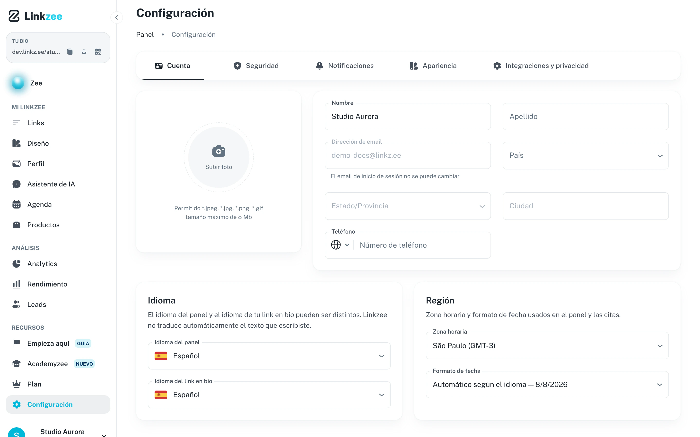

Los ajustes de tu **cuenta** están en un solo lugar. Aquí defines cómo Linkzee se
comunica contigo, dónde te encuentras y cómo se ve y se siente la interfaz.

<Frame caption="La pestaña Cuenta: idioma, región, zona horaria, apariencia y accesibilidad.">
  
</Frame>

## Idioma y región

- **Idioma del panel**: el idioma que Linkzee usa en todo tu editor.
- **Idioma del link en bio**: el idioma de los botones, etiquetas y mensajes
  de tu página pública. Puede ser distinto del idioma del panel. Linkzee no
  traduce el texto que escribiste tú.
- **País** — elige tu país, y tu **zona horaria** lo sigue automáticamente.
- **Estado** y **ciudad** — precisa tu ubicación.
- **Formato de fecha** — elige cómo se muestran las fechas.

Todo esto está en **Configuración → Idioma y región**. Tu cuenta y tu página
empiezan en el idioma de la página donde te registraste.

<Note>
  Esta zona horaria se aplica a **tu panel** (fechas, informes). Los horarios de
  tus reservas siguen la **zona horaria del negocio**, que se configura por
  separado en **Agenda → Configuración** — así un negocio puede operar en una
  zona horaria distinta a la de tu cuenta, y cada una funciona de forma
  independiente.
</Note>

### Sugerencia de idioma para tu página

Si tu página pública está en un idioma que los clientes de tu región no suelen
leer, el panel muestra un aviso corto, por ejemplo: "Tu página pública está en
inglés. Los clientes de tu región suelen leer en portugués." Toca **Cambiar
a** para cambiar el idioma de la página con un toque, o **Dejarla así**.

## Apariencia y accesibilidad

- **Apariencia** — cambia entre **Claro** y **Oscuro**.
- **Accesibilidad** — ajusta el **Tamaño de fuente** y activa el **Alto contraste**
  para leer con más facilidad.

Cada cambio que haces aquí se aplica de inmediato — no hay ningún botón de Guardar
que recordar.

## Páginas relacionadas

<CardGroup cols={2}>
  <Card title="Contraseña y seguridad" icon="lock" href="/es/account/password-security">
    Cambia tu contraseña o restablécela si la olvidaste.
  </Card>
  <Card title="SEO de la página pública" icon="magnifying-glass" href="/es/account/public-page-seo">
    Define el título y la descripción que la gente ve en Google y en las vistas previas de enlaces.
  </Card>
</CardGroup>
