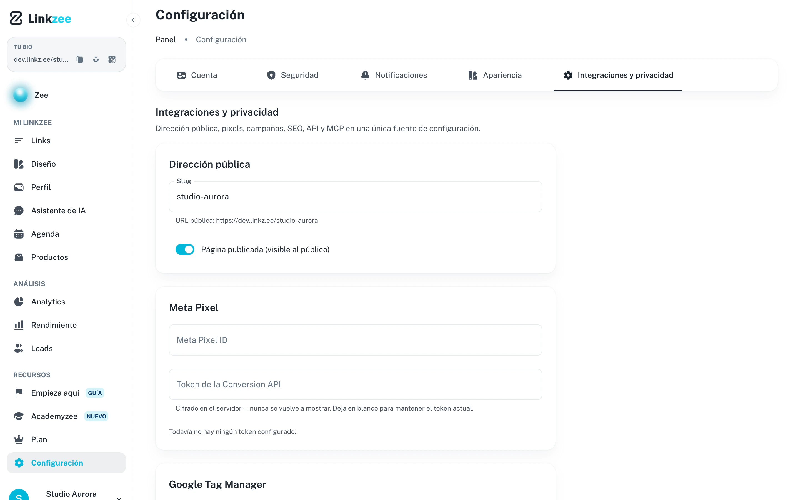

Linkzee tiene su propia pantalla de [Rendimiento](/es/analytics/overview), pero
también puedes medir conversiones con tus **propias** herramientas de marketing.
Conéctalas una vez y Linkzee envía los datos a medida que las visitas interactúan
con tu página.

<Frame caption="Integraciones y privacidad: Meta Pixel, GTM y la dirección pública de tu página.">
  
</Frame>

Todo lo que hay aquí se guarda automáticamente mientras escribes: no hay botón de
Guardar.

## Meta Pixel

Añade el ID de tu **Meta Pixel** para hacer seguimiento de visitas y conversiones
en el Administrador de eventos de Meta. Después, añade también el token de su
**Conversion API**.

El token es importante: los navegadores e iOS suelen bloquear el script del pixel,
por lo que se pueden perder eventos. La Conversion API envía la conversión
directamente desde Linkzee, así que se registra igualmente aunque el script esté
bloqueado. Añadir ambos te da el seguimiento más completo.

## Google Tag Manager

Añade el ID de tu contenedor de **Google Tag Manager** para cargar tu contenedor
de GTM en tu página pública. Desde ahí puedes gestionar tus propias etiquetas y
activadores en Google Tag Manager.

## Parámetros UTM

Define parámetros **UTM** predeterminados —como source, medium y campaign— que
Linkzee añade automáticamente a tus enlaces de salida. Esto etiqueta el tráfico
que envías para que tus analíticas lo atribuyan a la fuente y la campaña correctas.

<Note>
  Encontrarás estos valores en tus herramientas de marketing: el ID del Pixel y
  el token de la Conversion API en el **Administrador de eventos de Meta**, y el
  ID del contenedor en **Google Tag Manager**.
</Note>

## Cómo mide Linkzee sus propios anuncios

La configuración de arriba es tuya y funciona en tu página pública. Aparte, en
las páginas de la propia Linkzee (sitio, cuestionario, registro y suscripción),
y solo si aceptas las cookies de publicidad, Linkzee mide los resultados de sus
anuncios con Meta (Pixel y API de Conversiones) y Google Tag Manager. Para ello,
Linkzee envía a Meta:

- Correo electrónico, teléfono y nombre en forma cifrada (hash SHA-256), y un
  identificador interno también en hash.
- Tu ubicación aproximada derivada de la dirección IP (ciudad, estado y país,
  nunca el código postal).
- La dirección IP y el navegador usados en el momento del evento.
- Los identificadores publicitarios de Meta (cookies `_fbp` y `_fbc`).

En los pagos, la dirección de facturación que indicas a Stripe puede
complementar estos datos. El teléfono puede venir de tu cuenta o del WhatsApp o
teléfono que indicaste al configurar tu página.

Estos datos de medición se guardan por poco tiempo: el contexto del pago hasta
**30 días** y el contexto del registro (sin la dirección IP) hasta **90 días**.
Puedes retirar el consentimiento en cualquier momento en **Preferencias de
cookies**; la retirada borra estos contextos y detiene nuevos envíos. Linkzee
aplica el modo de uso limitado de datos de Meta donde la ley lo exige. Si el
envío a Meta falla, el evento queda en una cola de reenvío hasta 2 días, y
Linkzee guarda un registro mínimo de las conversiones ya enviadas (solo el
identificador del evento, sin datos personales) para no contar nunca la misma
conversión dos veces. La cola también se borra cuando retiras el consentimiento.

## Próximos pasos

<CardGroup cols={2}>
  <Card title="Rendimiento" icon="chart-line" href="/es/analytics/overview">
    Consulta clics, visualizaciones y tus mejores elementos dentro de Linkzee.
  </Card>
  <Card title="Ajustes de la cuenta" icon="gear" href="/es/account/account">
    Configura tu idioma, región, apariencia y opciones de accesibilidad.
  </Card>
</CardGroup>
