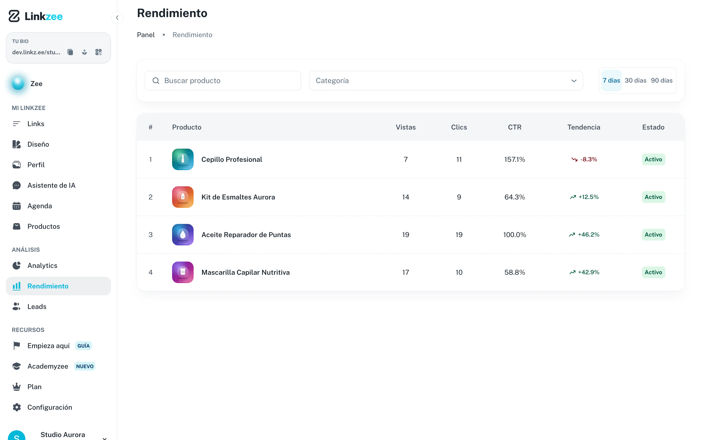

La pantalla de **Analytics** muestra cómo va tu página de Linkzee. Sigue cada
visita desde el momento en que alguien abre tu página hasta el clic, la reserva o
el contacto, para que veas lo que funciona y hagas más de eso.

La pantalla tiene tres pestañas — **Resumen**, **De dónde vinieron** y
**Botones** — y un selector de periodo arriba. Debajo del título ves cuándo se
actualizaron los números por última vez: se renuevan **más o menos cada hora**.

## Tu historial según el plan

Hasta dónde puedes mirar hacia atrás depende del plan de la tienda en la que
estás:

| Plan | Historial | Periodos que puedes elegir |
| --- | --- | --- |
| Free | 7 días | Hoy · 7 días |
| Essential | 90 días | Hoy · 7 días · 30 días · 90 días |
| Pro y Scale | 12 meses | Hoy · 7 días · 30 días · 90 días · 12 meses |

Los periodos por encima de tu plan aparecen con una **corona**. Al tocar uno,
ves lo que muestra cada plan y puedes mejorar el tuyo. Tus datos se siguen
guardando de todos modos: al suscribirte, el historial más largo aparece al
instante.

<Note>
  Todos los periodos terminan **hoy** y usan la zona horaria de tu tienda. Las
  comparaciones ("vs. 30 días anteriores") solo usan días dentro del historial de
  tu plan, así que no hay comparación con el año anterior. **Hoy** y **12 meses**
  no muestran comparación, y ves "—" cuando no hay historial suficiente para
  comparar.
</Note>

## Resumen

La pestaña **Resumen** te da la imagen completa en una sola pantalla:

- **Una frase destacada** — por ejemplo, *"De cada 100 visitas, 41 hicieron clic
  en algo y 3 reservaron."* Con menos de 100 visitas usa los números reales.
- **Cuatro números clave** — **Visitas**, **Visitantes**, **% que hizo clic** y
  **Clics**, cada uno con su variación frente al periodo anterior.
- **Visitas y clics** — un gráfico por día (por mes en 12 meses).
- **El embudo** — el camino de quienes visitaron (ver abajo).
- **De dónde vinieron** — tus principales orígenes, con **Ver todo** para abrir
  la siguiente pestaña.
- **Más clicados** — tus botones más usados, con **Ver todos** para abrir la
  pestaña Botones.
- **Dispositivos**, **Ciudades** y **Países**.
- Un acceso a **Rendimiento de los productos** (ver [La pantalla de Rendimiento](#la-pantalla-de-rendimiento)).

Si tu página aún no tiene visitas, la pestaña muestra **Compartir mi enlace**,
que abre la hoja para compartir — ver [Enlaces rastreados y código QR](/es/analytics/tracked-links).

## El embudo

El embudo muestra cuántos visitantes avanzaron en cada paso y qué parte siguió de
un paso al siguiente. Cada paso solo cuenta personas del paso anterior, así que
un paso nunca es mayor que el anterior.

| Tu página tiene… | Embudo |
| --- | --- |
| Agenda | Visitaron → Hicieron clic en algo → Abrieron la agenda → Reservaron |
| Captura de contactos, sin agenda | Visitaron → Hicieron clic en algo → Se volvieron contactos |
| Ninguno de los dos | Visitaron → Hicieron clic en algo |

## De dónde vinieron

La pestaña **De dónde vinieron** responde *"¿qué lugar me trae clientes?"*:

- **Por origen** — Instagram, TikTok, WhatsApp, Google, QR impreso, etc., con la
  parte de las visitas, el % que hizo clic y cuántos reservaron en cada uno. Abre
  un origen para ver de qué punto de esa red llegó la visita — **Bio**,
  **Historias**, **Mensaje directo**… — o **Sin enlace rastreado** cuando la
  visita llegó sin uno de tus enlaces.
- **Directo (sin origen)** — visitas sin información de dónde vinieron (alguien
  escribió tu dirección o la app ocultó el origen). Cuando esta parte es alta, un
  aviso sugiere **Obtener mis enlaces**, para que cada red tenga su propio enlace.
- **Enlaces de campaña** — las visitas y reservas que trajo cada uno de tus
  enlaces de campaña. Toca uno para ver los detalles. Ver [Enlaces de campaña](/es/analytics/tracked-links#enlaces-de-campa%C3%B1a).
- **Anuncios y Google Analytics** (avanzado) — los parámetros UTM que llegaron de
  anuncios y herramientas externas (`utm_source`, `utm_campaign`…).

## Botones

La pestaña **Botones** ordena todos los botones de tu página, del más al menos
clicado: enlaces, productos, el botón de reservar, redes sociales, el mapa y
otros. Usa los filtros de arriba (**Todos**, **Enlaces**, **Productos**,
**Agenda**, **Redes sociales**, **Mapa**) para filtrar.

Toca un botón para ver sus clics por día, de dónde vinieron esos clics y — en el
botón de reservar — cuántas personas reservaron. **Editar este botón** te lleva
directo a donde lo cambias.

## Qué significa cada número

| Número | Qué cuenta |
| --- | --- |
| **Visitas** | Cada vez que alguien abre tu página. Recargar o moverse por la página en la misma visita no vuelve a contar; una nueva visita empieza tras 30 minutos fuera o cuando la persona llega por otro enlace. |
| **Visitantes** | Navegadores o dispositivos distintos que abrieron tu página en el periodo. La misma persona en el navegador de Instagram y en Safari cuenta como 2. |
| **Clics** | Toques en tus enlaces, productos, botón de reservar, redes sociales, mapa y botones de apoyo y de reseñas. |
| **% que hizo clic** | De todas las visitas, la parte en la que la persona hizo clic en al menos una cosa. |
| **Clics por visita** ("15 de cada 100 visitas") | Cuántos clics recibió un botón por cada 100 visitas. Puede pasar de 100 cuando la gente hace clic en el mismo botón más de una vez. |
| **Abrieron la agenda** | Visitas en las que la persona abrió tu agenda. |
| **Reservaron** | Reservas hechas desde una visita a tu página en el periodo, en cualquier estado. |
| **Se volvieron contactos** | Contactos nuevos captados desde una visita a tu página en el periodo. |
| **Sobre todo de** | El origen que envió más clics a ese botón. |
| **vs. anterior** | La variación frente al periodo de la misma duración justo antes. Los conteos varían en %; las tasas varían en puntos ("+3 puntos"). |

<Note>
  Linkzee mide tu página con una **medición propia y anónima**, sin cookies de
  terceros. Estos datos nunca se comparten con nadie y solo se usan para las
  estadísticas de tu tienda. Los visitantes que desactivan la medición en el aviso
  de cookies siguen contando como visitas, pero no como visitantes.
</Note>

## La pantalla de Rendimiento

Junto a Analytics en el menú hay una pantalla dedicada de **Rendimiento**: una
tabla de tus **productos**, cada uno con sus vistas, clics y tasa de clics para
el periodo que elijas (**7 días, 30 días, 90 días o 12 meses**, dentro del
historial de tu plan). Úsala para detectar qué productos se ganan su lugar en la
página — y cuáles necesitan una mejor imagen, título o posición.

<Frame caption="Rendimiento: clics por enlace y producto, con totales del período.">
  
</Frame>

## Haz que trabaje para ti

Usa tus números para saber de dónde vienen tus clientes y qué tocan más, y luego
apuesta por lo que funciona: dale a cada red su propio enlace, mueve tus botones
más fuertes arriba y renueva las ofertas que están perdiendo fuerza.

<CardGroup cols={2}>
  <Card title="Enlaces rastreados y código QR" icon="qrcode" href="/es/analytics/tracked-links">
    Un enlace para cada lugar donde compartes tu página, enlaces de campaña y un cartel con QR para imprimir.
  </Card>
  <Card title="Aumenta tus clics" icon="arrow-trend-up" href="/es/best-practices/growing-clicks">
    Consejos prácticos para convertir más visitas en toques.
  </Card>
</CardGroup>
