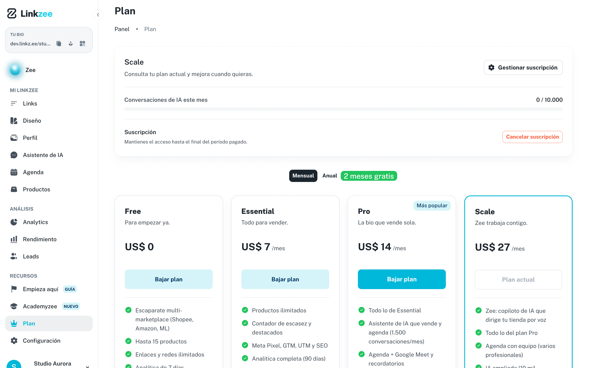

Linkzee tiene cuatro planes — **Free, Essential, Pro y Scale** — y tu primera tienda
empieza con **14 días gratis con todo desbloqueado**. Esta página explica qué incluye
cada plan, cuánto cuesta en cada país y cómo funciona la facturación.

<Note>
  El plan pertenece a una **tienda**, no a tu cuenta. Si llevas más de una
  tienda, cada una tiene su propio plan, sus propias facturas y su propia fecha
  de renovación — mira [Plan por tienda](/es/billing/plan-per-store).
</Note>

<Frame caption="La página Plan: tu plan actual, el uso y todas las opciones lado a lado.">
  
</Frame>

## Qué incluye cada plan

### Free — para empezar
- Vitrina de productos en Shopee, Amazon BR y Mercado Libre
- Hasta **15 productos**
- Enlaces y redes sociales ilimitados
- Analíticas de **7 días**, con un enlace rastreado para cada red y un cartel con código QR
- Tu **primera tienda** empieza con **14 días gratis** con todas las funciones (nivel Scale), sin tarjeta

### Essential — todo para vender
- **Productos ilimitados**
- Contador de escasez y productos destacados
- Meta Pixel, GTM, UTM y SEO
- Analíticas de **90 días**
- **Enlaces de campaña** — hasta **10** activos

### Pro — la bio que vende sola
Todo lo de Essential, y además:
- **12 meses** de historial de analíticas
- Enlaces de campaña **ilimitados**
- **Asistente de IA** que vende y agenda — **1.500 conversaciones/mes** por tienda
- Agenda con Google Meet, recordatorios por correo y **pagos en la reserva** (señal o importe total — tarifa de Linkzee del 1% por pago en este plan; **0% en Scale**)
- Meta Conversion API (CAPI)
- API pública, MCP y webhook de leads

### Scale — para equipos
Todo lo de Pro, y además:
- **Agenda con equipo** (varios agentes; el visitante elige con quién agenda)
- IA ampliada — **10.000 conversaciones/mes** por tienda
- **Zee — copiloto de IA por voz** que gestiona tu tienda por voz y texto (solo en Scale)

## Comparación

| Función | Free | Essential | Pro | Scale |
| --- | :---: | :---: | :---: | :---: |
| Productos | 15 | Ilimitado | Ilimitado | Ilimitado |
| Enlaces y redes sociales | Ilimitado | Ilimitado | Ilimitado | Ilimitado |
| Historial de analíticas | 7 días | 90 días | 12 meses | 12 meses |
| Contador de escasez y destacados | — | ✓ | ✓ | ✓ |
| Meta Pixel, GTM, UTM, SEO | — | ✓ | ✓ | ✓ |
| Enlaces rastreados por red + cartel con QR | ✓ | ✓ | ✓ | ✓ |
| Enlaces de campaña | — | 10 | Ilimitados | Ilimitados |
| Asistente de IA (vende y agenda) | — | — | 1.500/mes | 10.000/mes |
| Agenda + Google Meet + recordatorios por correo | — | — | ✓ | ✓ |
| Tarifa de Linkzee en pagos de reserva | — | — | 1% | **0%** |
| Meta Conversion API (CAPI) | — | — | ✓ | ✓ |
| API pública + MCP | — | — | ✓ | ✓ |
| Webhook de leads | — | — | ✓ | ✓ |
| Agenda con equipo | — | — | — | ✓ |
| Zee — copiloto de IA (voz y texto) | — | — | — | ✓ |

<Note>
  Cada límite y cada función de esta tabla se leen del plan de **una tienda**,
  incluidos la cuota de conversaciones de IA y la tarifa de Linkzee en los
  pagos de reserva. Una tienda en Free conserva los límites de Free aunque otra
  tienda de tu cuenta esté en Scale. El pago en la reserva necesita la agenda,
  así que solo está disponible en Pro y Scale.
</Note>

## Precios

En el plan **anual** obtienes **2 meses gratis** (pagas 10× el precio mensual).

| Plan | Mensual | Anual (2 meses gratis) |
| --- | --- | --- |
| Free | R$0 / US$0 | R$0 / US$0 |
| Essential | R$27 / US$7 | R$270 / US$70 |
| Pro | R$47 / US$17 | R$470 / US$170 |
| Scale | R$147 / US$47 | R$1.470 / US$470 |

<Note>
  Si te suscribiste antes de un cambio de precio, **conservas el precio con el
  que te suscribiste** mientras esa suscripción siga activa **en el mismo
  plan**. Cambiar de plan (subir o bajar) pasa la suscripción al precio vigente
  ese día. A una tienda que suscribas más tarde se le cobra el precio vigente el
  día en que la suscribes.
</Note>

### Moneda y países

- **Pagando desde Brasil:** se te cobra en reales brasileños (**R$**), al precio fijo de arriba.
- **Cualquier otro país:** el precio se basa en el importe en dólares de arriba y, en
  el pago, se muestra y se cobra automáticamente en tu **moneda local** (el importe
  convertido puede variar un poco según el tipo de cambio). Funciona en todo el mundo,
  sin una tabla de precios distinta por país.

El país se detecta según dónde estás cuando abres el pago, no según tu perfil.
Si estás de viaje o usas una VPN, puedes ver el precio en dólares y sin Pix.
Una vez suscrito, la suscripción mantiene esa moneda.

## 14 días gratis

Tu **primera tienda** empieza en **Free**, pero con **14 días de prueba que desbloquean
todas las funciones** (el nivel Scale) — **sin tarjeta de crédito**. Úsalos para probar
el asistente de IA, la agenda, el seguimiento y todo lo demás. Al terminar los 14 días,
esa tienda se queda en Free a menos que te suscribas a un plan de pago.

Durante la prueba, el asistente de IA atiende hasta **1.500 conversaciones**,
el mismo límite que Pro.

Mientras dura la prueba, la pantalla **Contenido** muestra **Tu prueba en
números**: los días que quedan, una lista corta de misiones para aprovecharla
al máximo (publicar 3 productos, conectar una red social, recibir tu primer
clic, activar el asistente de IA, compartir tu enlace) y tus resultados hasta
ahora (visitas a la bio, clics en productos y tu producto estrella).

La prueba es **una por persona**, no una por tienda. Cualquier tienda que crees
después de la primera empieza en **Free y sin prueba**, y eliminar una tienda no
devuelve la prueba. Mira [Varias tiendas](/es/account/multiple-stores).

## Cambiar de plan

- **Sube o baja de plan cuando quieras** desde **Dashboard → Plan**, que
  siempre muestra el plan de la **tienda en la que estás**. Si llevas más de
  una tienda, cambia antes a la correcta.
- Los cambios entre planes dentro del **mismo ciclo de facturación** son
  **prorrateados**. Antes de que confirmes, Linkzee te muestra el **importe
  prorrateado exacto**.
  - **Subir de plan:** solo pagas la diferencia por los días restantes, que se
    cobra en el momento. El plan nuevo empieza en cuanto se aprueba ese pago.
    Si no se aprueba (una tarjeta rechazada o un código Pix sin pagar), tu
    **plan actual sigue activo** y no cambia nada.
  - **Bajar de plan:** el importe no usado queda como crédito en tu cuenta y se
    descuenta de tu próxima factura. Si llevas más de una tienda, el crédito
    puede usarse en la próxima factura de cualquiera de ellas.
- No se puede **subir de plan** en las **24 horas anteriores a una
  renovación**, sea cual sea el método de pago. Sube de plan después de la
  renovación. Bajar de plan se puede en cualquier momento.
- **Un cambio a la vez.** Mientras un cambio espera el pago, págalo o deja que
  venza antes de hacer otro. Con una renovación pendiente, paga la factura
  antes de cambiar de plan.
- **Cambiar entre mensual y anual** funciona como una suscripción nueva:
  cancela la actual, deja que termine el periodo que ya pagaste y solo
  entonces suscríbete en el nuevo ciclo (una suscripción nueva solo puede
  empezar cuando la actual ha terminado por completo).
- **Cancelar** mantiene las funciones de pago hasta el final del periodo que
  ya pagaste; después **esa tienda** vuelve a Free. Tus otras tiendas
  conservan sus propios planes.

## Métodos de pago

En el pago, Linkzee muestra automáticamente los métodos de pago disponibles en
tu país:
- **Brasil:** tarjeta de crédito y **Pix recurrente** (Pix Automático).
- **Otros países:** tarjetas internacionales y, según tu país, otros métodos
  que admiten cobros recurrentes, como Apple Pay, Klarna, Cash App Pay, Amazon
  Pay o Satispay.

Todos los pagos se procesan de forma segura con **Stripe**. Linkzee es operado
por **Zee Labs LLC**, una empresa de Estados Unidos, y el cobro con tarjeta aparece
en tu extracto como **LINKZEE**. Con Pix, la app de tu banco muestra a **Ebanx**,
socio de Pix de Stripe, como destinatario.

### IOF en los pagos desde Brasil

Como Linkzee es una empresa de Estados Unidos, los pagos hechos desde Brasil
son compras internacionales e incluyen el **IOF**, el impuesto brasileño sobre
compras internacionales (hoy, 3,5%):

- **Pix:** el IOF se suma al precio del plan. Ves el total en el pago y en la
  app de tu banco antes de confirmar.
- **Tarjeta:** tu banco cobra el IOF en el extracto de la tarjeta, como en
  cualquier compra internacional.

### Pagar con Pix recurrente

Cuando te suscribes con Pix, autorizas una vez el **Pix Automático** en la app
de tu banco. A partir de ahí, cada renovación se debita automáticamente: tu
banco te avisa del importe con antelación, y el débito suele hacerse unos
**3 días después de la fecha de renovación**. No hay que pagar nada a mano.

- **Plan anual:** el pago muestra el límite anual que estás autorizando. El
  límite es un poco mayor que el precio del plan como margen de seguridad,
  pero solo se te cobra el precio de tu plan, más el IOF (mira arriba).
- **Subir de plan con Pix:** el débito automático no cubre la diferencia
  prorrateada, así que la pagas una vez con un código Pix (o con tarjeta).
  Hasta que pagues, tu **plan actual sigue activo** y no se cobra nada. Si el
  código vence, abre la factura de nuevo y se genera uno nuevo. Si la
  diferencia no se paga en aproximadamente un día, el cambio se cancela y tu
  plan sigue igual.
- Para subir un **plan anual pagado con Pix**, contacta con soporte.
- Si la autorización del Pix Automático se pausa o se cancela en la app de tu
  banco, o el banco no programa una renovación, recibes un correo para que
  puedas pagar la renovación antes de que se interrumpa nada.

## Cuando hay un pago pendiente

Si una renovación no se paga, con tarjeta o con Pix, Linkzee normalmente
**mantiene tu plan activo unos días más** para que puedas pagar.
**Dashboard → Plan** muestra **Pago pendiente**, con la fecha hasta la que tu
plan sigue activo, y un botón **Pagar ahora** que abre la factura abierta (Pix
o tarjeta). La factura también muestra **Pagar** en tu historial de pagos.

Si un pago de esa suscripción ya falló hace poco, este plazo extra puede no
volver a darse, y la tienda vuelve a Free en el momento, hasta que se pague la
factura.

Si la factura sigue sin pagar en esa fecha, las funciones de pago de esa
tienda se pausan y vuelve a Free. **No se borra nada** (los productos por
encima del límite de Free solo se ocultan): en cuanto se paga la factura, todo
vuelve tal como lo dejaste. Linkzee te envía un correo antes y cuando esto
ocurre.

## Facturas y recibos

Cada cobro genera una factura que puedes descargar como **recibo en PDF**:

1. Cambia a la tienda cuyas facturas quieres ver.
2. Ve a **Dashboard → Plan**.
3. Abre el **Historial de pagos**.
4. Cada entrada muestra el importe, la fecha y el estado — haz clic en **Recibo** para abrir o descargar el PDF.

Cada tienda tiene su propio historial de pagos, así que solo encuentras las
facturas de una tienda mientras esa tienda es la activa.

<Note>
¿No sabes qué plan te conviene? Escribe a support@linkz.ee y te ayudamos a elegir.
</Note>
