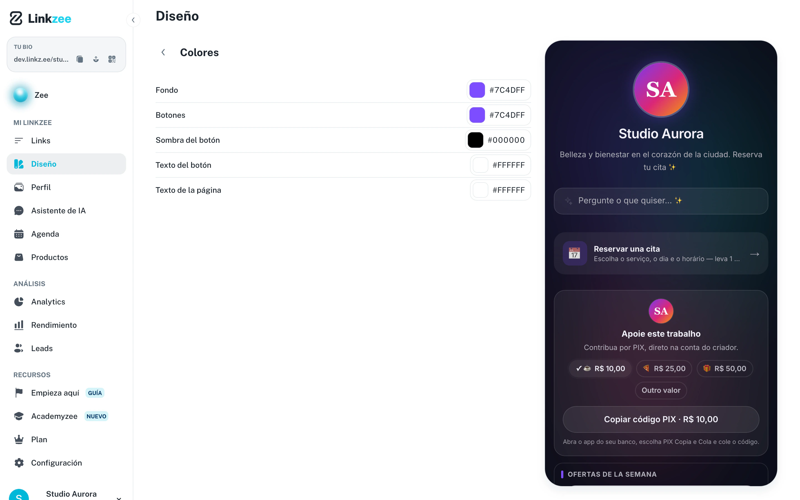

Un tema te da un aspecto completo con un solo toque. Cuando quieras ir más allá,
Linkzee te ofrece controles **curados** para afinar los detalles. Eliges entre
opciones pensadas para funcionar juntas, así nada desentona nunca.

<Frame caption="El panel Colores: espectro completo, hex y sugerencias — con vista previa al instante.">
  
</Frame>

Cada cambio aparece al instante en la vista previa en tiempo real — a la derecha
en escritorio, o debajo del editor en el celular — y se guarda automáticamente a
medida que avanzas.

## Qué puedes ajustar

<AccordionGroup>
  <Accordion title="Encabezado" icon="user">
    Elige cómo se ubican tu nombre, foto y logo en la parte superior de tu página:
    - **Clásico**: un avatar redondo y compacto con tu nombre y biografía.
    - **Hero**: una foto **o un video corto** que se extiende de lado a lado en
      la parte superior de la página (mira [Perfil](/es/your-page/header)).
    - **Banner**: una imagen de portada con tu avatar colocado encima.
    - **Recorte**: tú, sin fondo, sobre tu página. Sube un **PNG o WebP
      transparente**; una imagen sin transparencia no se acepta en este diseño.
    - **Forma**: tu retrato dentro de un contorno orgánico. Elige **Orgánico**,
      **Orgánico 2**, **Arco** o **Cuadrado suave**, y un color para la forma
      (o déjalo en el color del tema).

    **Ajustar encuadre** te permite arrastrar y hacer zoom en la foto dentro
    del diseño. Con un video en el hero, también puedes colocar tu logo
    encima, sólido o vidrio (Premium), con un borde en el color de tu avatar.
  </Accordion>
  <Accordion title="Avatar" icon="circle-user">
    Elige cómo aparece tu foto en la parte superior de la página: **Ninguno**,
    **Anillo**, **Anillo de color**, **Sombra** o **Brillo**, con el **Color
    del avatar** que prefieras. Mientras no elijas uno, se usa el efecto del
    tema. El diseño Hero muestra la foto de borde a borde, así que no tiene
    efecto de avatar.
  </Accordion>
  <Accordion title="Fondo de pantalla" icon="image">
    Define el estilo de tu fondo. Cada estilo muestra una muestra real, y sus
    opciones aparecen justo debajo. El color principal viene de **Colores**;
    los estilos que mezclan dos colores añaden el campo **Segundo color**.

    | Estilo | Opciones |
    | --- | --- |
    | **Color sólido** | Solo el color. |
    | **Degradado** | **Personalizado** (dos colores, dirección **Hacia arriba**, **Hacia abajo** o **Radial**) o **Prediseñado** (15 degradados listos, como Atardecer, Océano y Medianoche, con colores de texto que se leen bien sobre ellos). **Animar** hace que se mueva suavemente; **Textura granulada** añade un grano sutil. |
    | **Blur** | Manchas de color suaves, con **Intensidad** y **Posición** (arriba, centro o difuso). |
    | **Patrón** | 10 patrones (puntos, cuadrícula, ondas, colmena y más) teñidos con tu color, con **Tamaño** e **Intensidad**. |
    | **Malla** | Campos de color mezclados en tres disposiciones: **Clásica**, **Esquinas** o **Centro**. |
    | **Imagen** | Tu propia foto, con **Oscurecer la foto** (suave, medio, fuerte) para mantener el texto legible, y un **Desenfoque** opcional. Puedes reencuadrarla. |
    | **Duotono** | Tu foto en dos colores: tu color principal y un **Segundo color**. |
    | **Vídeo** | Un clip corto en bucle. |

    **Vídeo** acepta un archivo MP4 o MOV de hasta 40 MB y lo optimiza igual
    que el video del hero (720p, los primeros 30 segundos, sin sonido y en
    bucle) para que cargue rápido. Puedes **Reemplazarlo** o **Eliminarlo**
    cuando quieras. Los visitantes que prefieren menos movimiento o tienen el
    ahorro de datos activado ven su imagen de portada en su lugar.
  </Accordion>
  <Accordion title="Disposición del escaparate de productos" icon="grip">
    Elige cómo se muestra tu escaparate de productos: **Estándar**, una
    cuadrícula limpia; **Masonry**, tarjetas de alturas variadas; o
    **Carrusel**, donde cada categoría se convierte en una estantería
    horizontal que deslizas en el móvil (con flechas en el ordenador), con un
    botón **"Ver todo (n)"** que despliega la categoría completa ahí mismo.
    También puedes definir el estilo de la tarjeta y cómo se ajustan las fotos
    (mira [Escaparate de productos](/es/products/overview)).
  </Accordion>
  <Accordion title="Botones" icon="square">
    Define el **estilo** del botón (relleno, contorno, suave o **cristal**), la
    **forma** del botón (redondeado, levemente redondeado o recto) y la
    **sombra** del botón (ninguna, suave, fuerte o dura). La sombra es
    totalmente libre: elige el nivel que quieras.
  </Accordion>
  <Accordion title="Texto" icon="font">
    Elige tu **tipografía** de una lista curada, agrupada en sin serifa, con
    serifa y mono y display. O abre **Pares** para combinaciones listas: una
    fuente para tu nombre y los títulos, otra para los textos, en estilos como
    Editorial, Moderno, Boutique o Divertido.
  </Accordion>
  <Accordion title="Colores" icon="palette">
    Define el color del **fondo**, de los **botones**, de la **sombra del botón**,
    del **texto del botón** y del **texto de la página**. Cada fila abre un
    selector de color **completo** (espectro, código hex, cuentagotas y
    muestras sugeridas) para que puedas igualar el color exacto de tu marca,
    no solo los ajustes preestablecidos.

    Si una combinación es difícil de leer, aparece el aviso **Contraste bajo
    para la lectura** con una sugerencia, para que tu página siga legible.
  </Accordion>
  <Accordion title="Iconos sociales" icon="share-nodes">
    Elige cómo se ven tus iconos sociales: **Predeterminado** (sigue el tema),
    **Iconos**, **Relleno**, **Contorneado** o **Botones**. Relleno y
    Contorneado usan el color del botón; Botones muestran el nombre de cada red.
  </Accordion>
  <Accordion title="Tarjetas" icon="clone">
    Define el aspecto de las tarjetas de tu página: **Sólido**, **Vidrio**,
    **Neón** o **Suave**, con **Esquinas** sutiles, medias o redondas.
  </Accordion>
  <Accordion title="Movimiento" icon="wand-magic-sparkles">
    Define la **intensidad de las animaciones** de tu página pública:
    **Apagado**, **Sutil** o **Estándar**. Los visitantes que prefieren menos
    movimiento siempre ven la versión estática. Aquí también está el **Modo
    Escenario** (Premium), que hace que tu página reaccione a la música de tu
    tarjeta de Spotify (mira [Spotify](/es/your-page/spotify)).
  </Accordion>
</AccordionGroup>

<Note>
  Las muestras sugeridas y las tipografías integradas son gratuitas. Las
  opciones premium llevan una insignia y puedes probarlas en cualquier plan:
  un **color personalizado** (fuera de las muestras sugeridas), el estilo de
  botón de **cristal**, los fondos **Imagen**, **Malla**, **Duotono** y
  **Vídeo**, los degradados **radial** y **prediseñado**, **Animar**, un
  **video en el hero**, el logo de vidrio sobre el video, y las fuentes y
  pares premium. Las verás en la vista previa en vivo, pero si **esta tienda**
  está en Free su página pública conserva su último aspecto gratuito hasta que
  mejores el plan de esa tienda (mira [Plan por tienda](/es/billing/plan-per-store)).
</Note>

### Guardar o descartar cambios premium

En el plan Free, en cuanto aplicas una opción premium, el guardado automático
se pausa y aparecen los botones **Guardar** y **Descartar** en la parte
superior de la pantalla de Diseño.

- **Descartar** recupera el aspecto que está publicado ahora.
- **Guardar** abre las opciones de mejora de plan. Cuando la tienda pasa a un
  plan de pago, todo lo que configuraste se publica.

Las opciones gratuitas siguen guardándose automáticamente como siempre.

<Warning>
  Volver a elegir un tema listo restablece estas opciones al aspecto de ese tema.
</Warning>

## Próximos pasos

<CardGroup cols={2}>
  <Card title="Temas" icon="swatchbook" href="/es/design/themes">
    Empieza desde un aspecto completo y listo, y luego afínalo aquí.
  </Card>
  <Card title="Resumen del diseño" icon="palette" href="/es/design/overview">
    Descubre cómo funcionan juntos los temas y la personalización.
  </Card>
</CardGroup>
