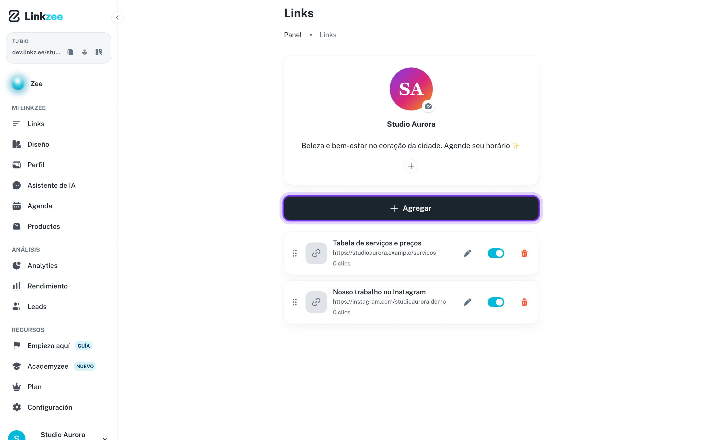
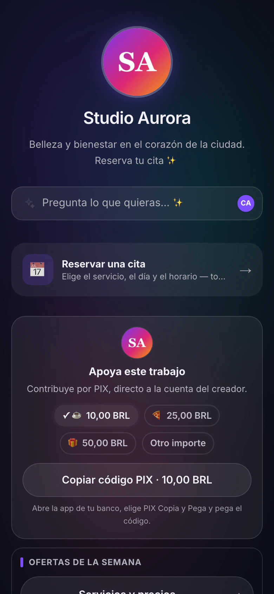

Esta guía te lleva desde el registro hasta una página activa en `linkz.ee/your-name`,
lista para poner en tu bio. Solo toma unos minutos.

<Frame caption="El editor Mi Linkzee: añade enlaces y mira la vista previa en vivo.">
  
</Frame>

<Steps>
  <Step title="Crea tu cuenta">
    Regístrate con tu **email y contraseña**, o elige **Continuar con Google**
    para empezar con un clic y sin contraseña que recordar. Consulta
    [Crea tu cuenta](/es/get-started/create-account) para ver los detalles.
  </Step>
  <Step title="Confirma tu email">
    Si te registraste con email y contraseña, abre el email de activación de
    Linkzee y haz clic en el enlace para activar tu cuenta. Si usaste
    **Continuar con Google**, tu cuenta ya está activa — pasa al siguiente paso.
  </Step>
  <Step title="Cuéntanos sobre tu trabajo">
    El onboarding guiado empieza por tu área de trabajo y por cómo puede
    ayudarte tu bio. Después, elige cómo te contactan tus clientes. El orden
    sugerido de los canales sigue la costumbre de tu país (por ejemplo, WhatsApp
    primero en Brasil, teléfono primero en Japón, mensaje de texto primero en
    EE. UU. y Canadá), y puedes cambiar el país. Usa **Cambiar texto** para
    modificar el texto del botón principal. Los enlaces que agregas reciben un
    nombre según su tipo, y puedes renombrar cada botón. El WhatsApp o teléfono
    que indicas aquí también se guarda en tu cuenta.
  </Step>
  <Step title="Agrega tus fotos">
    Sube la **Foto de perfil**, la **Portada** y hasta 3 fotos de **Tu trabajo**.
    Usa **Reencuadrar** para ajustar el encuadre de la foto de perfil y de la
    portada cuando quieras.
  </Step>
  <Step title="Revisa y publica">
    En el paso 4, elige la dirección de tu página en **Tu dirección**. Linkzee
    comprueba la disponibilidad mientras escribes y sugiere opciones si la que
    quieres ya tiene dueño. Consulta [Tu nombre de usuario](/es/get-started/your-username)
    para ver las reglas. Se elige un tema listo según los colores de tu logo,
    marcado con **Tu marca**; puedes elegir cualquier otro tema. En las fotos del
    trabajo, edita el título de la sección y, si quieres, agrega una leyenda a
    cada foto. Abre **Ver en pantalla completa** para ver tu bio como la ve el
    visitante y luego toca **Volver a ajustar** o **Publicar mi bio**.
  </Step>
  <Step title="Comparte tu página y conoce tu panel">
    En el paso 5 tu bio ya está publicada en `linkz.ee/your-name`. Copia el
    enlace y ponlo en tu bio de Instagram o TikTok. Después abre **Conoce tu
    panel**: ahí cambias todo cuando quieras y sigues quién llega por tu bio.
    Haz clic en **+ Agregar** para sumar más elementos, como un **Link**, un
    **Producto** o una **Red social**.
  </Step>
</Steps>

<Note>
  No hay botón de "Guardar" — todo lo que editas se guarda automáticamente, y la
  vista previa en vivo se actualiza en tiempo real (a la derecha en escritorio; en el móvil, toca **Vista previa**
  para abrirla a pantalla completa).
</Note>

## A dónde ir después

<CardGroup cols={2}>
  <Card title="Tu página" icon="table-cells" href="/es/your-page/overview">
    Construye tu página: agrega links, redes sociales, y tu nombre, foto y bio.
  </Card>
  <Card title="Diseño y temas" icon="palette" href="/es/design/overview">
    Elige un tema prediseñado y ajusta los colores, botones y fondo.
  </Card>
</CardGroup>

<Frame caption="Tu página pública lista: bio, agenda, vitrina y asistente en un solo enlace.">
  
</Frame>
