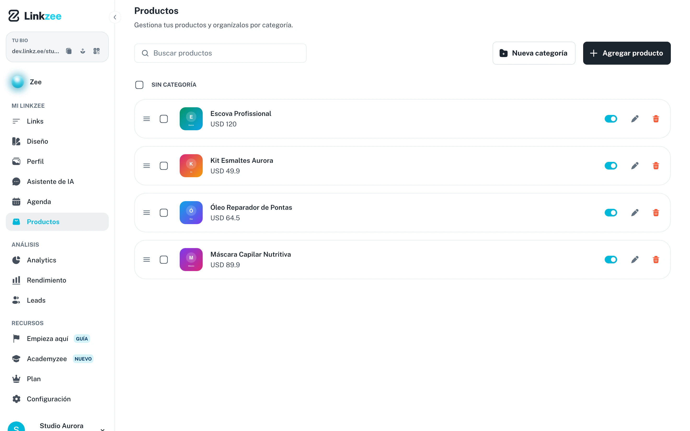

El **catálogo de productos** es la ventaja de Linkzee para los afiliados: convierte
tus links de marketplaces en una tienda de verdad. En lugar de una simple lista de
links, tus seguidores ven productos que pueden explorar y comprar con un solo toque,
mientras tú conservas tu comisión de afiliado.

Funciona con **Shopee**, **Amazon**, **Mercado Livre** y otros marketplaces.

<Frame caption="Tu vitrina de productos en el panel.">
  
</Frame>

## Cómo aparece en tu página

Tus productos aparecen **agrupados juntos** como tu escaparate, para que tu
página se mantenga limpia y fácil de explorar. La disposición la eliges tú: en
**Diseño** puedes escoger la **cuadrícula estándar**, el **mosaico (masonry)**
o el **carrusel**, que convierte cada categoría en una estantería horizontal
con botón "Ver todo". Cada tarjeta de producto muestra:

| Elemento | Qué muestra |
| --- | --- |
| **Imagen** | La foto del producto |
| **Nombre** | El título del producto |
| **Precio** | El precio en R$, si defines uno |
| **Sello de promoción** | Una etiqueta corta como "OFERTA", cuando está activada |
| **Contador de escasez** | Un temporizador que sigue contando hacia atrás |
| **Botón de acción** | Un botón **debajo** de la tarjeta que lleva a los visitantes a la oferta |

Cuando un visitante toca el botón de acción, el clic se registra y se le redirige
al marketplace, manteniendo tu **link de afiliado** intacto.

<Note>
  Todo lo que editas se guarda automáticamente y actualiza tu página en vivo en
  tiempo real. En el escritorio la vista previa queda a la derecha; en el móvil,
  toca **Vista previa** arriba para ver tu página a pantalla completa.
</Note>

## Explora el catálogo

<CardGroup cols={2}>
  <Card title="Agregar productos" icon="plus" href="/es/products/adding-products">
    Pega un link de marketplace y deja que Linkzee complete el nombre, la imagen y el precio automáticamente.
  </Card>
  <Card title="Precio y promociones" icon="tag" href="/es/products/pricing-promotions">
    Define un precio, agrega un sello de promoción y destaca tu mejor oferta.
  </Card>
  <Card title="Contador de escasez" icon="hourglass-half" href="/es/products/scarcity-counter">
    Suma urgencia con una cuenta regresiva que siempre luce fresca para cada visitante.
  </Card>
  <Card title="Categorías" icon="layer-group" href="/es/products/categories">
    Organiza un catálogo grande para que los visitantes puedan explorar por categoría.
  </Card>
</CardGroup>

## Configuración del catálogo

Abre **Configuración del catálogo** desde el engranaje de la tarjeta del
catálogo en **Contenido**, o ve a **Diseño → Vitrina**. Cada elección se aplica
al instante:

| Ajuste | Opciones |
| --- | --- |
| **Columnas de la grilla** | **2 columnas** o **1 columna**. |
| **Estilo de la grilla** | **Estándar**, **Masonry** o **Carrusel**. |
| **Estilo de la tarjeta** | **Clásico** o **Spotlight** (mira abajo). |
| **Fotos** | **Inteligente** (recomendado) decide por foto: una foto cuadrada llena la tarjeta, una panorámica se vuelve una tarjeta de dos columnas y el resto aparece completa sobre un fondo suave. **Siempre completa** nunca recorta la foto y rellena el espacio sobrante con una versión desenfocada de ella. **Rellenar** recorta desde el centro para que todas las tarjetas queden llenas, ideal para fotos estandarizadas de estudio. |

También puedes ocultar todo el catálogo de tu página con su interruptor, sin
borrar ningún producto.

## Orden del catálogo

Arriba en la pantalla **Productos**, el **Orden del catálogo** define cómo se
ordenan los productos en tu página:

| Opción | Cómo funciona |
| --- | --- |
| **Más recientes** | El predeterminado. Los productos nuevos aparecen primero. |
| **Personalizado** | El catálogo sigue tu orden, y los productos nuevos van arriba. La primera vez que lo eliges, el orden parte de la lista actual. |

Volver a **Más recientes** deja guardado tu orden personalizado: elige
**Personalizado** de nuevo y vuelve. El cambio se aplica al instante, sin
confirmación.

En la pantalla **Catálogo** del menú, arrastra las tarjetas para cambiar el
orden. El nuevo orden se guarda solo y activa **Personalizado**.

También puedes mover un producto pidiéndoselo a
[Zee](/es/zee/using-zee), por ejemplo "pon la tarjeta de regalo arriba", o usa
la [API](/es/api-reference/products). Mover un producto con el catálogo en
**Más recientes** activa **Personalizado** con un orden nuevo, hecho a partir de
la lista que ves, en lugar del que estaba guardado.

## Estilo de tarjeta Spotlight

En **Diseño → Vitrina → Estilo de la tarjeta** puedes cambiar las tarjetas de
producto de **Clásico** (foto arriba; nombre, precio y botón abajo) a
**Spotlight**: la foto llena el marco de la tarjeta, y el nombre, el precio y un
botón de cristal quedan justo debajo, sobre un brillo suave hecho con los
propios colores de la foto. El texto nunca tapa el producto. Los sellos, como
un descuento, aparecen como pequeñas píldoras de cristal al pie de la foto. Tu
página sigue en clásico hasta que lo elijas.

Con Spotlight activo, la vitrina también gana:

- **Destacado**: una tarjeta de ancho completo, en la posición del carrusel,
  con el producto que marcaste como destacado. Sin destacado, el producto más
  clicado ocupa el lugar, etiquetado "el más clicado de la semana".
- **Ritmo editorial**: en la cuadrícula, la tercera tarjeta de cada cinco pasa
  a ocupar dos columnas, como un lookbook.
- **Categorías con foto**: los chips de categoría se vuelven círculos con la
  foto del producto más reciente de cada una. Al desplazarte más allá, los chips
  se fijan bajo la búsqueda.
- **Botones que nunca se parten**: los textos largos se convierten, en las
  tarjetas de media anchura, en un verbo corto con el icono de la acción
  ("Pedir" + WhatsApp, "Ver" + ↗); el texto completo aparece en el destacado y en
  las tarjetas anchas. Consejo: la copy en primera persona vende más: "Lo
  quiero", "Quiero este look", "Asegurar el mío" (el formulario del producto las
  sugiere).
- **Tarjeta de dirección**: en el bloque del mapa, la opción **Visualización**
  cambia el mapa abierto por una tarjeta compacta con logo, dirección, horario de
  hoy y "Cómo llegar".
