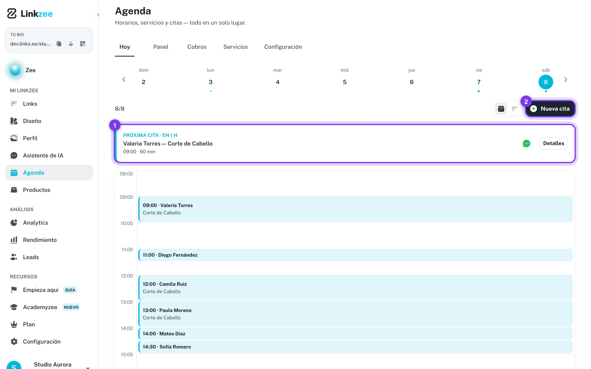

La Agenda permite que las personas **reserven tus servicios directamente desde tu
bio**. Actívala en **Agenda** y aparecerá una tarjeta de reserva en tu página,
para que los visitantes reserven un horario sin salir de tu Linkzee.

<Frame caption="La Agenda abre en Hoy: franja semanal, próxima cita y la línea de tiempo del día.">
  
</Frame>

## Tres configuraciones, un solo motor

La Agenda se adapta a cómo trabajas. Elige la configuración que combine con tu
negocio: todas funcionan sobre el mismo motor subyacente.

| Modo | Para quién es | Cómo funciona |
| --- | --- | --- |
| **Solo yo** | Una persona (manicurista, tatuador) | Los visitantes solo eligen un horario. |
| **Mi equipo** | Clínicas, salones | Cada profesional tiene sus propios horarios y servicios, y el visitante elige a quién. |
| **Por cupos** | Canchas, clases grupales | Hay varios cupos disponibles por horario. |

## Cómo reservan los visitantes

Aparece una tarjeta de reserva en tu página, con el estilo de tu tema. Los
visitantes reservan en un asistente sencillo, paso a paso: eligen lo que
necesitan, ven los horarios realmente disponibles y confirman. Los horarios
disponibles siguen la **zona horaria del negocio**, configurada en
**Agenda → Configuración**, así todos ven los cupos correctos.

<Note>
  Como todo en Linkzee, tus cambios de agenda se guardan automáticamente y la
  vista previa se actualiza en vivo. En computadora queda a la derecha; en el
  móvil, toca **Vista previa** arriba para ver tu página a pantalla completa.
</Note>

### La tarjeta de reservas arriba

La tarjeta de reservas queda **fija arriba de tu página**, justo debajo de tu
nombre. Es la acción principal de tu bio. Además del botón **Reservar**, muestra
los **próximos horarios libres** de un servicio: el visitante toca un horario y
llega directo a la confirmación, con el servicio y el horario ya elegidos.

Para elegir qué servicio aparece ahí, ve a **Links**, en la tarjeta de la agenda,
y elige un **Servicio destacado**. En **Automático**, mostramos el servicio más
reservado de los últimos 30 días.

### Ocultar la tarjeta de reservas

La tarjeta de reservas viene activada. Para ocultarla, ve a **Agenda →
Configuración** y desactiva **Mostrar la tarjeta de reserva en la parte superior
de la página**, justo debajo de **Agenda activa en mi página**. Solo la tarjeta
sale de tu página: la agenda sigue activa y tus visitantes todavía pueden
reservar con:

- tu [link de reserva](/es/scheduling/booking-link) (`linkz.ee/tu-nombre?agenda=1`);
- la [lista de servicios](/es/scheduling/services) de tu página;
- los botones **"Lo quiero"** de tus [links](/es/your-page/links) y cualquier otro
  botón vinculado a un servicio o paquete.

Quien ya reservó desde su dispositivo conserva un acceso directo arriba: ve **Tu
próxima cita** cuando tiene una pendiente, o **Mis citas** si no.

<Warning>
  Si la lista de servicios también está desactivada, el panel te avisa: sin la
  tarjeta superior, tus clientes solo pueden reservar con tu link de reserva o
  con botones vinculados a servicios. Toca **Ver enlace de reserva** para ir
  hasta él y compartirlo, así no pierdes reservas.
</Warning>

Con el [servidor MCP](/es/integrations/mcp/tools-reference), `configure_agenda`
hace lo mismo con `showTopCard: false` (o `true` para volver a mostrar la
tarjeta).

## ¿Ya usas Qzee?

Si tu negocio organiza las citas en Qzee, puedes poner tu **agenda de Qzee**
arriba en la bio en lugar de la agenda de Linkzee. El cliente reserva directo
en Qzee, y tu bio recibe reservas por una agenda a la vez. Ver
[Agenda de Qzee en la bio](/es/scheduling/qzee-booking).

## Configúrala

<CardGroup cols={2}>
  <Card title="Servicios" icon="list-check" href="/es/scheduling/services">
    Crea los servicios que las personas pueden reservar, con duración, precio y más.
  </Card>
  <Card title="Horarios de atención" icon="clock" href="/es/scheduling/business-hours">
    Define cuándo estás disponible y tus reglas de reserva.
  </Card>
  <Card title="Equipo" icon="users" href="/es/scheduling/team">
    Agrega a las personas que atienden citas y los servicios que ofrecen.
  </Card>
  <Card title="Cobrar en las reservas" icon="credit-card" href="/es/scheduling/payments">
    Señal o importe total al reservar, pagado directo a ti.
  </Card>
  <Card title="Cobros y transferencias" icon="sack-dollar" href="/es/scheduling/earnings">
    Lo que recibiste, quién pagó y cómo llega a tu banco.
  </Card>
  <Card title="Reseñas" icon="star" href="/es/scheduling/reviews">
    Reseñas reales tras cada cita, mostradas donde la gente reserva.
  </Card>
  <Card title="Lista de espera" icon="user-clock" href="/es/scheduling/waitlist">
    Horarios cancelados ofrecidos automáticamente al siguiente de la fila.
  </Card>
  <Card title="Google Calendar" icon="calendar-plus" href="/es/scheduling/google-calendar">
    Conecta tu calendario para que las reservas aparezcan en tu teléfono, con Google Meet.
  </Card>
  <Card title="Paquetes de sesiones" icon="ticket" href="/es/scheduling/packages">
    Vende paquetes de sesiones por adelantado. Los créditos se usan automáticamente al reservar.
  </Card>
  <Card title="Planes recurrentes" icon="arrows-rotate" href="/es/scheduling/subscription-plans">
    Suscripciones mensuales o anuales con sesiones ilimitadas, créditos o descuentos.
  </Card>
  <Card title="Área de clientes" icon="circle-user" href="/es/scheduling/customer-area">
    Una página privada donde los clientes siguen sus reservas, créditos y suscripciones.
  </Card>
  <Card title="Agenda de Qzee" icon="calendar-days" href="/es/scheduling/qzee-booking">
    ¿Ya usas Qzee? Pon tu agenda de Qzee arriba en la bio.
  </Card>
</CardGroup>
