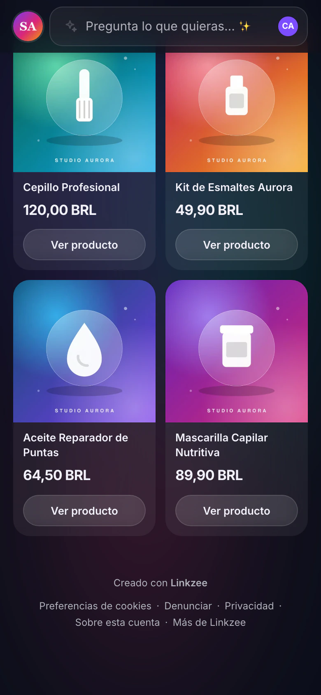

Tu página nació para compartirse. Linkzee te da un **código QR** descargable,
una **imagen de vista previa** cuidada para las apps — y, si quieres, una
**tarjeta de apoyo por PIX** para que los visitantes te envíen una
contribución directa.

## Código QR

Toca **Compartir** (en el menú lateral, o arriba de la pantalla en el móvil) y
luego el botón **Código QR** para descargar el QR de tu página o armar un
**cartel con QR** listo para imprimir (cartel A5 o adhesivo cuadrado en PDF para
imprenta, o imágenes de Historia y Publicación para redes). Quien lo escanee cae
directo en tu página pública, y la visita aparece en Analytics como **QR
impreso**. Ver [Enlaces rastreados y código QR](/es/analytics/tracked-links).

## Imagen al compartir

Cuando alguien comparte tu enlace — en WhatsApp, Instagram, X, donde sea — la
app muestra una **tarjeta de vista previa generada automáticamente** con tu
foto y tu nombre. No hay nada que configurar: se actualiza sola cuando cambias
la cabecera de tu página.

## Tarjeta de apoyo por PIX (Brasil)

Deja que los visitantes apoyen tu trabajo con un PIX directo — sin
intermediarios, sin comisión, directo a tu clave:

1. En **Mi Linkzee → Agregar**, elige **Apoyo**.
2. Ingresa tu **clave PIX** (CPF/CNPJ, correo, teléfono o clave aleatoria) y,
   si quieres, importes sugeridos.
3. Una tarjeta de apoyo aparece en tu página: el visitante escanea el **código
   QR** o toca **copiar código** y paga en la app de su banco.

<Note>
  El PIX va **directo del banco del visitante al tuyo** — Linkzee no toca el
  dinero ni cobra nada por ello. La tarjeta puede reubicarse en la página como
  cualquier otro elemento.
</Note>

<Frame caption="La tarjeta de apoyo por PIX en tu página pública: montos sugeridos y código para copiar.">
  
</Frame>
