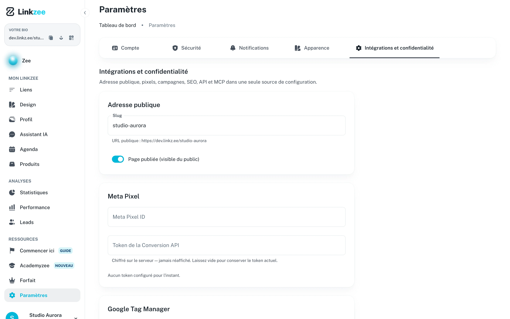

Linkzee dispose de son propre écran [Performance](/fr/analytics/overview), mais vous
pouvez aussi mesurer les conversions avec vos **propres** outils marketing.
Connectez-les une fois et Linkzee envoie les données au fur et à mesure que les
visiteurs interagissent avec votre page.

<Frame caption="Intégrations et confidentialité : Meta Pixel, GTM et l'adresse publique de votre page.">
  
</Frame>

Tout ici s'enregistre automatiquement à mesure que vous saisissez — il n'y a pas
de bouton Enregistrer.

## Meta Pixel

Ajoutez votre ID **Meta Pixel** pour suivre les visiteurs et les conversions dans
le Gestionnaire d'événements Meta. Ajoutez ensuite également le token de sa
**Conversion API**.

Le token est important : les navigateurs et iOS bloquent souvent le script du
pixel, ce qui peut faire disparaître des événements. La Conversion API envoie la
conversion directement depuis Linkzee, donc elle reste enregistrée même quand le
script est bloqué. Ajouter les deux vous offre le suivi le plus complet.

## Google Tag Manager

Ajoutez l'ID de conteneur **Google Tag Manager** pour charger votre conteneur GTM
sur votre page publique. De là, vous pouvez gérer vos propres balises et
déclencheurs dans Google Tag Manager.

## Paramètres UTM

Définissez des paramètres **UTM** par défaut — comme la source, le support et la
campagne — que Linkzee ajoute automatiquement à vos liens sortants. Cela étiquette
le trafic que vous envoyez pour que vos statistiques l'attribuent à la bonne source
et à la bonne campagne.

<Note>
  Vous trouverez ces valeurs dans vos outils marketing — votre ID de Pixel et le
  token de la Conversion API dans le **Gestionnaire d'événements Meta**, et votre
  ID de conteneur dans **Google Tag Manager**.
</Note>

## Comment Linkzee mesure ses propres publicités

Les réglages ci-dessus sont les vôtres et s'appliquent à votre page publique. À
part, sur les pages de Linkzee elle-même (site, quiz, inscription et
abonnement), et uniquement si vous acceptez les cookies publicitaires, Linkzee
mesure les résultats de ses publicités avec Meta (Pixel et API Conversions) et
Google Tag Manager. Pour cela, Linkzee envoie à Meta :

- E-mail, téléphone et nom sous forme chiffrée (hachage SHA-256), et un
  identifiant interne également haché.
- Votre localisation approximative déduite de l'adresse IP (ville, région et
  pays, jamais le code postal).
- L'adresse IP et le navigateur utilisés au moment de l'événement.
- Les identifiants publicitaires de Meta (cookies `_fbp` et `_fbc`).

Pour les paiements, l'adresse de facturation communiquée à Stripe peut compléter
ces données. Le téléphone peut provenir de votre compte ou du numéro WhatsApp ou
de téléphone que vous avez indiqué en configurant votre page.

Ces données de mesure sont conservées peu de temps : le contexte du paiement
jusqu'à **30 jours** et le contexte de l'inscription (sans l'adresse IP) jusqu'à
**90 jours**. Vous pouvez retirer votre consentement à tout moment dans
**Préférences de cookies** ; le retrait supprime ces contextes et arrête les
nouveaux envois. Linkzee applique le mode d'utilisation limitée des données de
Meta lorsque la loi l'exige. Si l'envoi à Meta échoue, l'événement reste dans une
file de renvoi jusqu'à 2 jours, et Linkzee conserve un registre minimal des
conversions déjà envoyées (uniquement l'identifiant de l'événement, sans données
personnelles) pour ne jamais compter deux fois la même conversion. La file est
également supprimée lorsque vous retirez votre consentement.

## Étapes suivantes

<CardGroup cols={2}>
  <Card title="Performance" icon="chart-line" href="/fr/analytics/overview">
    Consultez les clics, les vues et vos meilleurs éléments directement dans Linkzee.
  </Card>
  <Card title="Paramètres du compte" icon="gear" href="/fr/account/account">
    Configurez votre langue, votre région, votre apparence et vos options d'accessibilité.
  </Card>
</CardGroup>
