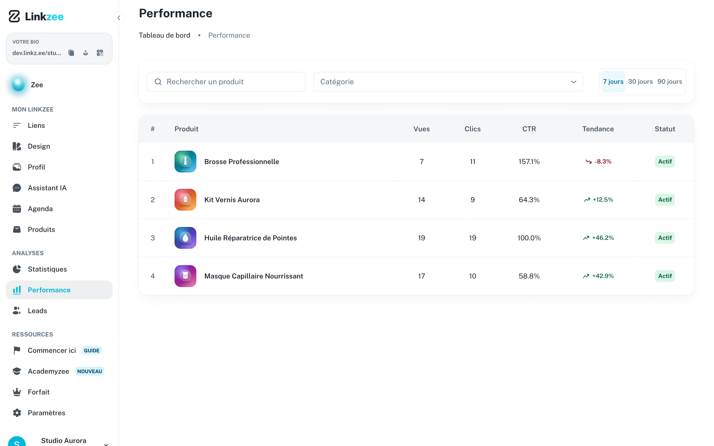

L'écran **Statistiques** montre comment se porte votre page Linkzee. Il suit
chaque visite, depuis le moment où quelqu'un ouvre votre page jusqu'au clic, à la
réservation ou au contact, pour que vous voyiez ce qui fonctionne et en fassiez
davantage.

L'écran a trois onglets (**Résumé**, **D'où ils viennent** et **Boutons**) et
un sélecteur de période en haut. Sous le titre, vous voyez quand les chiffres ont
été mis à jour : ils se renouvellent **environ toutes les heures**.

## Votre historique selon le forfait

La période que vous pouvez consulter dépend du forfait de la boutique dans
laquelle vous vous trouvez :

| Forfait | Historique | Périodes disponibles |
| --- | --- | --- |
| Free | 7 jours | Aujourd'hui · 7 jours |
| Essential | 90 jours | Aujourd'hui · 7 jours · 30 jours · 90 jours |
| Pro et Scale | 12 mois | Aujourd'hui · 7 jours · 30 jours · 90 jours · 12 mois |

Les périodes au-delà de votre forfait affichent une **couronne**. En touchant
l'une d'elles, vous voyez ce que montre chaque forfait et pouvez passer à un
forfait supérieur. Vos données continuent d'être enregistrées dans tous les cas :
en vous abonnant, l'historique plus long apparaît tout de suite.

<Note>
  Chaque période se termine **aujourd'hui** et utilise le fuseau horaire de votre
  boutique. Les comparaisons (« vs. 30 jours précédents ») n'utilisent que des
  jours compris dans l'historique de votre forfait : il n'y a donc pas de
  comparaison d'une année sur l'autre. **Aujourd'hui** et **12 mois** n'affichent
  pas de comparaison, et vous voyez un tiret à la place du chiffre quand l'historique ne suffit pas pour
  comparer.
</Note>

## Résumé

L'onglet **Résumé** vous donne toute la vue d'ensemble sur un seul écran :

- **Une phrase clé** : par exemple, *« Sur 100 visites, 41 ont cliqué sur quelque
  chose et 3 ont réservé. »* Avec moins de 100 visites, elle utilise les chiffres
  réels.
- **Quatre chiffres clés** : **Visites**, **Visiteurs**, **% qui a cliqué** et
  **Clics**, chacun avec son évolution par rapport à la période précédente.
- **Visites et clics** : un graphique par jour (par mois sur 12 mois).
- **L'entonnoir** : le parcours de ceux qui ont visité (voir plus bas).
- **D'où ils viennent** : vos principales provenances, avec **Tout voir** pour
  ouvrir l'onglet suivant.
- **Les plus cliqués** : vos boutons phares, avec **Tout voir** pour ouvrir
  l'onglet Boutons.
- **Appareils**, **Villes** et **Pays**.
- Un raccourci vers **Performance des produits** (voir [L'écran Performance](#l%C3%A9cran-performance)).

Si votre page n'a pas encore de visites, l'onglet affiche **Partager mon lien**,
qui ouvre la fenêtre de partage. Voir [Liens suivis et QR code](/fr/analytics/tracked-links).

## L'entonnoir

L'entonnoir montre combien de visiteurs ont avancé à chaque étape, et la part qui
a continué d'une étape à l'autre. Chaque étape ne compte que des personnes de
l'étape précédente : une étape n'est donc jamais plus grande que la précédente.

| Votre page a… | Entonnoir |
| --- | --- |
| L'agenda | Ont visité → Ont cliqué sur quelque chose → Ont ouvert l'agenda → Ont réservé |
| La collecte de contacts, sans agenda | Ont visité → Ont cliqué sur quelque chose → Sont devenus contacts |
| Ni l'un ni l'autre | Ont visité → Ont cliqué sur quelque chose |

Avec l'[agenda Qzee](/fr/scheduling/qzee-booking) sur votre bio, le Résumé affiche
l'entonnoir des clics : les réservations se font sur Qzee et apparaissent dans
le rapport Qzee.

## D'où ils viennent

L'onglet **D'où ils viennent** répond à la question *« quel endroit m'amène des
clients ? »* :

- **Par provenance** : Instagram, TikTok, WhatsApp, Google, QR imprimé, etc., avec
  pour chacun la part des visites, le % qui a cliqué et le nombre de réservations.
  Ouvrez une provenance pour voir de quel endroit de ce réseau la visite est
  venue (**Bio**, **Stories**, **Message privé**…) ou **Sans lien suivi** quand
  la visite est arrivée sans l'un de vos liens.
- **Direct (sans origine)** : les visites sans information sur leur provenance
  (quelqu'un a tapé votre adresse, ou l'application l'a masquée). Quand cette part
  est élevée, un message propose **Obtenir mes liens**, pour que chaque réseau ait
  son propre lien.
- **Liens de campagne** : les visites et réservations apportées par chacun de vos
  liens de campagne. Touchez-en un pour voir le détail. Voir [Liens de campagne](/fr/analytics/tracked-links#liens-de-campagne).
- **Publicités et Google Analytics** (avancé) : les paramètres UTM venus de
  publicités et d'outils externes (`utm_source`, `utm_campaign`…).

## Boutons

L'onglet **Boutons** classe tous les boutons de votre page, du plus cliqué au
moins cliqué : liens, produits, le bouton de réservation, réseaux sociaux, la
carte et les autres. Utilisez les filtres du haut (**Tous**, **Liens**,
**Produits**, **Agenda**, **Réseaux sociaux**, **Carte**) pour filtrer.

La carte de l'[agenda Qzee](/fr/scheduling/qzee-booking) apparaît comme **Agenda
Qzee** : chaque ouverture par un visiteur compte comme un clic, et le filtre
**Agenda** l'additionne au bouton de réservation Linkzee. Son détail n'affiche
pas combien de personnes ont réservé, car ces réservations sont dans le rapport
Qzee.

Touchez un bouton pour voir ses clics par jour, d'où viennent ces clics et, pour
le bouton de réservation, combien de personnes ont réservé. **Modifier ce
bouton** vous emmène directement là où vous le modifiez.

## Ce que signifie chaque chiffre

| Chiffre | Ce qu'il compte |
| --- | --- |
| **Visites** | Chaque fois que quelqu'un ouvre votre page. Recharger ou parcourir la page pendant la même visite ne compte pas à nouveau ; une nouvelle visite commence après 30 minutes d'absence ou quand la personne arrive par un autre lien. |
| **Visiteurs** | Les navigateurs ou appareils différents qui ont ouvert votre page sur la période. La même personne dans le navigateur d'Instagram et dans Safari compte pour 2. |
| **Clics** | Les touchers sur vos liens, produits, bouton de réservation, carte de l'agenda Qzee, réseaux sociaux, carte et boutons de soutien et d'avis. |
| **% qui a cliqué** | Sur l'ensemble des visites, la part où la personne a cliqué sur au moins une chose. |
| **Clics par visite** (« 15 pour 100 visites ») | Le nombre de clics qu'un bouton a reçus pour 100 visites. Il peut dépasser 100 quand des personnes cliquent plusieurs fois sur le même bouton. |
| **Ont ouvert l'agenda** | Les visites où la personne a ouvert votre agenda. |
| **Ont réservé** | Les réservations faites depuis une visite sur votre page pendant la période, quel que soit leur statut. |
| **Sont devenus contacts** | Les nouveaux contacts recueillis depuis une visite sur votre page pendant la période. |
| **Vient surtout de** | La provenance qui a envoyé le plus de clics vers ce bouton. |
| **vs. précédent** | L'évolution par rapport à la période de même durée juste avant. Les nombres évoluent en % ; les taux évoluent en points (« +3 points »). |

<Note>
  Linkzee mesure votre page avec sa **propre mesure anonyme**, sans cookies tiers.
  Ces données ne sont jamais partagées et servent uniquement aux statistiques de
  votre boutique. Les visiteurs qui désactivent la mesure dans le bandeau des
  cookies comptent toujours comme visites, mais pas comme visiteurs.
</Note>

## L'écran Performance

À côté de Statistiques dans le menu se trouve un écran **Performance** dédié : un
tableau de vos **produits**, chacun avec ses vues, ses clics et son taux de clic
pour la période de votre choix (**7 jours, 30 jours, 90 jours ou 12 mois**, dans
la limite de l'historique de votre forfait). Utilisez-le pour repérer les
produits qui méritent leur place sur la page, et ceux qui ont besoin d'une
meilleure image, d'un meilleur titre ou d'une meilleure position.

<Frame caption="Performance : clics par lien et par produit, avec les totaux de la période.">
  
</Frame>

## Faites-en un atout

Servez-vous de vos chiffres pour savoir d'où viennent vos clients et ce qu'ils
touchent le plus, puis misez sur ce qui marche : donnez à chaque réseau son
propre lien, placez vos boutons les plus forts en haut et renouvelez les offres
qui s'essoufflent.

<CardGroup cols={2}>
  <Card title="Liens suivis et QR code" icon="qrcode" href="/fr/analytics/tracked-links">
    Un lien pour chaque endroit où vous partagez votre page, des liens de campagne et une plaque avec QR à imprimer.
  </Card>
  <Card title="Augmentez vos clics" icon="arrow-trend-up" href="/fr/best-practices/growing-clicks">
    Des conseils pratiques pour transformer plus de visites en clics.
  </Card>
</CardGroup>
