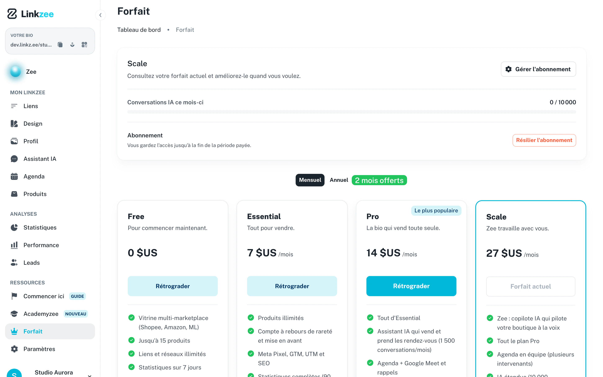

Linkzee propose quatre forfaits — **Free, Essential, Pro et Scale** — et votre première
boutique démarre avec un **essai gratuit de 14 jours, tout débloqué**. Cette page explique
ce que contient chaque forfait, combien il coûte dans chaque pays et comment fonctionne
la facturation.

<Note>
  Le forfait appartient à une **boutique**, pas à votre compte. Si vous gérez
  plusieurs boutiques, chacune porte son propre forfait, ses propres factures et
  sa propre date de renouvellement — voir
  [Un forfait par boutique](/fr/billing/plan-per-store).
</Note>

<Frame caption="La page Offre : votre offre actuelle, l’usage et toutes les options côte à côte.">
  
</Frame>

## Ce que contient chaque forfait

### Free — pour démarrer
- Vitrine de produits sur Shopee, Amazon BR et Mercado Livre
- Jusqu'à **15 produits**
- Liens et réseaux sociaux illimités
- Statistiques sur **7 jours**, avec un lien suivi pour chaque réseau et une plaque avec QR code
- Votre **première boutique** démarre avec **14 jours gratuits** avec toutes les fonctionnalités (niveau Scale), sans carte

### Essential — tout pour vendre
- **Produits illimités**
- Compte à rebours de rareté et produits mis en avant
- Meta Pixel, GTM, UTM et SEO
- Statistiques sur **90 jours**
- **Liens de campagne** — jusqu'à **10** actifs

### Pro — la bio qui vend toute seule
Tout ce qu'il y a dans Essential, et en plus :
- **12 mois** d'historique des statistiques
- Liens de campagne **illimités**
- **Assistant IA** qui vend et prend les rendez-vous — **1 500 conversations/mois** par boutique
- Agenda avec Google Meet, rappels par e-mail et **paiements à la réservation** (acompte ou montant total — commission Linkzee de 1 % par paiement sur ce forfait ; **0 % avec Scale**)
- Meta Conversion API (CAPI)
- API publique, MCP et webhook de leads

### Scale — pour les équipes
Tout ce qu'il y a dans Pro, et en plus :
- **Agenda en équipe** (plusieurs agents ; le visiteur choisit avec qui il réserve)
- IA étendue — **10 000 conversations/mois** par boutique
- **Zee — copilote IA vocal** qui pilote votre boutique à la voix et au texte (Scale uniquement)

## Comparaison

| Fonctionnalité | Free | Essential | Pro | Scale |
| --- | :---: | :---: | :---: | :---: |
| Produits | 15 | Illimité | Illimité | Illimité |
| Liens et réseaux sociaux | Illimité | Illimité | Illimité | Illimité |
| Historique des statistiques | 7 jours | 90 jours | 12 mois | 12 mois |
| Compte à rebours et mise en avant | — | ✓ | ✓ | ✓ |
| Meta Pixel, GTM, UTM, SEO | — | ✓ | ✓ | ✓ |
| Liens suivis par réseau + plaque avec QR | ✓ | ✓ | ✓ | ✓ |
| Liens de campagne | — | 10 | Illimités | Illimités |
| Assistant IA (vend et réserve) | — | — | 1 500/mois | 10 000/mois |
| Agenda + Google Meet + rappels par e-mail | — | — | ✓ | ✓ |
| Commission Linkzee sur les paiements de réservation | — | — | 1 % | **0 %** |
| Meta Conversion API (CAPI) | — | — | ✓ | ✓ |
| API publique + MCP | — | — | ✓ | ✓ |
| Webhook de leads | — | — | ✓ | ✓ |
| Agenda en équipe | — | — | — | ✓ |
| Zee — copilote IA (voix et texte) | — | — | — | ✓ |

<Note>
  Chaque limite et chaque fonctionnalité de ce tableau sont lues sur le forfait
  d'**une seule boutique**, y compris le quota de conversations IA et la
  commission Linkzee sur les paiements de réservation. Une boutique en Free
  conserve les limites du Free même si une autre boutique de votre compte est
  en Scale. Le paiement à la réservation nécessite l'agenda : il n'existe donc
  qu'avec Pro et Scale.
</Note>

## Tarifs

Avec le forfait **annuel**, vous obtenez **2 mois offerts** (vous payez 10× le prix mensuel).

| Forfait | Mensuel | Annuel (2 mois offerts) |
| --- | --- | --- |
| Free | R$0 / US$0 | R$0 / US$0 |
| Essential | R$27 / US$7 | R$270 / US$70 |
| Pro | R$47 / US$17 | R$470 / US$170 |
| Scale | R$147 / US$47 | R$1 470 / US$470 |

<Note>
  Si vous vous êtes abonné avant un changement de prix, **vous conservez le
  prix auquel vous avez souscrit** tant que cet abonnement reste actif **sur le
  même forfait**. Changer de forfait (montée ou baisse) fait passer l'abonnement
  au prix en vigueur ce jour-là. Une boutique que vous abonnez plus tard est
  facturée au prix en vigueur le jour où vous l'abonnez.
</Note>

### Devise et pays

- **En payant depuis le Brésil :** vous êtes facturé en réaux brésiliens (**R$**), au prix fixe ci-dessus.
- **Tout autre pays :** le prix est basé sur le montant en dollars ci-dessus et, au
  paiement, il est affiché et débité automatiquement dans votre **devise locale** (le
  montant converti peut varier légèrement selon le taux de change). Cela fonctionne
  partout dans le monde, sans grille tarifaire distincte par pays.

Le pays est détecté selon l'endroit où vous êtes quand vous ouvrez la page de
paiement, et non selon votre profil. Si vous voyagez ou utilisez un VPN, vous
pouvez voir le prix en dollars et sans Pix. Une fois abonné, l'abonnement garde
cette devise.

## 14 jours gratuits

Votre **première boutique** démarre sur **Free**, mais avec un **essai de 14 jours qui
débloque toutes les fonctionnalités** (le niveau Scale) — **sans carte bancaire**.
Profitez-en pour tester l'assistant IA, l'agenda, le suivi et tout le reste. À la fin
des 14 jours, cette boutique reste en Free, sauf si vous souscrivez à un forfait payant.

Pendant l'essai, l'assistante IA peut tenir jusqu'à **1 500 conversations**,
comme avec Pro.

Pendant l'essai, l'écran **Contenu** affiche **Votre essai en chiffres** :
les jours restants, une courte liste de missions pour en tirer le meilleur
(publier 3 produits, connecter un réseau social, recevoir votre premier clic,
activer l'assistante IA, partager votre lien) et vos résultats jusqu'ici
(visites de la bio, clics sur les produits et votre produit vedette).

L'essai est **unique par personne**, pas par boutique. Toute boutique que vous
créez après la première démarre en **Free, sans essai**, et supprimer une
boutique ne redonne pas l'essai. Voir
[Plusieurs boutiques](/fr/account/multiple-stores).

## Changer de forfait

- **Passez à un forfait supérieur ou inférieur à tout moment** depuis
  **Dashboard → Forfait**, qui affiche toujours le forfait de la **boutique où
  vous vous trouvez**. Si vous gérez plusieurs boutiques, basculez d'abord sur
  la bonne.
- Les changements de forfait au sein du **même cycle de facturation** sont
  **calculés au prorata**. Avant que vous confirmiez, Linkzee vous indique le
  **montant exact calculé au prorata**.
  - **Montée en gamme :** vous ne payez que la différence pour les jours
    restants, débitée tout de suite. Le nouveau forfait démarre dès que ce
    paiement est accepté. S'il ne l'est pas (carte refusée ou code Pix non
    payé), **votre forfait actuel reste actif** et rien ne change.
  - **Baisse de gamme :** le montant non utilisé devient un crédit sur votre
    compte et il est déduit de votre prochaine facture. Si vous gérez
    plusieurs boutiques, ce crédit peut servir sur la prochaine facture de
    n'importe laquelle d'entre elles.
- Une **montée en gamme** n'est pas possible dans les **24 heures qui
  précèdent un renouvellement**, quel que soit le moyen de paiement. Faites-la
  après le renouvellement. Une baisse de gamme reste possible à tout moment.
- **Un changement à la fois.** Tant qu'un changement attend son paiement,
  payez-le ou laissez-le expirer avant d'en faire un autre. Si un
  renouvellement est en attente, payez la facture avant de changer de forfait.
- **Le passage entre mensuel et annuel** fonctionne comme un nouvel
  abonnement : annulez l'abonnement en cours, laissez la période déjà réglée
  arriver à son terme, puis seulement abonnez-vous sur la nouvelle périodicité
  (un nouvel abonnement ne peut démarrer qu'une fois l'actuel entièrement
  terminé).
- **L'annulation** conserve vos fonctionnalités payantes jusqu'à la fin de la
  période déjà réglée ; ensuite **cette boutique** revient au Free. Vos autres
  boutiques conservent leur propre forfait.

## Moyens de paiement

Au moment du paiement, Linkzee affiche automatiquement les moyens de paiement
disponibles dans votre pays :
- **Brésil :** carte de crédit et **Pix récurrent** (Pix Automático).
- **Autres pays :** cartes internationales et, selon votre pays, d'autres
  moyens qui acceptent les paiements récurrents, comme Apple Pay, Klarna,
  Cash App Pay, Amazon Pay ou Satispay.

Tous les paiements sont traités en toute sécurité par **Stripe**. Linkzee est
exploité par **Zee Labs LLC**, une société américaine, et le débit par carte apparaît
sur votre relevé sous le nom **LINKZEE**. Avec Pix, l'application de votre banque
affiche **Ebanx**, partenaire Pix de Stripe, comme bénéficiaire.

### IOF pour les paiements depuis le Brésil

Comme Linkzee est une société américaine, les paiements effectués depuis le
Brésil sont des achats internationaux et incluent l'**IOF**, la taxe
brésilienne sur les achats internationaux (actuellement 3,5 %) :

- **Pix :** l'IOF s'ajoute au prix du forfait. Vous voyez le total au paiement
  et dans l'application de votre banque avant de confirmer.
- **Carte :** votre banque prélève l'IOF sur votre relevé de carte, comme pour
  tout achat international.

### Payer avec le Pix récurrent

Quand vous vous abonnez avec Pix, vous autorisez une seule fois le **Pix
Automático** dans l'application de votre banque. Ensuite, chaque
renouvellement est prélevé automatiquement : votre banque vous prévient du
montant à l'avance, et le prélèvement a généralement lieu environ **3 jours
après la date de renouvellement**. Rien à payer à la main.

- **Offre annuelle :** le paiement affiche la limite annuelle que vous
  autorisez. Cette limite est un peu supérieure au prix de l'offre, par
  sécurité, mais vous n'êtes débité que du prix de votre offre, plus l'IOF (voir ci-dessus).
- **Passer à une offre supérieure avec Pix :** la différence au prorata n'est
  pas couverte par le prélèvement automatique, vous la réglez donc une fois
  avec un code Pix (ou une carte). Tant que vous ne payez pas, **votre forfait
  actuel reste actif** et rien n'est débité. Si le code expire, rouvrez la
  facture et un nouveau code est généré. Si la différence n'est pas payée en
  environ une journée, le changement est annulé et votre forfait reste le même.
- Pour passer à une offre supérieure sur une **offre annuelle payée avec
  Pix**, contactez le support.
- Si l'autorisation Pix Automático est suspendue ou annulée dans
  l'application de votre banque, ou si la banque ne programme pas un
  renouvellement, vous recevez un e-mail pour pouvoir payer le renouvellement
  avant toute interruption.

## Quand un paiement est en attente

Si un renouvellement n'est pas payé, par carte ou par Pix, Linkzee **garde
généralement votre forfait actif quelques jours de plus** pour que vous
puissiez payer. **Dashboard → Forfait** affiche **Paiement en attente**, avec
la date jusqu'à laquelle votre forfait reste actif, et un bouton **Payer
maintenant** qui ouvre la facture en attente (Pix ou carte). La facture
affiche aussi **Payer** dans votre historique des paiements.

Si un paiement de cet abonnement a déjà échoué récemment, ce délai
supplémentaire peut ne pas être accordé de nouveau, et la boutique repasse en
Free tout de suite, jusqu'au paiement de la facture.

Si la facture n'est toujours pas payée à cette date, les fonctionnalités
payantes de cette boutique sont mises en pause et elle repasse en Free.
**Rien n'est supprimé** (les produits au-delà de la limite du Free sont
seulement masqués) : dès que la facture est payée, tout revient là où vous
l'aviez laissé. Linkzee vous envoie un e-mail avant et au moment où cela
arrive.

## Factures et reçus

Chaque paiement génère une facture que vous pouvez télécharger sous forme de **reçu PDF** :

1. Basculez sur la boutique dont vous voulez consulter les factures.
2. Allez dans **Dashboard → Forfait**.
3. Ouvrez l'**Historique des paiements**.
4. Chaque ligne indique le montant, la date et le statut — cliquez sur **Reçu** pour ouvrir ou télécharger le PDF.

Chaque boutique a son propre historique des paiements : vous ne trouverez donc
les factures d'une boutique que lorsqu'elle est la boutique active.

<Note>
Vous ne savez pas quel forfait choisir ? Écrivez à support@linkz.ee et nous vous aiderons.
</Note>
