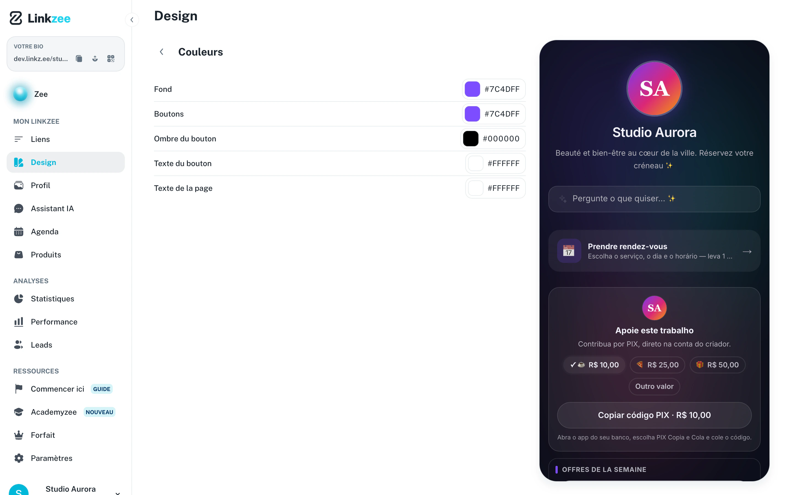

Un thème vous donne un rendu complet en un seul geste. Quand vous voulez aller
plus loin, Linkzee vous propose des réglages **soignés** pour peaufiner les
détails. Vous choisissez parmi des options conçues pour fonctionner ensemble, si
bien que rien ne jure jamais.

<Frame caption="Le panneau Couleurs : spectre complet, hex et suggestions — avec aperçu instantané.">
  
</Frame>

Chaque changement apparaît instantanément dans l'aperçu en direct — à droite sur
ordinateur, ou sous l'éditeur sur mobile — et s'enregistre automatiquement au fil
de vos modifications.

## Ce que vous pouvez ajuster

<AccordionGroup>
  <Accordion title="En-tête" icon="user">
    Choisissez la façon dont votre nom, votre photo et votre logo se placent en
    haut de votre page :
    - **Classique** : un avatar rond et compact avec votre nom et votre bio.
    - **Hero** : une photo **ou une courte vidéo** qui déborde en haut de la
      page (voir [Profil](/fr/your-page/header#vid%C3%A9o-dans-le-hero)).
    - **Bannière** : une image de couverture avec votre avatar posé par-dessus.
    - **Découpe** : vous, sans arrière-plan, au-dessus de votre page. Importez
      un **PNG ou WebP transparent** ; une image sans transparence n'est pas
      acceptée pour cette mise en page.
    - **Forme** : votre portrait dans un contour organique. Choisissez
      **Organique**, **Organique 2**, **Arche** ou **Carré adouci**, et une
      couleur pour la forme (ou laissez la couleur du thème).

    **Ajuster le cadrage** vous permet de faire glisser et de zoomer la photo
    dans la mise en page. Avec une vidéo dans le hero, vous pouvez aussi placer
    votre logo par-dessus, opaque ou verre (Premium), avec une bordure dans la
    couleur de votre avatar.
  </Accordion>
  <Accordion title="Avatar" icon="circle-user">
    Choisissez comment votre photo apparaît en haut de la page : **Aucun**,
    **Anneau**, **Anneau coloré**, **Ombre** ou **Lueur**, avec la **Couleur de
    l'avatar** de votre choix. Tant que vous n'en choisissez pas, l'effet du
    thème est utilisé. La mise en page Hero affiche la photo en pleine largeur,
    elle n'a donc pas d'effet d'avatar.
  </Accordion>
  <Accordion title="Fond d'écran" icon="image">
    Définissez le style de votre fond. Chaque style montre un vrai aperçu, et
    ses options apparaissent juste en dessous. La couleur principale vient de
    **Couleurs** ; les styles qui mélangent deux couleurs ajoutent un champ
    **Deuxième couleur**.

    | Style | Options |
    | --- | --- |
    | **Couleur unie** | Juste la couleur. |
    | **Dégradé** | **Personnalisé** (deux couleurs, direction **Vers le haut**, **Vers le bas** ou **Radial**) ou **Prédéfini** (15 dégradés prêts, comme Coucher de soleil, Océan et Minuit, avec des couleurs de texte bien lisibles). **Animer** le fait bouger doucement ; **Texture granuleuse** ajoute un grain subtil. |
    | **Flou** | Des taches de couleur douces, avec **Intensité** et **Position** (haut, centre ou diffus). |
    | **Motif** | 10 motifs (points, grille, vagues, nid d'abeille et plus) teintés de votre couleur, avec **Taille** et **Intensité**. |
    | **Maille** | Des zones de couleur fondues, en trois dispositions : **Classique**, **Coins** ou **Centre**. |
    | **Image** | Votre propre photo, avec **Assombrir la photo** (léger, moyen, fort) pour garder le texte lisible, et un **Flou** facultatif. Vous pouvez la recadrer. |
    | **Bichromie** | Votre photo en deux couleurs : votre couleur principale et une **Deuxième couleur**. |
    | **Vidéo** | Un court clip en boucle. |

    **Vidéo** accepte un fichier MP4 ou MOV jusqu'à 40 Mo et l'optimise de la
    même façon que la vidéo du hero (720p, les 30 premières secondes, muette et
    en boucle) pour un chargement rapide. Vous pouvez la **Remplacer** ou la
    **Supprimer** à tout moment. Les visiteurs qui préfèrent limiter les
    animations ou ont activé l'économiseur de données voient son image de
    couverture à la place.
  </Accordion>
  <Accordion title="Disposition de la vitrine de produits" icon="grip">
    Choisissez la façon dont votre vitrine de produits s'affiche :
    **Standard**, une grille épurée ; **Masonry**, une mosaïque de cartes de
    hauteurs variées ; ou **Carrousel**, où chaque catégorie devient une
    étagère horizontale à faire défiler du doigt sur mobile (avec des flèches
    sur ordinateur), avec un bouton **« Tout voir (n) »** qui déploie la
    catégorie complète sur place. Vous pouvez aussi régler le style de la carte
    et l'affichage des photos (voir
    [Vitrine de produits](/fr/products/overview#param%C3%A8tres-de-la-vitrine)).
  </Accordion>
  <Accordion title="Boutons" icon="square">
    Définissez le **style** du bouton (rempli, contour, doux ou **verre**), la
    **forme** du bouton (arrondi, légèrement arrondi ou droit) et l'**ombre**
    du bouton (aucune, douce, forte ou dure). Le réglage de l'ombre est
    entièrement libre.
  </Accordion>
  <Accordion title="Texte" icon="font">
    Choisissez votre **police** dans une liste soignée, regroupée en sans
    serif, serif et mono et display. Ou ouvrez **Paires** pour des
    combinaisons prêtes : une police pour votre nom et les titres, une autre
    pour les textes, dans des ambiances comme Éditorial, Moderne, Boutique ou
    Ludique.
  </Accordion>
  <Accordion title="Couleurs" icon="palette">
    Définissez la couleur du fond, des boutons, de l'ombre du bouton, du texte
    du bouton et du texte de la page. Chaque ligne ouvre un **sélecteur de
    couleur complet** (spectre, code hexadécimal, pipette et échantillons
    suggérés) afin que vous puissiez retrouver la couleur exacte de votre
    marque, et pas seulement des préréglages.

    Si une combinaison est difficile à lire, un avertissement **Contraste trop
    faible pour la lecture** apparaît avec une suggestion, pour que votre page
    reste lisible.
  </Accordion>
  <Accordion title="Icônes sociales" icon="share-nodes">
    Choisissez l'apparence de vos icônes sociales : **Par défaut** (suit le
    thème), **Icônes**, **Plein**, **Contour** ou **Boutons**. Plein et Contour
    utilisent la couleur de vos boutons ; Boutons affiche le nom de chaque
    réseau.
  </Accordion>
  <Accordion title="Cartes" icon="clone">
    Définissez l'apparence des cartes de votre page : **Uni**, **Verre**,
    **Néon** ou **Doux**, avec des **Coins** discrets, moyens ou arrondis.
  </Accordion>
  <Accordion title="Mouvement" icon="wand-magic-sparkles">
    Réglez l'**intensité des animations** de votre page publique :
    **Désactivé**, **Subtil** ou **Par défaut**. Les visiteurs qui préfèrent
    moins de mouvement voient toujours la version statique. Vous y trouvez
    aussi le **Mode Scène** (Premium), qui fait réagir votre page à la musique
    de votre carte Spotify (voir [Spotify](/fr/your-page/spotify)).
  </Accordion>
</AccordionGroup>

<Note>
  Les échantillons suggérés et les polices intégrées sont gratuits. Les
  options premium portent un badge et peuvent être essayées avec n'importe
  quel forfait : une **couleur personnalisée** (en dehors des échantillons
  suggérés), le style de bouton **verre**, les fonds **Image**, **Maille**,
  **Bichromie** et **Vidéo**, les dégradés **radial** et **prédéfinis**,
  **Animer**, une **vidéo** dans le hero, le logo en verre sur la vidéo, ainsi
  que les polices et paires premium. Vous les voyez dans l'aperçu en direct,
  mais si **cette boutique** est en Free, sa page publique conserve son dernier
  rendu gratuit jusqu'à ce que vous passiez cette boutique à une offre
  supérieure (voir [Un forfait par boutique](/fr/billing/plan-per-store)).
</Note>

### Enregistrer ou annuler les changements premium

Avec l'offre Free, dès que vous appliquez une option premium, l'enregistrement
automatique se met en pause et deux boutons, **Enregistrer** et **Annuler**,
apparaissent en haut de l'écran Design.

- **Annuler** rétablit le rendu actuellement publié.
- **Enregistrer** ouvre les options d'abonnement. Une fois la boutique sur une
  offre payante, tout ce que vous avez réglé est publié.

Les options gratuites continuent de s'enregistrer automatiquement, comme
d'habitude.

<Warning>
  Sélectionner à nouveau un thème prêt à l'emploi réinitialise ces choix pour
  revenir au rendu de ce thème.
</Warning>

## Étapes suivantes

<CardGroup cols={2}>
  <Card title="Thèmes" icon="swatchbook" href="/fr/design/themes">
    Partez d'un rendu complet et prêt à l'emploi, puis peaufinez-le ici.
  </Card>
  <Card title="Aperçu du design" icon="palette" href="/fr/design/overview">
    Découvrez comment les thèmes et la personnalisation fonctionnent ensemble.
  </Card>
</CardGroup>
