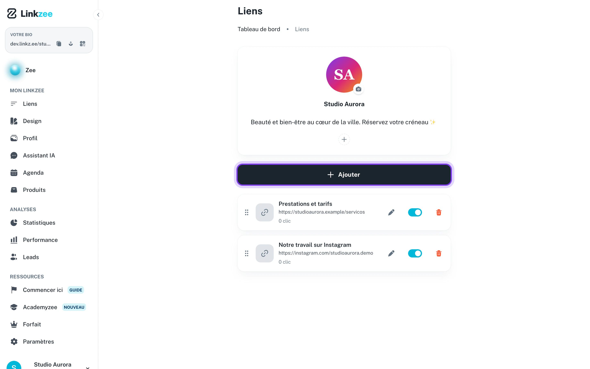
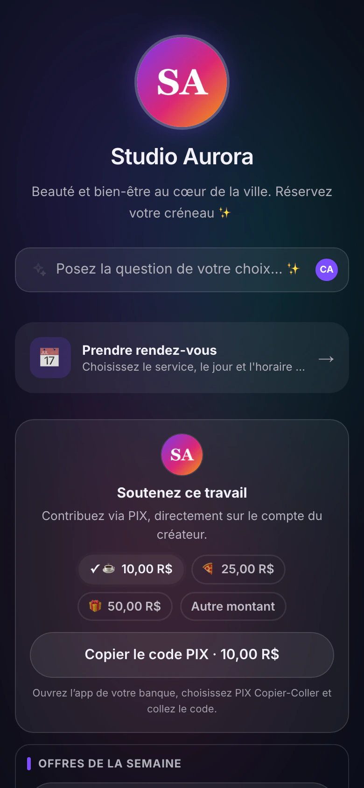

Ce guide vous accompagne de l'inscription jusqu'à une page en ligne sur `linkz.ee/your-name`,
prête à être ajoutée dans votre bio. Cela ne prend que quelques minutes.

<Frame caption="L'éditeur Mon Linkzee : ajoutez des liens et suivez l'aperçu en direct.">
  
</Frame>

<Steps>
  <Step title="Créez votre compte">
    Inscrivez-vous avec votre **e-mail et mot de passe**, ou choisissez **Continuer avec Google**
    pour démarrer en un clic, sans mot de passe à retenir. Consultez
    [Créez votre compte](/fr/get-started/create-account) pour les détails.
  </Step>
  <Step title="Confirmez votre e-mail">
    Si vous vous êtes inscrit avec un e-mail et un mot de passe, ouvrez l'e-mail d'activation
    de Linkzee et cliquez sur le lien pour activer votre compte. Si vous avez utilisé
    **Continuer avec Google**, votre compte est déjà actif — passez à l'étape suivante.
  </Step>
  <Step title="Parlez-nous de votre travail">
    L'onboarding guidé commence par votre domaine d'activité et par la façon
    dont votre bio peut vous aider. Choisissez ensuite comment vos clients vous
    contactent. L'ordre suggéré des canaux suit l'usage de votre pays (par
    exemple, WhatsApp d'abord au Brésil, téléphone d'abord au Japon, SMS d'abord
    aux États-Unis et au Canada), et vous pouvez changer de pays. Utilisez
    **Modifier le texte** pour changer le libellé du bouton principal. Les liens
    que vous ajoutez reçoivent un nom selon leur type, et vous pouvez renommer
    chaque bouton. Le numéro WhatsApp ou de téléphone indiqué ici est aussi
    enregistré dans votre compte.
  </Step>
  <Step title="Ajoutez vos photos">
    Ajoutez une **Photo de profil**, une **Couverture** et jusqu'à 3 photos de
    **Votre travail**. Utilisez **Recadrer** pour ajuster le cadrage de la photo
    de profil et de la couverture quand vous le souhaitez.
  </Step>
  <Step title="Vérifiez et publiez">
    À l'étape 4, choisissez l'adresse de votre page dans **Votre adresse**.
    Linkzee vérifie la disponibilité pendant que vous tapez et suggère des
    options si celle que vous voulez est déjà prise. Consultez
    [Votre nom d'utilisateur](/fr/get-started/your-username) pour les règles. Un
    thème prêt est choisi selon les couleurs de votre logo et porte le badge
    **Votre marque** ; vous pouvez choisir n'importe quel autre thème. Pour les
    photos de votre travail, modifiez le titre de la section et, si vous le
    souhaitez, ajoutez une légende à chaque photo. Ouvrez **Voir en plein
    écran** pour voir votre bio comme vos visiteurs, puis touchez **Modifier**
    ou **Publier ma bio**.
  </Step>
  <Step title="Partagez votre page et découvrez votre tableau de bord">
    À l'étape 5, votre bio est en ligne sur `linkz.ee/your-name`. Copiez le lien
    et placez-le dans votre bio Instagram ou TikTok. Ouvrez ensuite
    **Découvrez votre tableau de bord** : c'est là que vous modifiez tout quand
    vous voulez et suivez qui arrive par votre bio. Cliquez sur **+ Ajouter**
    pour ajouter d'autres éléments, comme un **Lien**, un **Produit** ou un
    **Réseau social**.
  </Step>
</Steps>

<Note>
  Il n'y a pas de bouton « Enregistrer » — tout ce que vous modifiez est enregistré automatiquement,
  et l'aperçu en direct se met à jour en temps réel (à droite sur ordinateur ; sur mobile, touchez **Aperçu** pour
  l'ouvrir en plein écran).
</Note>

## Et ensuite

<CardGroup cols={2}>
  <Card title="Votre page" icon="table-cells" href="/fr/your-page/overview">
    Construisez votre page : ajoutez des liens, des réseaux sociaux, ainsi que votre nom, votre photo et votre bio.
  </Card>
  <Card title="Design et thèmes" icon="palette" href="/fr/design/overview">
    Choisissez un thème prêt à l'emploi et ajustez les couleurs, les boutons et le fond.
  </Card>
</CardGroup>

<Frame caption="Votre page publique en ligne : bio, agenda, vitrine et assistant en un seul lien.">
  
</Frame>
