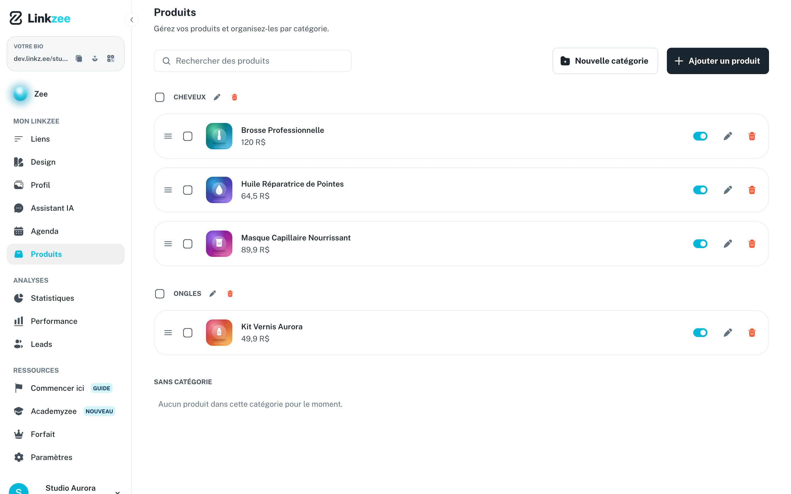

La **vitrine de produits** est l'atout de Linkzee pour les affiliés : elle
transforme vos liens de marketplaces en une véritable boutique. Au lieu d'une
simple liste de liens, vos abonnés voient des produits qu'ils peuvent parcourir
et acheter en un seul geste, tout en vous laissant votre commission
d'affiliation.

Elle fonctionne avec **Shopee**, **Amazon**, **Mercado Livre** et d'autres
marketplaces.

<Frame caption="Votre vitrine de produits dans le tableau de bord.">
  
</Frame>

## Comment elle s'affiche sur votre page

Vos produits apparaissent **regroupés ensemble** pour former votre vitrine, si
bien que votre page reste nette et facile à parcourir. La disposition, c'est
vous qui la choisissez : dans **Design**, optez pour la **grille standard**, la
**mosaïque (masonry)** ou le **carrousel**, qui transforme chaque catégorie en
étagère horizontale avec un bouton « Tout voir ». Chaque carte produit
affiche :

| Élément | Ce qu'il affiche |
| --- | --- |
| **Image** | La photo du produit |
| **Nom** | Le titre du produit |
| **Prix** | Le prix en R$, si vous en indiquez un |
| **Badge promo** | Un court libellé comme « PROMO », lorsqu'il est activé |
| **Compte à rebours de rareté** | Un minuteur qui continue de décompter |
| **Bouton d'action** | Un bouton **sous** la carte qui redirige les visiteurs vers l'offre |

Quand un visiteur appuie sur le bouton d'action, le clic est comptabilisé et il
est redirigé vers la marketplace, en conservant votre **lien d'affiliation**
intact.

<Note>
  Tout ce que vous modifiez est enregistré automatiquement et met à jour votre
  page en direct en temps réel. Sur ordinateur, l'aperçu se trouve à droite ;
  sur mobile, touchez **Aperçu** en haut pour voir votre page en plein écran.
</Note>

## Explorez la vitrine

<CardGroup cols={2}>
  <Card title="Ajouter des produits" icon="plus" href="/fr/products/adding-products">
    Collez un lien de marketplace et laissez Linkzee remplir automatiquement le nom, l'image et le prix.
  </Card>
  <Card title="Prix et promotions" icon="tag" href="/fr/products/pricing-promotions">
    Définissez un prix, ajoutez un badge promo et mettez en avant votre meilleure offre.
  </Card>
  <Card title="Compte à rebours de rareté" icon="hourglass-half" href="/fr/products/scarcity-counter">
    Ajoutez de l'urgence avec un compte à rebours qui semble toujours d'actualité pour chaque visiteur.
  </Card>
  <Card title="Catégories" icon="layer-group" href="/fr/products/categories">
    Organisez une grande vitrine pour que les visiteurs puissent parcourir par catégorie.
  </Card>
</CardGroup>

## Paramètres de la vitrine

Ouvrez les **Paramètres de la vitrine** depuis l'engrenage de la carte de la
vitrine dans **Contenu**, ou allez dans **Design → Vitrine**. Chaque choix
s'applique tout de suite :

| Réglage | Options |
| --- | --- |
| **Colonnes de la grille** | **2 colonnes** ou **1 colonne**. |
| **Style de la grille** | **Standard**, **Masonry** ou **Carrousel**. |
| **Style de la carte** | **Classique** ou **Spotlight** (voir ci-dessous). |
| **Photos** | **Intelligent** (recommandé) décide photo par photo : une photo carrée remplit la carte, une panoramique devient une carte sur deux colonnes et les autres s'affichent en entier sur un fond doux. **Toujours entière** ne rogne jamais la photo et comble l'espace restant avec une version floutée de celle-ci. **Remplir** recadre depuis le centre pour que chaque carte soit pleine, idéal pour des photos de studio uniformisées. |

Vous pouvez aussi masquer toute la vitrine de votre page avec son
interrupteur, sans supprimer aucun produit.

## Ordre de la vitrine

En haut de l'écran **Produits**, l'**Ordre de la vitrine** définit comment les
produits s'affichent sur votre page :

| Option | Fonctionnement |
| --- | --- |
| **Plus récents** | Par défaut. Les nouveaux produits apparaissent en premier. |
| **Personnalisé** | La vitrine suit votre ordre, et les nouveaux produits arrivent en haut. La première fois que vous le choisissez, l'ordre part de la liste actuelle. |

Revenir à **Plus récents** conserve votre ordre personnalisé : choisissez
**Personnalisé** à nouveau et il revient. Le changement s'applique tout de
suite, sans confirmation.

Dans l'écran **Vitrine** du menu, faites glisser les cartes pour changer
l'ordre. Le nouvel ordre s'enregistre tout seul et active **Personnalisé**.

Vous pouvez aussi déplacer un produit en le demandant à
[Zee](/fr/zee/using-zee), par exemple « mets la carte cadeau en haut », ou
utilisez l'[API](/fr/api-reference/products). Déplacer un produit quand la
vitrine est sur **Plus récents** active **Personnalisé** avec un nouvel ordre,
fait à partir de la liste que vous voyez, à la place de celui qui était
enregistré.

## Style de carte Spotlight

Dans **Design → Vitrine → Style de la carte**, vous passez les cartes produit de
**Classique** (photo en haut ; nom, prix et bouton en dessous) à **Spotlight** :
la photo remplit le cadre de la carte, et le nom, le prix et un bouton en verre
se placent juste en dessous, sur une douce lueur faite des couleurs de la photo
elle-même. Le texte ne couvre jamais le produit. Les badges, comme une remise,
s'affichent en petites pastilles de verre au pied de la photo. Votre page reste
en classique tant que vous ne choisissez pas.

Avec Spotlight, la vitrine gagne aussi :

- **À la une** : une carte pleine largeur, à la place du carrousel, avec le
  produit que vous avez marqué comme mis en avant. Sans produit mis en avant,
  le plus cliqué prend la place, étiqueté « le plus cliqué de la semaine ».
- **Rythme éditorial** : dans la grille, la troisième carte sur cinq passe sur
  deux colonnes, comme un lookbook.
- **Catégories en photo** : les puces de catégorie deviennent des cercles avec
  la photo du produit le plus récent de chacune. Une fois dépassées, les puces
  se fixent sous la recherche.
- **Des boutons qui ne passent jamais à la ligne** : les textes longs
  deviennent, sur les cartes à demi-largeur, un verbe court avec l’icône de
  l’action (« Commander » + WhatsApp, « Voir » + ↗) ; le texte complet s’affiche
  sur la carte à la une et les cartes larges. Conseil : une copie à la première
  personne vend mieux : « Je le veux », « Je veux ce look », « Réserver le
  mien » (le formulaire produit les suggère).
- **Fiche d’adresse** : dans le bloc carte, l’option **Affichage** remplace la
  carte ouverte par une fiche compacte avec logo, adresse, horaires du jour et
  « Itinéraire ».
